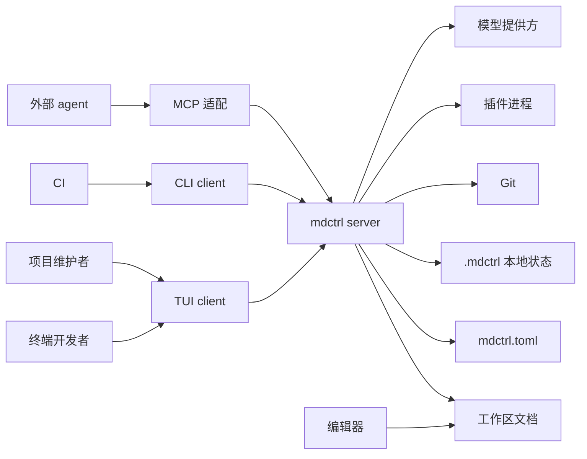
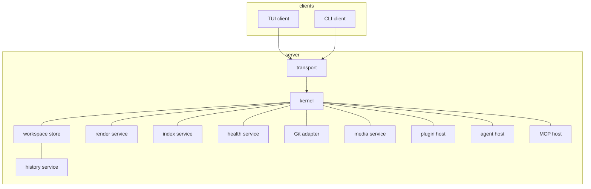
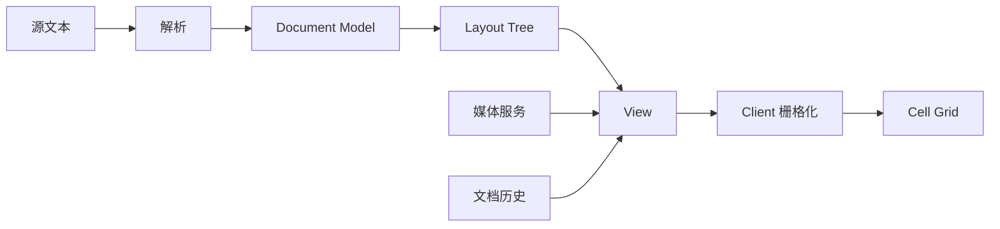
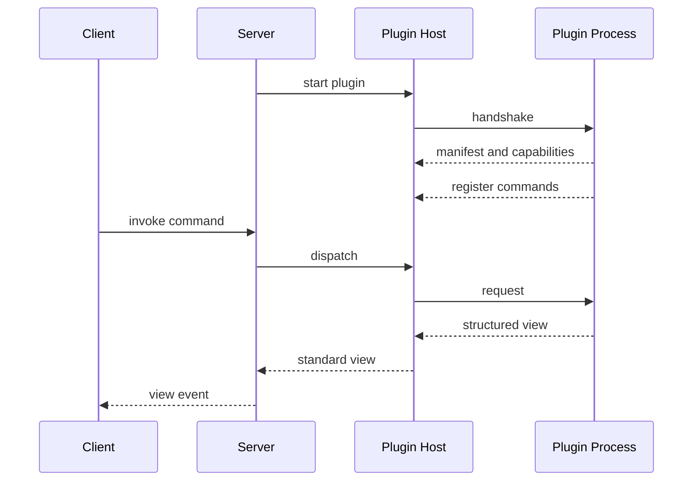
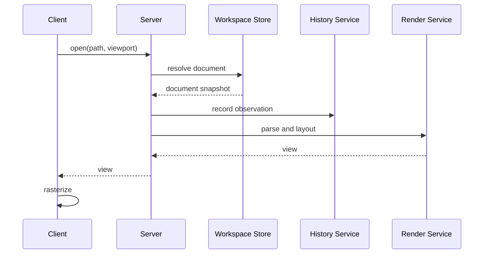
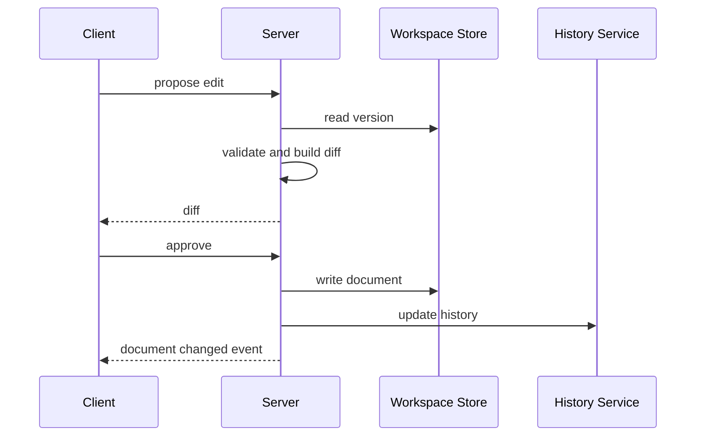

# mdctrl 架构

> 文档状态：已确认 · 最后复核：2026-11-09

> mdctrl 的架构从一个判断开始：文档状态需要一个唯一所有者，交互方式可以有很多种。

**相关文档**：[产品愿景](vision.md) · [技术选型](techStack.md) · [开发模式](devMode.md) · [开发计划](devPlan.md)

**目录**

- [1 目的与范围](#1-目的与范围)
- [2 架构总览](#2-架构总览)
- [3 核心概念](#3-核心概念)
- [4 系统上下文](#4-系统上下文)
- [5 服务器组成](#5-服务器组成)
  - [5.1 kernel](#51-kernel)
  - [5.2 services](#52-services)
  - [5.3 hosts](#53-hosts)
  - [5.4 server](#54-server)
- [6 工作区与文档历史](#6-工作区与文档历史)
  - [6.1 `mdctrl.toml`](#61-mdctrltoml)
  - [6.2 `.mdctrl`](#62-mdctrl)
  - [6.3 文档历史](#63-文档历史)
  - [6.4 初始化与工作区生命周期](#64-初始化与工作区生命周期)
- [7 状态所有权](#7-状态所有权)
  - [7.1 写入路径](#71-写入路径)
  - [7.2 主题与配置](#72-主题与配置)
- [8 协议边界](#8-协议边界)
  - [8.1 请求与订阅](#81-请求与订阅)
  - [8.2 视图](#82-视图)
  - [8.3 传输](#83-传输)
- [9 渲染架构](#9-渲染架构)
  - [9.1 渲染管线](#91-渲染管线)
  - [9.2 主题、媒体与缓存](#92-主题媒体与缓存)
- [10 插件架构](#10-插件架构)
- [11 Agent 与 MCP](#11-agent-与-mcp)
- [12 模块与 crate](#12-模块与-crate)
- [13 关键流程](#13-关键流程)
  - [13.1 打开并阅读文档](#131-打开并阅读文档)
  - [13.2 编辑、审批与写入](#132-编辑审批与写入)
  - [13.3 搜索、体检与 agent](#133-搜索体检与-agent)
- [14 部署形态](#14-部署形态)
- [15 基本约束与安全](#15-基本约束与安全)
- [16 架构决策](#16-架构决策)

## 1 目的与范围

本文描述 mdctrl 的运行时结构、状态边界、协议语义、模块职责与关键流程。它面向维护者与贡献者，作为实现与评审的架构基线。

产品方向由 `vision.md` 承接；技术栈、协议编码、存储格式与具体依赖由 `techStack.md` 与各 crate 技术文档承接；开发分工、阶段排期与任务拆分由 `devPlan.md` 承接。

架构语言使用 **kernel** 指代最小核心；实现上，kernel 落在 `mdctrl-core`。

## 2 架构总览

mdctrl 采用**模块化单体 + 协议化 C/S**的结构。server 拥有文档状态，client 通过协议读取视图、发送命令；kernel、services 与 hosts 在 server 内部协作。

默认形态是 **embedded**：server 与 client 运行在同一进程内，通过协议通道通信。可选形态是 **daemon**：server 独立运行，多个 client 通过本地 IPC 连接。两种形态共享同一套协议语义，差异集中在传输层。

插件以独立进程接入，agent 通过内置宿主或 MCP 接入。整体结构保持“一个状态所有者，多种交互入口”。

| 形态 | 进程结构 | 适用场景 |
| --- | --- | --- |
| embedded | server + client 同进程 | 日常终端使用，启动快，状态集中 |
| daemon | server 独立，client 连接 | 多客户端、后台索引、未来 GUI/Web |
| plugin | 插件独立进程 | 扩展能力、故障隔离 |
| remote | server 与 client 跨机器 | 远期远程访问与协作 |

## 3 核心概念

**kernel** 是最小核心，实现落在 `mdctrl-core`。kernel 在 server 内提供领域模型与总线，具体职责见 5.1。

**server** 是运行时容器与状态所有者，组合 kernel、services、hosts 与传输层。

**client** 是交互端，当前包括 TUI 与 CLI。client 持有视图状态，通过协议发送命令、查询与订阅事件。

**service** 是内置能力提供者，向 kernel 注册命令、查询与事件，由 server 统一调度。

**host** 是外部进程或协议的宿主，把外部能力转换成统一的命令、事件与视图语义。

**workspace store** 是工作区状态的存储边界，细节见第 6 节。

**document history** 是文档历史，细节见 6.3。

**command / query / event / view** 是协议中的四类信息，细节见第 8 节。

## 4 系统上下文

mdctrl 位于开发者、维护者、agent 与仓库工具之间。终端开发者与维护者通过 TUI 或 CLI 使用 mdctrl；外部 agent 通过 MCP 接入；Git、编辑器与 CI 作为外部系统参与文档生命周期。



server 是文档状态的汇聚点；client 是交互入口；Git、编辑器与 CI 保留各自的职责。`mdctrl.toml` 保存团队共享配置，`.mdctrl` 保存本地状态。

## 5 服务器组成

server 由 kernel、services、hosts 与传输层组成。kernel 提供领域模型与总线；services 提供内置能力；hosts 管理外部进程与协议；传输层连接 client。

### 5.1 kernel

kernel 负责：

- 工作区模型与根目录语义；
- 文档身份、元数据、链接与生命周期；
- 文档历史模型；
- 配置模型；
- 命令总线、事件总线与服务注册。

kernel 以文档与命令为中心，终端与网络细节位于 server 外层。

### 5.2 services

services 是内置能力提供者：

| service | 职责 |
| --- | --- |
| render | 解析 Markdown，生成文档模型与布局 |
| index | 全文索引、链接图与查询 |
| health | 断链、过期、孤立、缺失元数据等规则 |
| git | 读取文档相关的 Git 元数据 |
| media | 数学公式、Mermaid 与图片资源 |

service 向 kernel 注册命令、查询与事件；server 负责组合与调度。

### 5.3 hosts

hosts 管理外部能力：

- plugin host：启动插件进程、握手、注册命令、管理权限与生命周期；
- agent host：管理内置 agent、provider 与工作流；
- MCP host：把文档查询能力暴露给外部 agent。

host 把外部协议转换成统一的命令、事件与视图语义。

### 5.4 server

server 是组合根：

- 加载 `mdctrl.toml` 与 `.mdctrl`；
- 初始化 kernel、services 与 hosts；
- 管理传输、会话与生命周期；
- 把 client 命令分发到对应 service 或 host；
- 把状态变化转换成事件与视图。



## 6 工作区与文档历史

工作区是 mdctrl 的状态落点。每个工作区由 `mdctrl.toml` 与 `.mdctrl` 共同描述。

### 6.1 `mdctrl.toml`

`mdctrl.toml` 位于仓库根目录，保存团队共享配置：

- 工作区级设置；
- 插件声明与锁；
- 文档历史与索引策略；
- 团队约定的共享选项。

`mdctrl.toml` 提交到 Git，团队成员共享同一份配置。

### 6.2 `.mdctrl`

`.mdctrl` 位于仓库根目录，保存本地状态，整个目录加入 `.gitignore`：

```text
.mdctrl/
  history      文档历史
  cache        索引与派生缓存
  sessions     本地会话
  config       本机配置
  lock         工作区锁
```

`.mdctrl` 同时作为工作区根标记。`mdctrl` 从当前目录向上查找最近的 `.mdctrl`，确定工作区根目录。文档扫描跳过 `.mdctrl`。

### 6.3 文档历史

文档历史（history）保存文档的本地观察记录：

- 文档路径与内容指纹；
- 首次发现、最近观察、最近变更；
- 变更来源与观察时间；
- 与文档相关的 Git 元数据。

文档历史保存元数据，正文以工作区文件为准。`cache` 保存索引与派生数据，可以随时重建；`history` 持久保存本地观察记录。

Git 作为可选信息源：

| 信息 | Git 可用 | Git 缺失 |
| --- | --- | --- |
| 路径与内容指纹 | 工作区文件 | 工作区文件 |
| 首次发现、最近观察、最近变更 | 文档历史 | 文档历史 |
| 提交、作者、提交时间 | Git | 文档历史记录观察时间 |
| 工作区状态、差异 | Git | 文档历史记录变更前后指纹 |
| 生命周期元数据 | frontmatter + 文档历史 | frontmatter + 文档历史 |

Git 可用时，文档历史在启动、文件变化与分支切换后刷新 Git 元数据；Git 缺失时，文档历史独立记录文件变化。Git 适配器把版本信息补充到文档历史，正文与索引继续以工作区文件为基础。

### 6.4 初始化与工作区生命周期

`mdctrl init` 显式创建工作区：

1. 确定工作区根目录；
2. 创建 `.mdctrl` 与 `history`、`cache`、`sessions`、`config`；
3. 确保仓库忽略 `.mdctrl/`；
4. 创建 `mdctrl.toml`，保留团队共享配置；
5. 写入本地 schema 版本。

`mdctrl init` 重复执行时保持幂等。每个工作区一个 server 实例，通过 `.mdctrl/lock` 避免并发写入；embedded 与 daemon 共享同一把锁。

## 7 状态所有权

server 与 client 的状态边界保持清晰：

| 状态 | 所有者 |
| --- | --- |
| 工作区、文档、文档历史 | server |
| 索引、健康结果、缓存 | server |
| 工作区会话 | server |
| 视图状态：焦点、滚动、选择、输入组合 | client |
| 终端 Cell 与终端能力 | client |
| 共享配置 `mdctrl.toml` | server 读取 |
| 键位、主题选择、视图布局 | client |

server 持有每个 client 的工作区会话；client 持有本端视图会话。文档内容、版本号与写入结果由 server 统一管理。

### 7.1 写入路径

写入遵循统一路径：

1. client 或 agent 发送编辑提案；
2. server 读取当前版本，校验路径与权限；
3. server 生成差异；
4. 人确认接受、拒绝或局部采纳；
5. server 写入文档，更新文档历史；
6. server 广播文档变化事件；
7. 所有 client 更新视图。

### 7.2 主题与配置

server 在视图中提供语义 token，client 把 token 映射到终端颜色与样式。主题选择、键位与视图布局由 client 管理；工作区设置、插件声明、文档历史策略由 server 管理。

## 8 协议边界

client 与 server 通过统一协议通信。协议定义四类信息：

| 类型 | 方向 | 用途 |
| --- | --- | --- |
| command | client → server | 执行操作、修改文档、调用插件 |
| query | client → server | 读取文档、搜索、健康状态 |
| event | server → client | 通知文档、索引、健康、插件与 agent 状态变化 |
| view | server → client | 返回可渲染的文档视图 |

### 8.1 请求与订阅

请求带唯一标识，响应与请求关联；client 可以订阅事件主题，server 在状态变化时推送事件。协议握手包含版本与能力协商，client 与 server 据此选择可用能力。

### 8.2 视图

视图是视口范围内的语义快照，包含：

- 文档结构与块级元素；
- 布局树；
- 语义样式 token；
- 媒体资源引用；
- 诊断与生命周期提示。

client 请求视图时携带视口尺寸与终端能力；server 返回当前视口的视图。文档变化时，server 发送失效事件，client 请求新视图。视图增量补丁作为后续优化，初始协议以语义快照与失效事件为主。

### 8.3 传输

传输层保持抽象：

- embedded 模式使用进程内通道；
- daemon 模式使用本地 IPC；
- remote 模式使用远程连接；
- 插件使用独立的结构化消息通道。

四种传输共享同一套消息语义。协议编码与传输实现由技术文档承接。

## 9 渲染架构

渲染遵循“server 产出布局，client 负责终端”的边界：

```text
源文本 → Parser → Document Model → Layout → View → Client 栅格化
```

### 9.1 渲染管线

- `mdctrl-core` 定义 Document、Metadata、Link、Lifecycle 等稳定领域类型；
- `mdctrl-render` 负责解析 Markdown、生成文档模型与布局树；
- server 把布局树与语义 token 组合成 View；
- client 把 View 栅格化为终端 Cell；
- 文档模型保留源位置，服务编辑、诊断与跳转。



### 9.2 主题、媒体与缓存

主题以语义 token 表达：前景、背景、强调、边框、代码配色与状态色。client 把 token 映射到终端颜色与样式，终端背景变化时切换主题。

数学公式与 Mermaid 由媒体服务后台生成资源。视图先显示占位，资源就绪后通过事件替换；终端能力不足时显示文本近似或源码。

布局缓存按文档版本、视口与主题失效。client 缓存当前视口与相邻视口，滚动时提前请求下一段视图。

## 10 插件架构

插件分为两级：

- 内置 service 通过统一注册与命令接口接入，位于 server 进程内；
- 外部插件以独立进程运行，通过结构化消息协议接入。

外部插件由 plugin host 管理：

- manifest 描述身份、版本、入口、能力与权限；
- 握手后注册命令、查询、视图与导出器；
- host 管理安装、列表、移除、诊断与故障隔离；
- 插件异常影响单个进程，server 继续工作；
- 插件返回结构化视图，由 host 转换成标准 View/Layout，client 统一栅格化。



插件权限采用能力声明与宿主强制：

| 能力 | 含义 |
| --- | --- |
| workspace.read | 读取工作区文档 |
| workspace.propose | 提交写入提案 |
| command.invoke | 调用命令总线 |
| network.access | 访问网络 |

写入提案统一进入审批路径；插件能力在 manifest 中声明，host 在调用时校验。热路径留在 server 内，扩展能力走进程边界；官方能力与插件共享同一套扩展语义。

## 11 Agent 与 MCP

agent host 位于 server 内，内置 agent 通过命令总线工作，读取文档、历史、索引与健康状态，写入统一进入审批路径。

agent 围绕三套工作流：

- 写文档：从代码、上下文与已有文档形成初稿，经人审阅后落盘；
- 分析文档：理解结构、内容与健康状态，给出摘要与改进建议；
- 审阅文档：发现不一致、过期、链接与表达问题，形成修改建议。

每次写入保留来源、模型与时间等溯源信息。agent 可以读取当前文档、反链、文档历史与 Git 元数据，形成上下文。

MCP host 把文档查询能力暴露给外部 agent，先覆盖文档、搜索、健康与反链的只读访问。外部 agent 作为 client 接入，共享权限与审批规则；写入能力在权限与审批机制完善后开放。

provider 抽象把模型调用与工作流解耦；凭据保存在本地配置或系统凭据存储，`mdctrl.toml` 保存共享项目设置。

## 12 模块与 crate

逻辑模块按变化轴划分：

| 模块 | 职责 |
| --- | --- |
| workspace | 工作区根、`mdctrl.toml`、`.mdctrl`、锁与初始化 |
| document | 文档身份、元数据、链接与生命周期 |
| history | 文档历史、Git 元数据合并与刷新 |
| render | 解析、文档模型与布局 |
| index | 全文索引、链接图与查询 |
| health | 文档健康规则 |
| git | Git 元数据适配 |
| media | 数学公式、Mermaid 与图片资源 |
| plugin | manifest、进程协议、权限与生命周期 |
| agent | provider、工作流、审批与 MCP |
| clients | TUI 与 CLI |

初始 crate：

| crate | 职责 |
| --- | --- |
| `mdctrl-protocol` | 命令、查询、事件、视图与错误类型 |
| `mdctrl-core` | kernel：工作区模型、文档模型、文档历史模型、生命周期、配置、命令/事件总线、服务注册 |
| `mdctrl-render` | 解析、文档模型与布局 |
| `mdctrl-server` | 组合根、workspace store、history service、services、hosts 与传输 |
| `mdctrl-tui` | 终端客户端 |
| `mdctrl-cli` | CLI 客户端与二进制入口 |

依赖方向：

| crate | 依赖 |
| --- | --- |
| `mdctrl-protocol` | 无 |
| `mdctrl-core` | `mdctrl-protocol` |
| `mdctrl-render` | `mdctrl-core`、`mdctrl-protocol` |
| `mdctrl-server` | `mdctrl-core`、`mdctrl-render`、`mdctrl-protocol` |
| `mdctrl-tui` | `mdctrl-protocol` |
| `mdctrl-cli` | `mdctrl-protocol`、`mdctrl-server`、`mdctrl-tui` |

依赖方向保持单向，依赖图保持无环。index、health、git、media、plugin、agent、MCP 先作为 `mdctrl-server` 内部模块；边界稳定后再拆 crate。

## 13 关键流程

### 13.1 打开并阅读文档

client 发送打开命令与视口信息；server 解析文档、读取文档历史、生成视图；client 栅格化并显示。



### 13.2 编辑、审批与写入

client 或 agent 发送编辑提案；server 生成差异；人确认后写入，更新文档历史并广播事件。



### 13.3 搜索、体检与 agent

搜索由 client 发送 query，index service 返回结果；体检由 CLI 或 TUI 触发生成健康结果；agent 通过命令总线读取上下文、生成差异并进入审批路径。三条路径共享同一套状态与事件。

## 14 部署形态

| 形态 | server | client | 连接 |
| --- | --- | --- | --- |
| embedded | 进程内 | TUI 或 CLI | 进程内通道 |
| daemon | 独立进程 | 多个 TUI/CLI | 本地 IPC |
| plugin | 独立进程 | server 管理 | 结构化消息 |
| remote | 独立进程 | 远程 client | 远程连接 |

client 优先连接现有 server；当前工作区没有 server 时，client 启动 embedded server。每个工作区一个 server，通过 `.mdctrl/lock` 保证单写入者。

daemon 由 `mdctrl serve` 显式启动；多 client 各自持有视图会话，共享文档状态；写入带版本检查，事件广播到所有 client。空闲退出作为后续选项。

插件与 agent 以独立进程运行，由 host 管理生命周期。remote 形态复用同一套协议，传输实现由技术文档承接。

## 15 基本约束与安全

mdctrl 的“open”体现在少量基本约束与大量可选配置：

- Markdown 文件是事实来源；
- server 拥有工作区、文档、文档历史、索引与会话；
- client 通过协议操作状态；
- 写入经过审批；
- 工作区边界与路径安全；
- 协议版本与能力协商；
- 插件能力声明与宿主强制；
- MCP 先只读；
- `mdctrl.toml` 保存共享项目设置，凭据保存在本地配置或系统凭据存储；
- 主题、键位、编辑器、外部渲染器、插件与服务组合交给用户。

媒体资源先显示占位，就绪后替换；插件异常隔离在单个进程；Git 缺失时文档历史继续记录本地变化。三类行为共同保证核心阅读路径稳定。

## 16 架构决策

| 决策 | 结论 |
| --- | --- |
| C/S 形态 | 模块化单体，协议化 C/S；embedded 默认，daemon 可选 |
| 状态所有权 | server 拥有工作区、文档、历史、索引与会话；client 拥有视图状态 |
| 视图粒度 | 视口语义快照 + 失效事件；增量补丁作为后续优化 |
| 主题 | server 提供语义 token，client 映射到终端 |
| 插件视图 | host 把插件视图转换成标准 View/Layout，client 统一栅格化 |
| 多客户端 | 每工作区一个 server，每 client 一个会话；文档状态共享；写入带版本检查 |
| 文档模型 | core 定义领域类型；render 负责解析与布局；index/health 消费领域模型 |
| Git | Git 可选；文档历史是基础层；Git 可用时补充版本元数据 |
| 工作区 | `mdctrl.toml` 共享配置；`.mdctrl` 本地状态并自动忽略；`mdctrl init` 显式初始化 |
| 媒体 | 后台渲染 + 缓存 + 占位视图 |
| 插件权限 | 能力声明 + host 强制；写入进入审批路径 |
| daemon | 每工作区一个 server；`mdctrl serve` 显式启动；空闲退出后续评估 |
| 配置 | server 管理工作区、services、plugins、agent；client 管理键位、主题选择与视图布局 |
| crate | 初始 6 个 crate；services 先作为 server 内部模块 |

架构层决策到此收敛。协议编码、存储格式、具体传输实现、索引算法、插件 manifest 格式、provider 接口与 crate 拆分时机，由 `techStack.md` 与各 crate 技术文档承接。
