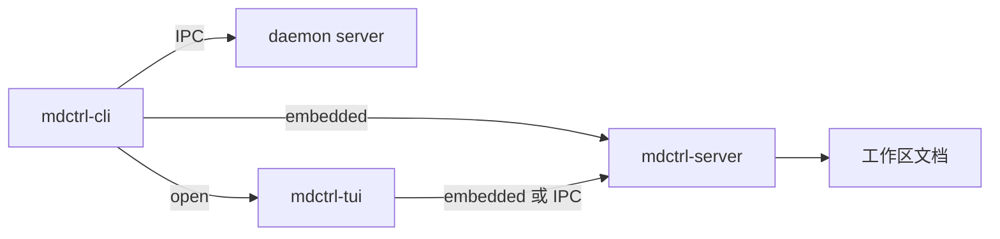
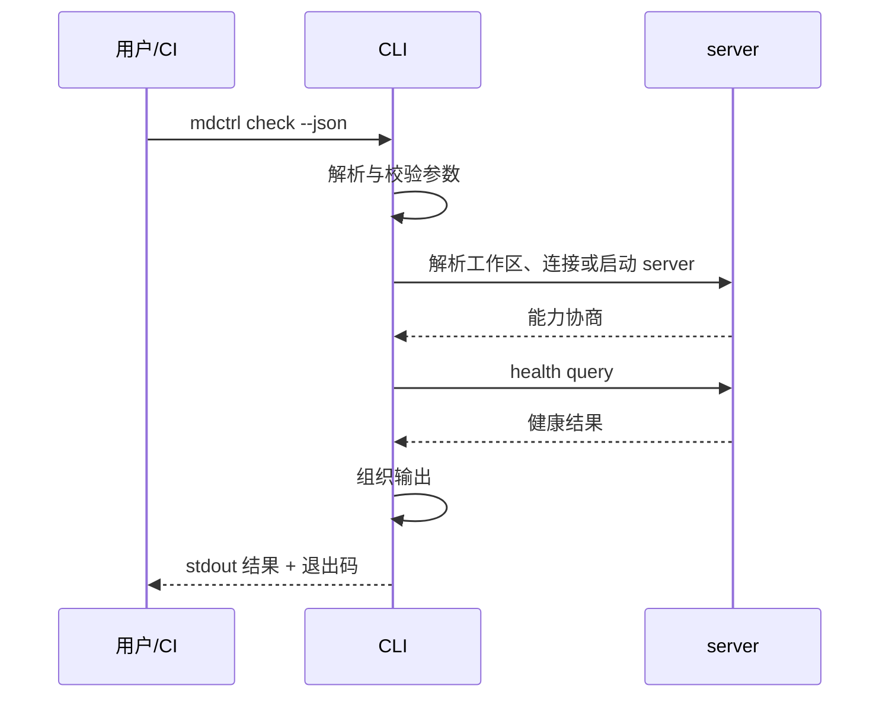

# mdctrl-cli 技术文档

> 文档状态：草案 · 最后复核：2026-11-14

> CLI 是薄客户端：解析命令、连接 server、组织输出、映射退出码，不实现文档业务规则。

**关联 Issue**：[#4 建立 clients crate 技术文档](https://github.com/Field-888/mdctrl/issues/4)

**相关文档**：[架构](../../architecture.md) · [技术选型](../../techStack.md) · [开发模式](../../devMode.md) · [开发计划](../../devPlan.md) · [mdctrl-tui](../mdctrl-tui/README.md)

**目录**

- [1 定位与职责](#1-定位与职责)
- [2 命令面](#2-命令面)
- [3 输出与退出码](#3-输出与退出码)
- [4 与 server 和 TUI 的关系](#4-与-server-和-tui-的关系)
- [5 模块划分](#5-模块划分)
- [6 命令执行流程](#6-命令执行流程)
- [7 非目标](#7-非目标)
- [8 文件索引](#8-文件索引)
- [9 演进边界](#9-演进边界)

## 1 定位与职责

`mdctrl-cli` 是 mdctrl 的二进制入口，也是脚本、CI 与 agent 的调用面。它承担四类职责：

- **解析**：命令、子命令、位置参数与全局选项；
- **连接**：连接现有 server，或按 embedded 形态启动 server；
- **编排**：把命令转换为 command / query，等待结果；
- **输出**：生成人类可读或结构化输出，并映射退出码。

它不承担 Markdown 解析、索引实现、健康规则与文档写入。业务语义由 server 侧 services 负责；CLI 保持薄层，避免脚本行为与 TUI 行为分叉。

当前脚手架只提供 `--version` 与 `--help`；命令面按 MVP 逐步实现。

## 2 命令面

全局形式：

```text
mdctrl [全局选项] <命令> [参数]
```

### 2.1 全局选项

| 选项 | 作用 | 默认 |
| --- | --- | --- |
| `--workspace <dir>` | 指定工作区根目录 | 从当前目录向上查找 |
| `--json` | 输出单个结构化结果信封 | 关闭 |
| `--json-stream` | 输出 NDJSON 流，仅用于 `index update` / `index rebuild` | 关闭 |
| `--no-color` | 禁用颜色 | 自动检测 |
| `--quiet` | 抑制进度与提示 | 关闭 |
| `--verbose` | 输出调试信息到 stderr | 关闭 |
| `--version`, `-V` | 打印版本 | — |
| `--help`, `-h` | 打印帮助 | — |

### 2.2 命令

| 命令 | 阶段 | 作用 |
| --- | --- | --- |
| `init` | MVP1 | 初始化工作区 |
| `open <path>` | MVP1 | 在 TUI 中打开文档 |
| `search <query>` | MVP1 | 全文检索 |
| `find <pattern>` | MVP1 | 文件名与路径查找 |
| `status` | MVP1 | 工作区、server 与索引状态 |
| `serve` | MVP1 | 启动 daemon |
| `check [paths...]` | MVP2 | 健康检查 |
| `index <action>` | MVP2 | 索引状态、更新与重建 |
| `plugin <action>` | MVP4 | 插件安装、列表、移除与诊断 |
| `mcp` | MVP2 | 以 MCP 服务方式运行（只读） |

命令语义：

- `open` 在前台启动 TUI，退出码反映 TUI 会话结果；
- `search` 与 `find` 默认输出人类可读结果，`--json` 输出结构化结果；
- `check` 与 `index` 是数据命令，输出契约见[数据命令](data-commands.md)；
- `serve` 前台运行 daemon，信号触发优雅退出；
- `status` 不改变状态，仅报告。

### 2.3 参数约定

- 位置参数使用路径或查询串，不做隐式通配；
- 路径相对于工作区根解析，越界路径拒绝；
- 多个路径参数按给定顺序处理；
- 未知子命令与非法的选项组合返回用法错误；
- 破坏性操作要求显式确认，CI 场景提供 `--yes` 或等价选项；
- 命令别名保持少量，避免脚本依赖隐式行为。

详细语法、参数与组合规则见[命令组合](commands.md)。

## 3 输出与退出码

### 3.1 输出通道

| 通道 | 内容 |
| --- | --- |
| stdout | 命令结果本身 |
| stderr | 进度、警告、诊断与调试日志 |

规则：

- 管道与非 TTY 场景不输出颜色与进度；
- `--json` 时 stdout 只包含结构化结果，不混入日志；
- 人类可读输出尊重终端宽度，宽字符按显示宽度对齐；
- 失败时 stderr 包含可操作的错误信息，不回显敏感内容；
- 输出不依赖本地语言环境，字段与标识保持英文。

### 3.2 退出码

| 退出码 | 含义 | 场景 |
| --- | --- | --- |
| 0 | 成功 | 命令完成且无阻断问题 |
| 1 | 运行时失败 | IO、协议、内部错误 |
| 2 | 用法错误 | 未知命令、非法参数组合 |
| 3 | 工作区错误 | 未初始化、配置无效、根目录越界 |
| 4 | 数据不可用 | 索引未建立、server 不可用、结果过期 |
| 5 | 检查发现问题 | `check` 发现达到阈值的健康问题 |
| 130 | 被中断 | 收到 SIGINT |

规则：

- 退出码是脚本契约，新增码值需要文档与测试同步；
- `check` 区分“执行失败”（1/3/4）与“达到阈值”（5），便于 CI 分支处理；
- `--json` 不改变退出码语义；
- 未捕获 panic 统一映射为 1，并输出诊断。

输出格式与稳定性见[输出](output.md)。

## 4 与 server 和 TUI 的关系



| 形态 | 行为 |
| --- | --- |
| embedded | CLI 启动进程内 server，命令完成后退出 |
| daemon | CLI 连接现有 server，复用其状态与索引 |
| open | CLI 启动或连接 server，再把终端交给 TUI |

规则：

- 优先复用已有 daemon；没有时按 embedded 形态启动；
- 每个工作区一个 server，通过 `.mdctrl/lock` 保证单写入者；
- CLI 不持有文档状态，不缓存索引结果；
- 结构化输出字段来自协议类型，不在 CLI 侧重命名；
- TUI 与 CLI 对同一查询返回一致的结果与排序。

## 5 模块划分

| 模块 | 职责 | 主题文件 |
| --- | --- | --- |
| `main` | 进程入口、panic 与信号处理 | 本文 |
| `cli` | 参数解析、帮助与用法错误 | [命令组合](commands.md) |
| `commands` | 命令分派与执行编排 | [命令组合](commands.md) |
| `client` | 连接 embedded/daemon、握手与请求 | [命令组合](commands.md) |
| `output` | 人类可读与结构化输出 | [输出](output.md) |
| `exit` | 错误到退出码映射 | [输出](output.md) |
| `data` | check/index 结果模型与序列化 | [数据命令](data-commands.md) |
| `testkit` | 命令断言与快照辅助 | [测试](testing.md) |

依赖方向：

```text
main → cli → commands → {client, output, data, exit}
client → protocol, server
commands → tui（仅 open 命令）
```

`lib.rs` 暴露可测试的运行入口，`main.rs` 只负责调用与退出码返回。

## 6 命令执行流程



执行顺序固定为：解析 → 校验 → 工作区解析 → 连接 → 请求 → 输出 → 退出。任何阶段失败都走统一错误映射，保证输出与退出码一致。

## 7 非目标

- 不实现健康规则、索引与解析；
- 不直接读写文档文件；
- 不维护交互式界面状态；
- 不提供隐式网络访问；
- 不在 CI 场景要求 TTY；
- 不承诺未文档化的输出字段。

## 8 文件索引

| 文件 | 内容 |
| --- | --- |
| [README.md](README.md) | 定位、命令面、输出与退出码 |
| [commands.md](commands.md) | 命令语法、参数组合与协议映射 |
| [output.md](output.md) | 输出通道、JSON 信封、颜色与退出码细节 |
| [data-commands.md](data-commands.md) | check/index 的数据契约与 CI 用法 |
| [testing.md](testing.md) | 命令测试、快照、退出码与不变量 |

## 9 演进边界

- MVP1 建立 `init`、`open`、`search`、`find`、`status` 与 `serve`；
- MVP2 引入 `check`、`index` 与 `mcp`；
- MVP3 增加编辑相关命令与审批参数；
- MVP4 增加插件管理命令，并保持与内置命令相同的输出契约；
- 命令名、退出码与 JSON 字段属于稳定契约，变更需要版本说明。
