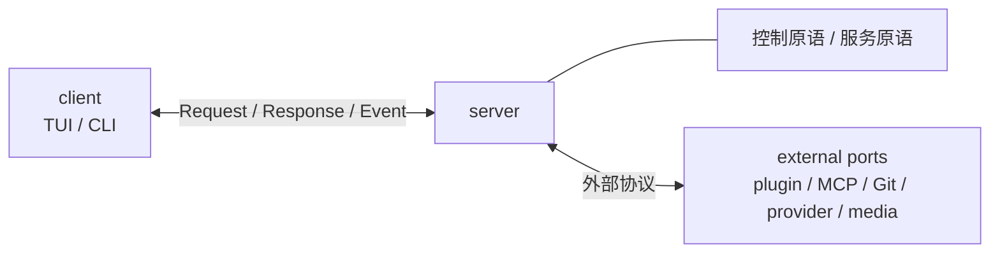

# mdctrl-protocol 技术文档

> 文档状态：草案 · 最后复核：2026-11-23

> protocol 是 client、plugin、MCP 使用 server 服务的共同契约，规定 server 如何通过控制原语与服务原语对外提供服务，以及这些原语如何被请求、返回和订阅。

## 1 协议概览

protocol 连接 server、client（TUI/CLI）与外部端口（plugin、MCP、Git、provider、media）。server 把对外能力组织成控制原语与服务原语；client 通过 Request、Response、Event 调用原语并接收结果；外部端口把各自协议映射到同一组原语。协议同时规定这些交互共同使用的标识、路径、版本、错误与序列化方式。



原语是协议的中心概念。它把 server 的能力整理成稳定、可查询、可组合的接口；控制原语管理会话与运行时，服务原语表达业务能力。消息、值模型与外部端口都围绕原语展开。

## 2 控制原语与服务原语

原语是 server 对外提供的最小服务单元。原语分为两类：控制原语由 runtime 定义，管理会话与运行时；服务原语由 domain 定义，表达 server 的业务能力。

控制原语包括 `runtime.hello`、`runtime.ping`、`runtime.status`、`runtime.catalog`、`runtime.subscribe`、`runtime.unsubscribe`、`runtime.cancel`、`runtime.job.status`、`runtime.job.cancel`。它们围绕会话、订阅、取消与 Job 生命周期展开。

服务原语使用 `domain.action` 命名，例如 `document.view`、`search.query`、`index.update`、`write.propose`。域包括 workspace、document、view、search、index、history、health、write、media、agent、plugin。服务原语描述符声明读写属性（`Read`、`Write`）、执行方式（`Unary`、`Job`、`Subscription`）和权限要求。

两类原语共享 ID、输入、输出、错误、事件等基础字段；协议规定它们的命名、调用与结果表达。控制原语的细节见 [runtime.md](runtime.md)，服务原语的目录与语义见 [domain.md](domain.md) 与 `domain/`。

CLI、TUI、plugin 使用同一组服务原语；plugin 通过 external port 接入，与 CLI、TUI 共享原语 ID 与载荷语义。

## 3 消息与 Reply

client 与 server 之间通过三种消息交互：

```text
Request  { id, primitive, meta?, payload }
Response { id, primitive, meta?, reply: Reply<Payload> }
Event    { topic, scope, payload }

Reply<T> { ok, data, error, warnings }
```

`Request` 指定要调用的控制原语或服务原语；`Response` 通过 `Reply` 返回结果；`Event` 承载状态变化、进度与媒体就绪等异步通知。`Reply` 统一表达成功、失败与警告，wire 响应与 CLI 输出共用这一结构。

`meta` 承载本次调用相关的运行时信息，`generation`、`timeout_ms`、`idempotency_key` 等字段在 [runtime.md](runtime.md) 展开。具体原语的载荷、错误码与事件定义在对应文档中。

## 4 文档地图

| 文档 | 内容 |
| --- | --- |
| [concepts.md](concepts.md) | 控制原语、服务原语、消息、身份、状态与术语 |
| [base.md](base.md) | 标识、路径、版本、时间、范围、错误与序列化 |
| [runtime.md](runtime.md) | 控制原语、握手、会话、请求生命周期、请求 ID 命名空间、订阅、Job、流控与运行时错误 |
| [domain.md](domain.md) | 服务原语目录、跨域规则与跨域流程 |
| `domain/*.md` | 各服务的原语、载荷、错误与事件 |
| [external.md](external.md) | plugin、MCP、Git、provider、media 的端口映射 |
| [implementation.md](implementation.md) | Rust 类型、注册表、分派、校验与契约测试 |

阅读路径：

- 实现 client：`concepts` → `runtime` → `domain` 中对应服务
- 实现 server：`concepts` → `base` → `runtime` → `domain` → `implementation`
- 接入 plugin 或 MCP：`concepts` → `external` → `domain` 中对应服务
- 评审协议：`concepts` → `base` → `runtime`

## 5 与其他文档的衔接

| 文档 | 内容 |
| --- | --- |
| [架构](../../architecture.md) | 系统结构、状态所有权、部署形态与关键决策 |
| `mdctrl-protocol` | 原语、消息、值模型、版本、错误与序列化 |
| [技术选型](../../techStack.md) | 技术选择与验证状态 |
| crate 文档 | 内部模块、算法与公共 Rust API |

架构决定系统结构与状态归属；protocol 决定原语与消息的表达；crate 文档描述实现。出现差异时，先修订 protocol，再同步 crate 文档。实现完成后，契约测试校验协议行为。
