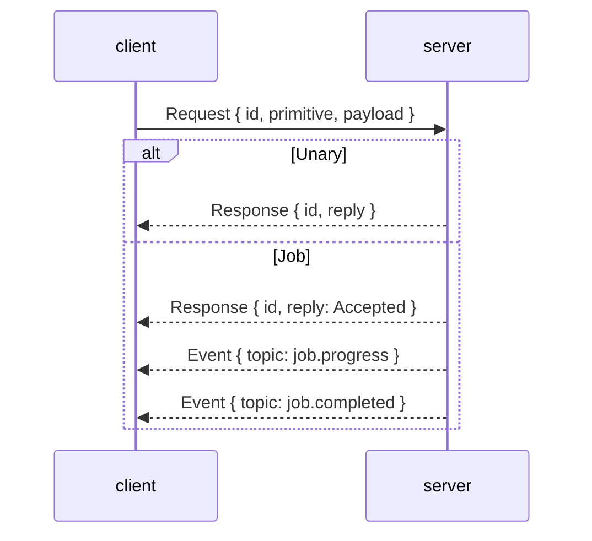

# mdctrl-protocol 概念模型

> 文档状态：草案 · 最后复核：2026-11-23

> 建立 protocol 的概念共识与术语基础：谁在通信、通信什么、如何表达身份与状态。

## 1 目的与范围

本文给出 protocol 的概念模型与术语，供 protocol 各文档以及 core、render、server、client 文档共同使用。读者先理解这里的原语、消息、身份与状态，再进入 [base.md](base.md)、[runtime.md](runtime.md)、[domain.md](domain.md)、[external.md](external.md) 与 [implementation.md](implementation.md) 的字段、流程与实现。

protocol 的核心是原语。server 把对外能力组织成原语；client 调用原语并接收结果；external port 把外部协议映射到原语或内部数据。原语分为控制原语与服务原语。

## 2 通信主体

protocol 连接三类主体：server、client 与 external port。

| 主体 | 角色 | 典型实现 |
| --- | --- | --- |
| server | 提供控制原语与服务原语，拥有工作区状态 | embedded server、daemon |
| client | 调用原语，持有视图状态 | TUI、CLI |
| external port | 连接外部系统，承载原语调用或外部能力 | plugin、MCP、Git、provider、media |

server 是原语的提供方。它维护工作区、文档、历史、索引、健康结果、会话、Job 与写入提案；控制原语管理会话与运行时，服务原语表达业务能力。

client 是原语的使用方。TUI 与 CLI 通过协议调用原语；TUI 把结果栅格化为终端界面，CLI 把结果组织为人类可读或结构化输出。client 持有焦点、滚动、选择、输入、终端 Cell 与主题选择等视图状态。

external port 是 server 连接外部系统的接入端。plugin 与 MCP 通过它调用服务原语；Git、provider、media 通过它向 server 提供外部能力。

## 3 协议组成

protocol 的文档与内容按四组组织：

| 组 | 内容 | 文档 |
| --- | --- | --- |
| base | 标识、路径、版本、时间、范围、错误、序列化 | [base.md](base.md) |
| runtime | 控制原语、握手、会话、请求生命周期、订阅、Job、流控 | [runtime.md](runtime.md) |
| domain | 服务原语、载荷、结果与事件 | [domain.md](domain.md)、`domain/*.md` |
| external | plugin、MCP、Git、provider、media 的端口映射 | [external.md](external.md) |

base 提供所有交互共同使用的值；runtime 承载控制原语；domain 承载服务原语；external 把外部协议映射到服务原语或内部数据。

runtime 与 domain 共用消息模型与 base 值。控制与服务在职责上分开：runtime 回答如何建立与控制连接，domain 回答 server 提供哪些业务能力。

## 4 控制原语与服务原语

### 4.1 原语的共同结构

原语是 server 对外提供的最小服务单元。两类原语共享一组基础字段：

```text
id, input, output, errors, events, limits, since
```

原语 ID 使用命名空间区分：

```text
runtime.*       控制原语
<domain>.*      服务原语
```

原语描述符是原语在协议中的定义，为这些字段提供类型与约束；控制原语与服务原语在基础字段之上各自扩展。

### 4.2 控制原语

控制原语属于 runtime，管理会话与运行时状态。

```text
runtime.hello
runtime.ping
runtime.status
runtime.catalog
runtime.subscribe
runtime.unsubscribe
runtime.cancel
runtime.job.status
runtime.job.cancel
```

控制原语围绕会话、状态、订阅、取消与 Job 生命周期展开。`runtime.hello` 是握手原语，建立 session 并返回 server、workspace、能力与限制；`runtime.subscribe` 与 `runtime.unsubscribe` 管理事件订阅；`runtime.cancel` 取消请求或任务；`runtime.job.status` 与 `runtime.job.cancel` 管理长任务。

控制原语的执行方式包括 `Unary` 与 `Subscription`；Job 的生命周期由 `runtime.job.*` 管理。控制原语管理连接与运行时，载荷围绕会话、订阅与 Job 状态。

### 4.3 服务原语

服务原语属于 domain，表达 server 的业务能力。

```text
document.view
search.query
index.update
write.propose
```

服务原语使用 `domain.action` 命名，域包括 workspace、document、view、search、index、history、health、write、media、agent、plugin。

服务原语描述符声明读写属性、执行方式与权限要求：

| 属性 | 取值 |
| --- | --- |
| `access` | `Read`、`Write` |
| `execution` | `Unary`、`Job`、`Subscription` |
| `policy` | 允许的 principal、所需能力、审批要求 |

`Read` 原语读取文档与派生数据，并更新最近观察等观察元数据；文档内容保持原样。`Write` 原语改变持久状态，文档写入按 policy 进入审批。

服务原语是 CLI、TUI、plugin 使用 server 服务的 API。协议规定服务原语的命名、调用与结果表达；具体服务提供哪些原语、原语的完整语义与约束，由对应服务的文档维护。原语目录见 [domain.md](domain.md)，各服务的定义见 `domain/*.md`。

### 4.4 与消息、命令、工具的区别

| 概念 | 回答什么 | 例子 |
| --- | --- | --- |
| 控制原语 | 会话与运行时如何控制 | `runtime.hello`、`runtime.subscribe` |
| 服务原语 | server 提供什么业务能力 | `document.view`、`search.query` |
| 消息 | 原语调用如何传输 | `Request`、`Response`、`Event` |
| CLI 命令 | 用户如何触发 | `mdctrl open` |
| MCP tool | 外部 agent 如何调用 | `read_document` 映射到服务原语 |

plugin 通过 external port 调用服务原语，与 CLI、TUI 共享原语 ID 与载荷语义。MCP tool 是外部 agent 看到的名称，内部映射到只读服务原语。

## 5 消息与交互

client 与 server 之间通过三种消息交互：

| 消息 | 方向 | 作用 |
| --- | --- | --- |
| `Request` | client → server | 调用控制原语或服务原语 |
| `Response` | server → client | 通过 `Reply` 返回结果 |
| `Event` | server → client | 状态变化、进度与媒体就绪通知 |

`Request` 携带请求 ID、原语 ID、元数据与载荷；`Response` 携带同一请求 ID 与 `Reply`；`Event` 携带 topic、scope 与载荷。`RequestId` 由 client 生成，在会话内唯一；server 按会话隔离命名空间，并以 `(SessionId, RequestId)` 关联请求与响应。`meta` 承载 `generation`、`timeout_ms`、`idempotency_key` 等运行时信息。

`Reply` 统一表达成功、失败与警告：

```text
Reply<T> { ok, data, error, warnings }
```

`ok` 表示原语执行成功；业务结论放在 `data`；`error` 携带稳定错误码；`warnings` 提供非阻断提示。wire 响应与 CLI 输出共用这一结构。

握手由控制原语 `runtime.hello` 完成。长任务由服务原语以 `Job` 方式执行：`Reply` 返回 `Accepted { job_id }`，随后通过事件报告进度与结果；`runtime.job.status` 与 `runtime.job.cancel` 负责查询与取消。订阅由控制原语管理：`runtime.subscribe` 返回 `subscription_id`，`runtime.unsubscribe` 结束订阅。

事件表达状态变化、进度与媒体就绪。client 收到事件后重新查询所需数据；事件队列溢出时，server 发送重新同步通知，client 重新查询当前状态。



## 6 通信方式

| 方式 | 参与者 | 机制 | 使用的原语 |
| --- | --- | --- | --- |
| protocol | client ↔ server | 进程内 typed channel、本地 IPC | 控制原语与服务原语 |
| plugin port | plugin ↔ server | stdio | 服务原语，同一组 ID 与载荷 |
| MCP port | 外部 agent ↔ server | stdio | 只读服务原语 |
| 静态 API | crate ↔ crate | Rust 方法调用 | 内部 API |
| 内部调用 | module ↔ module | Rust 方法调用、core 总线 | 内部契约 |
| 出站 external port | server → Git、provider、media | CLI、HTTP、子进程 | 外部能力 |

embedded 与 daemon 使用同一套消息；embedded 的传输是进程内 typed channel，daemon 使用本地 IPC。两种形态共享原语、消息与状态语义。

plugin port 把 plugin 的请求交给 server，server 按能力过滤后调用服务原语。plugin 使用与 CLI、TUI 相同的原语 ID 与载荷，共享同一套 API 与语言。

MCP port 把 MCP 工具映射到只读服务原语。外部 agent 通过 MCP 使用 server 的文档、搜索、健康与反链能力。

Git、provider、media 是 server 的外部能力来源。Git 向 history 提供提交与状态；provider 向 agent 服务提供模型调用；media renderer 向 media 提供渲染结果。

crate 之间使用 Rust 方法调用，返回 `Result<T, E>`。`Reply<T>` 出现在原语接口，由 server 在接入处完成映射。

## 7 身份与版本

### 7.1 身份

| 术语 | 英文 | 所有者 | 作用 |
| --- | --- | --- | --- |
| 协议参与者 | `Participant` | protocol | 参与协议对话的 server 与 client |
| 代表身份 | `Principal` | session | 代表谁行动：User、Agent、Plugin、Mcp |
| 会话 | `Session` | server | 绑定 participant、principal、能力、订阅与限制 |
| 工作区 | `Workspace` | server | 工作区状态容器 |
| 文档路径 | `DocumentPath` | server | 文档身份 |
| 原语标识 | `PrimitiveId` | protocol | 原语身份，命名空间区分控制与服务 |
| 请求标识 | `RequestId` | client | 会话内唯一的请求标识，用于关联响应 |
| 任务标识 | `JobId` | server | 长任务句柄 |
| 订阅标识 | `SubscriptionId` | server | 事件订阅句柄 |

`Participant` 覆盖 server 与 client；external port 归在 server 的接入端。`Principal` 表达动作代表谁：用户操作对应 `User`，内置 agent 对应 `Agent`，plugin 提案对应 `Plugin`，MCP 外部 agent 对应 `Mcp`。

`Session` 把 participant、principal、能力、订阅与限制绑定在一起。`Workspace` 是 server 管理的资源，承载文档、历史、索引与配置。`DocumentPath` 是工作区相对路径，作为文档身份。

### 7.2 版本

| 术语 | 英文 | 所有者 | 作用 |
| --- | --- | --- | --- |
| 协议版本 | `ProtocolVersion` | protocol | 握手与兼容判断 |
| 消息结构版本 | `WireSchemaVersion` | protocol | 消息信封结构 |
| 工作区结构版本 | `WorkspaceSchemaVersion` | server | 本地状态迁移 |
| 文档版本 | `DocumentVersion` | server | 由 `DocumentFingerprint` 与 `DocumentRevision` 组成 |
| 文档指纹 | `DocumentFingerprint` | server | 内容身份、写入基准、`exact` 匹配 |
| 文档修订 | `DocumentRevision` | server | 排序与展示 |
| 索引版本 | `IndexVersion` | server | 搜索、健康、反链结果标注 |
| 视图代次 | `ViewGeneration` | client | 丢弃过期视图响应 |

`DocumentFingerprint` 表达内容身份，用于写入基准与 `exact` 匹配；`DocumentRevision` 是 server 维护的单调序号，用于排序与展示。

视图代次由 client 维护，server 在响应中回传 `generation` 字段。client 用它判断视图响应是否过期。

`IndexVersion` 描述索引状态，服务于搜索、健康与反链结果。它标注结果基于哪一版索引，与文档版本、视图代次分开使用。

## 8 状态与所有权

| 状态 | 所有者 |
| --- | --- |
| 工作区、文档、文档历史、索引、健康结果、会话、Job、写入提案 | server |
| 焦点、滚动、选择、输入、终端 Cell、主题选择 | client |
| plugin 进程、provider 模型、Git 仓库、media renderer | external |

约定：

- server 是工作区文档的唯一写入者。
- client 持有视图状态与 `generation`。
- 事件用于提示变化，client 据此重新查询。
- protocol 使用自有 DTO 表达消息与载荷；外部协议在 external port 内完成转换。
- 控制原语管理会话与运行时；服务原语管理业务能力。

## 9 术语表

| 术语 | 英文 | 定义 |
| --- | --- | --- |
| 原语 | `Primitive` | server 对外提供的最小服务单元，分为控制原语与服务原语。原语由描述符定义，包含 ID、输入、输出、错误、事件等。 |
| 控制原语 | `ControlPrimitive` | runtime 中的原语，用于建立会话、订阅事件、取消请求和管理 Job。控制原语服务于连接与运行时。 |
| 服务原语 | `ServicePrimitive` | domain 中的原语，表达 server 的业务能力。CLI、TUI、plugin 通过服务原语使用 server 的服务。 |
| 原语描述符 | `PrimitiveDescriptor` | 描述原语的 ID、输入、输出、错误、事件、限制与引入版本。控制原语与服务原语在基础字段之上各自扩展。 |
| 原语标识 | `PrimitiveId` | 原语在协议中的稳定标识，命名空间区分控制原语与服务原语。 |
| 请求标识 | `RequestId` | client 为每次请求生成的标识，在会话内唯一；server 按会话隔离命名空间，用于关联响应。 |
| 任务标识 | `JobId` | server 为长任务分配的标识，用于查询进度与取消。 |
| 订阅标识 | `SubscriptionId` | server 为事件订阅分配的标识，用于结束订阅。 |
| 通信主体 | communication subject | protocol 连接的三类主体：server、client 与 external port。 |
| 协议参与者 | `Participant` | 参与协议对话的主体，包括 server 与 client。external port 归在 server 的接入端。 |
| 代表身份 | `Principal` | 发起动作时代表的身份，包括 User、Agent、Plugin、Mcp。Session 把 participant 与 principal 绑定。 |
| 会话 | `Session` | server 持有的运行时上下文，绑定 participant、principal、能力、订阅与限制。 |
| 工作区 | `Workspace` | server 管理的工作区状态容器，包含文档、历史、索引与配置。 |
| 文档路径 | `DocumentPath` | 工作区相对路径，作为文档身份。它使用 UTF-8 与 `/` 分隔，排除内部状态目录。 |
| 请求 | `Request` | client 调用原语的消息，携带 ID、原语 ID、元数据与载荷。 |
| 响应 | `Response` | server 返回原语结果的消息，通过 `Reply` 表达成功、失败与警告。 |
| 回复 | `Reply` | 原语处理结果，包含 `ok`、`data`、`error` 与 `warnings`。wire 响应与 CLI 输出共用这一结构。 |
| 事件 | `Event` | server 向 client 推送的异步通知，表达状态变化、进度与媒体就绪。 |
| 任务 | `Job` | 长任务的服务原语执行方式。server 返回 `Accepted` 与 `job_id`，随后通过事件报告进度与结果。 |
| 订阅 | `Subscription` | 控制原语建立的事件关注关系。client 通过 `runtime.subscribe` 订阅范围，通过 `runtime.unsubscribe` 结束。 |
| 外部端口 | `ExternalPort` | server 连接外部系统的接入端，承载 plugin、MCP、Git、provider、media 等外部协议，并把它们映射到服务原语或内部数据。 |
| 协议版本 | `ProtocolVersion` | 协议的主次版本，用于握手与兼容判断。 |
| 消息结构版本 | `WireSchemaVersion` | 消息信封的结构版本，用于序列化兼容。 |
| 工作区结构版本 | `WorkspaceSchemaVersion` | 本地工作区状态的 schema 版本，用于迁移。 |
| 文档版本 | `DocumentVersion` | 文档的完整版本，由 `DocumentFingerprint` 与 `DocumentRevision` 组成。 |
| 文档指纹 | `DocumentFingerprint` | 文档内容的身份，用于写入基准与 `exact` 匹配。内容变化时指纹变化。 |
| 文档修订 | `DocumentRevision` | server 为文档维护的单调序号，用于排序与展示。它随 server 生命周期变化。 |
| 索引版本 | `IndexVersion` | 索引状态的单调版本，用于标注搜索、健康与反链结果基于哪一版索引。 |
| 视图代次 | `ViewGeneration` | client 为文档视图维护的请求代次。server 在响应中回传 `generation` 字段，client 用它丢弃过期响应。 |
