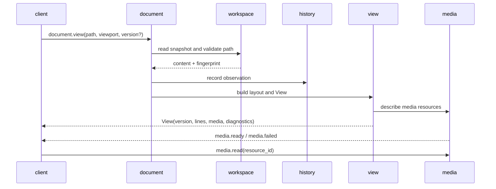
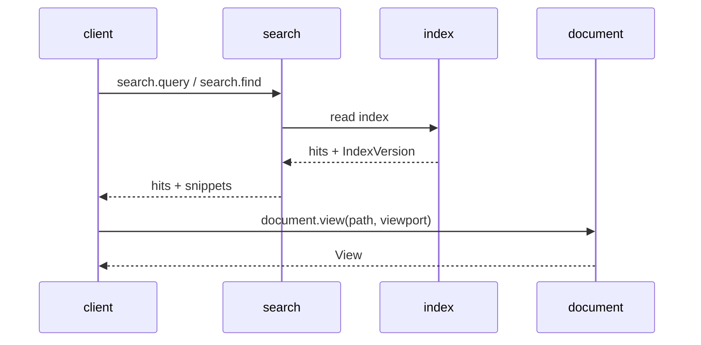
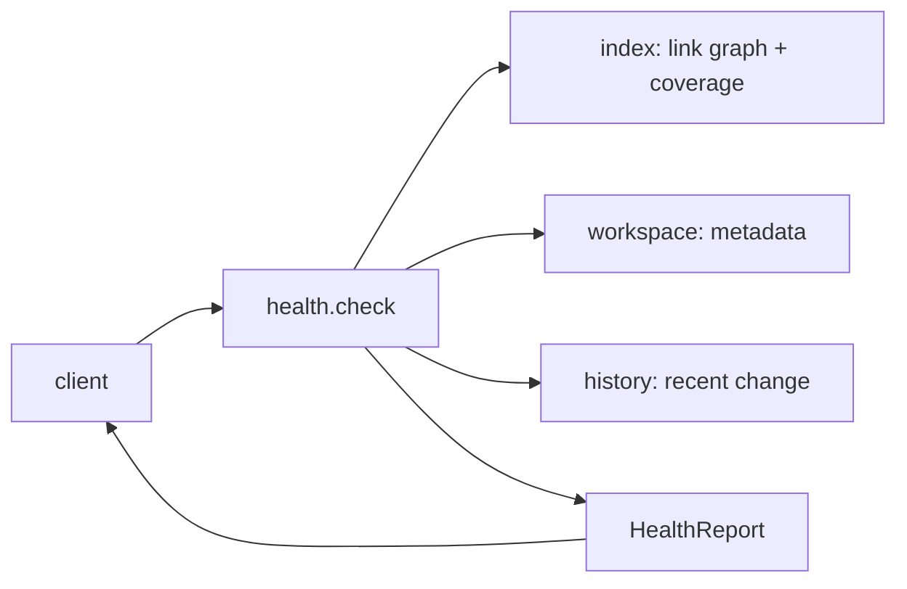
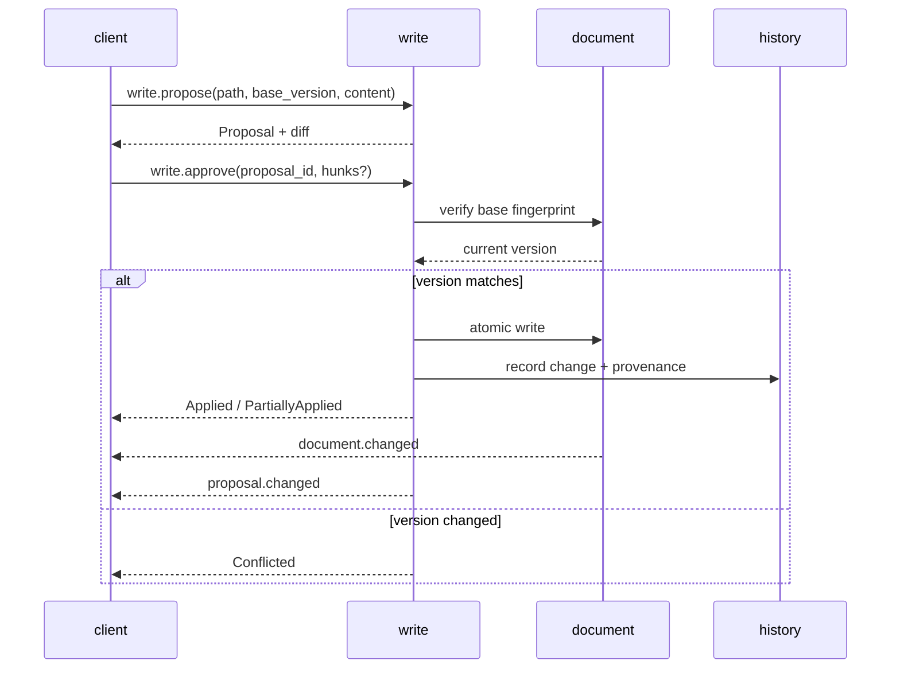
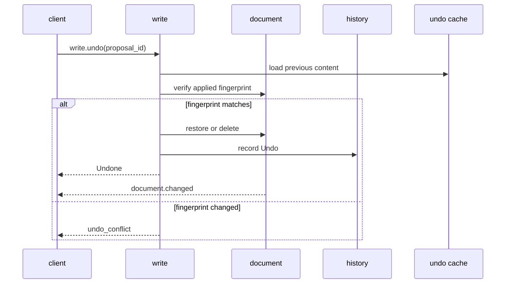
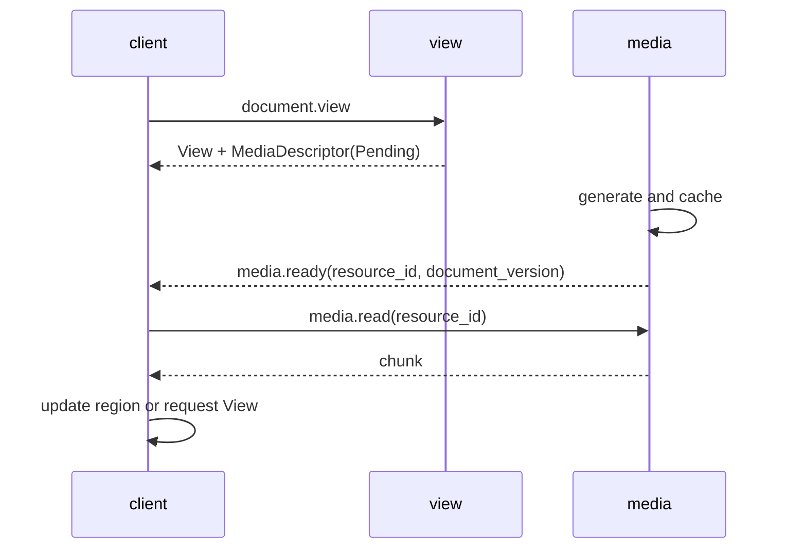
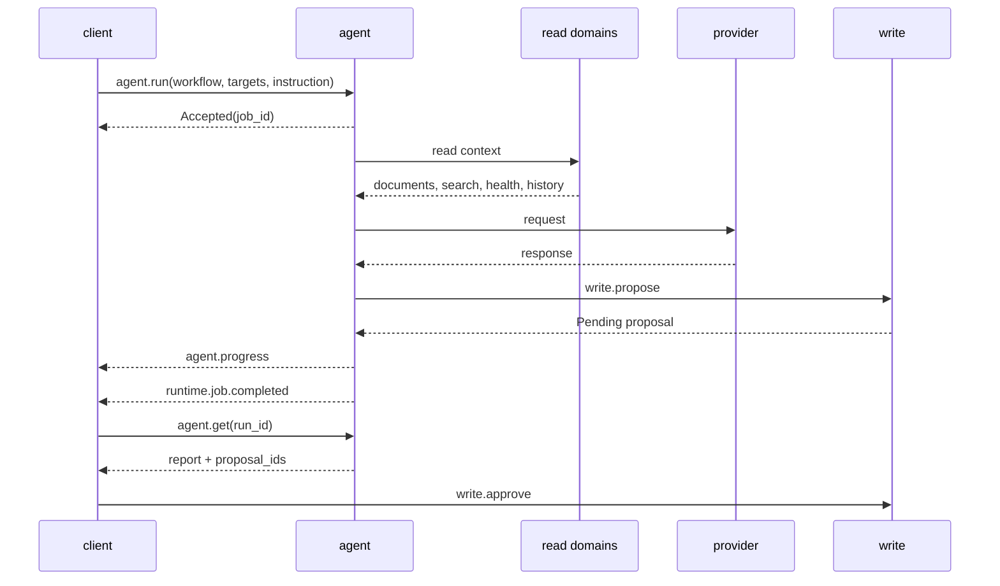
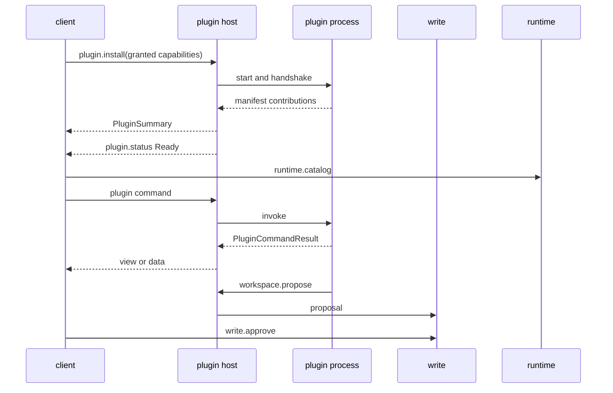
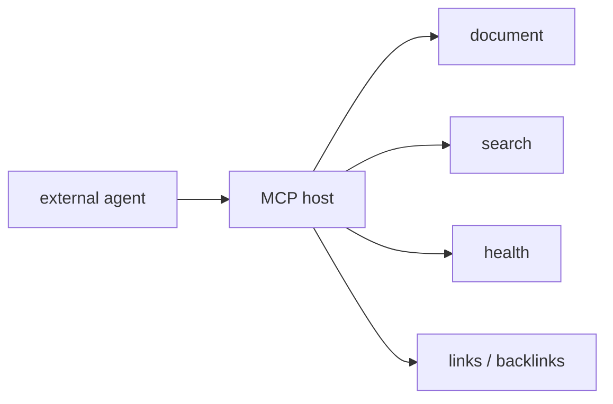

# mdctrl-protocol 服务原语与跨域流程

> 文档状态：草案 · 最后复核：2026-11-27

> domain 定义服务原语模型、域目录、域组依赖、跨域流程、版本、事件、权限与错误规则。

## 1 定位

domain 是 protocol 的数据面。它规定 server 对外提供哪些业务能力、这些能力如何组织成服务原语，以及各域如何通过原语与事件协作。服务原语是 client、plugin 与 MCP 使用 server 能力的统一入口。

域按三组组织：

- 基础状态域：workspace、document、history；
- 阅读与检索域：view、index、search、health；
- 写入与扩展域：write、media、agent、plugin。

[base.md](base.md) 提供标识、路径、版本、时间、错误与序列化；[runtime.md](runtime.md) 提供控制原语、会话、请求生命周期、订阅与 Job；[external.md](external.md) 提供 plugin、MCP、Git、provider 与 media 的端口映射；[implementation.md](implementation.md) 提供 Rust 类型、分派与测试。各域的服务原语、载荷、错误与事件由 `domain/*.md` 定义。

provider、MCP、Git、media renderer 与插件进程通过 external port 接入或提供能力；服务域目录聚焦 server 的业务能力。跨域组合由 server 编排，client 消费原语、结果与事件。

## 2 域组与依赖

| 组 | 域 | 主要依赖 |
| --- | --- | --- |
| 基础状态 | workspace、document、history | workspace → document → history |
| 阅读与检索 | view、index、search、health | document/workspace → view；workspace/document → index → search；index + workspace/document/history → health |
| 写入与扩展 | write、media、agent、plugin | document/history/workspace → write；view/workspace → media；read 域 + write → agent/plugin |

- 依赖单向、无环。
- 每个域围绕自己的状态或派生结果组织能力。
- 域之间通过服务原语或 server 内部编排协作。
- `view` 由 document 与 render 派生；`index` 为 search、链接与 health 提供派生数据。
- `write` 是文档修改的统一落盘入口；media、agent、plugin 通过各自原语与 write 协作。

## 3 服务原语模型

服务原语使用统一的描述符字段：

```text
id, access, execution, input, output, errors, events, policy, limits, since, deprecated?
```

| 属性 | 取值 | 说明 |
| --- | --- | --- |
| `access` | `Read`、`Write` | 读取可以更新最近观察等观察元数据；写入改变持久状态 |
| `execution` | `Unary`、`Job`、`Subscription` | Job 使用 runtime 的 Job 控制；Subscription 使用 runtime 的事件订阅 |
| `policy` | principal、能力、审批 | 声明谁可以调用原语、需要什么能力、写入是否进入审批 |

- 结果统一使用 base 的 `Reply<T>`；分页使用 `PageInfo`。
- `Job` 原语通过 `runtime.job.*` 管理；`Subscription` 通过 runtime 订阅。
- 插件贡献的命令是动态服务原语，进入 `runtime.catalog`，命名空间为 `plugin.<plugin_id>.<command>`。
- 域文档是原语载荷、错误、事件与权限的权威来源。

## 4 域目录

| 域 | 范围 | 主要原语 | 主要事件 | 文档 |
| --- | --- | --- | --- | --- |
| workspace | 根目录、初始化、状态、配置、扫描 | `workspace.init`、`workspace.status`、`workspace.config.get`、`workspace.config.set` | `workspace.config_changed`、`workspace.scan_updated` | [workspace.md](domain/workspace.md) |
| document | 文档身份、元数据、列表、大纲、查看、链接、反链 | `document.list`、`document.metadata`、`document.outline`、`document.view`、`document.links`、`document.backlinks` | `document.changed` | [document.md](domain/document.md) |
| view | View 载荷、布局行、样式、媒体占位、诊断 | 由 `document.view` 提供载荷 | 由上游事件触发失效 | [view.md](domain/view.md) |
| search | 全文搜索、文件名与路径查找 | `search.query`、`search.find` | 由 `index.updated` 触发刷新 | [search.md](domain/search.md) |
| index | 索引状态、更新、重建、链接图 | `index.status`、`index.update`、`index.rebuild` | `index.updated`、`index.failed` | [index.md](domain/index.md) |
| history | 观察、变更、溯源、Git 元数据 | `history.summary`、`history.tree`、`history.node`、`history.changes`、`history.provenance` | `history.changed` | [history.md](domain/history.md) |
| health | 断链、孤儿、过期、缺失元数据 | `health.check` | `health.updated` | [health.md](domain/health.md) |
| write | 提案、差异、审批、写入、撤销 | `write.propose`、`write.get`、`write.list`、`write.approve`、`write.reject`、`write.withdraw`、`write.undo` | `proposal.changed` | [write.md](domain/write.md) |
| media | 公式、Mermaid、图片、资源读取与降级 | `media.read` | `media.ready`、`media.failed` | [media.md](domain/media.md) |
| agent | 分析、审阅、写作、运行与报告 | `agent.run`、`agent.get` | `agent.progress`、`runtime.job.*` | [agent.md](domain/agent.md) |
| plugin | 插件管理、能力、命令与插件视图 | `plugin.list`、`plugin.install`、`plugin.remove`、`plugin.doctor`、`plugin.enable`、`plugin.disable`、`plugin.<plugin_id>.<command>` | `plugin.status` | [plugin.md](domain/plugin.md) |

- 表中列出当前公开原语与主要事件，完整载荷见各域文档。
- 插件命令是动态原语；管理原语使用保留名。
- `view` 的原语入口是 `document.view`；载荷由 view 域定义。

## 5 跨域流程

| 流程 | 参与者 | 结果 |
| --- | --- | --- |
| 打开与阅读 | document、workspace、history、view、media | View、观察记录、媒体占位 |
| 搜索与定位 | search、index、document | 命中结果、`document.view` |
| 健康检查 | health、index、history、workspace | 健康报告 |
| 写入 | write、document、history、workspace、index、health | 文档版本、历史、失效事件 |
| 撤销 | write、document、history、workspace | 恢复或删除、撤销溯源 |
| 媒体 | view、media、client | 媒体描述、`media.read`、就绪/失败事件 |
| Agent | agent、document/search/health/history、write、provider | 报告、提案、溯源 |
| Plugin | plugin、workspace、write、view、runtime | 插件命令、提案、插件视图 |
| MCP | external port、document/search/health/backlinks | 只读结果 |

### 5.1 打开与阅读



- `document.view` 读取文档快照与版本；`version` 省略时使用 latest，携带时按 exact 匹配指纹。
- history 记录最近观察；观察不改变文档内容。
- server 生成布局与 View；media 提供占位、资源描述与降级内容。
- client 栅格化为终端 Cell，并按 `media.ready` / `media.failed` 更新媒体区域；需要重新布局时重新请求 View。

### 5.2 搜索与定位



- `search.query` 与 `search.find` 消费 index 提供的全文、文件名、链接与锚点数据。
- 结果按 server 定义的顺序返回，client 保持该顺序；结果携带 `IndexVersion`。
- 搜索命中通过 `document.view` 打开，client 按 `source_span` 调整视口定位。
- `index.updated` 到达后，client 重新查询；索引派生结果可以按 `IndexVersion` 判断是否过期。

### 5.3 健康检查



- `health.check` 读取 index 的链接图与覆盖、workspace 的文档元数据与 history 的最近变更。
- 规则为 `broken-link`、`orphan`、`stale` 与 `missing-metadata`；严重度使用 `error`、`warning`、`info`。
- 报告携带 `IndexVersion` 与可选 `IndexCoverage`；索引缺失或损坏时返回 `index.unavailable`。
- `health.updated` 到达后，client 重新调用 `health.check`。

### 5.4 写入与撤销





- `write.propose` 接收完整新内容，由 server 生成逐行差异；`write.approve` 支持全部或部分 hunk。
- 审批前与写入前都做版本检查；失败时文档保持原内容，提案进入 `Conflicted`。
- 写入使用原子替换；成功后 history 记录 change 与 `Provenance`，write 与 document 分别发布 `proposal.changed` 与 `document.changed`。
- index 与 health 通过文档变化重新计算；client 收到事件后刷新对应结果。
- `write.undo` 使用同一 apply 路径；`Create` 撤销删除文件，`Update` 撤销恢复写入前内容。
- 撤销前比较当前指纹与提案 `new_version`；失败时保留当前内容并返回 `write.undo_conflict`。
- 撤销在时间窗口内有效，缓存只保存在 server 内存；history 记录 `operation = Undo` 与 `undo_of`。

### 5.5 媒体



- View 提供 `MediaDescriptor`，其中 `ResourceId` 标识媒体产物；`reserved` 是占位尺寸，`actual` 是实际尺寸。
- media 在后台生成并缓存；成功后发布 `media.ready`，失败后发布 `media.failed`。
- client 通过 `media.read` 分块读取资源；资源失败或终端不支持图片协议时使用 `fallback`。
- 图片内容、主题或目标尺寸变化时产生新的 `ResourceId`；缓存淘汰后 `media.read` 返回 `media.not_found`，client 重新请求 View。
- 本地图片经 workspace 校验；远程图片在 View 中显示 `alt` 与链接。

### 5.6 Agent



- `agent.run` 使用 runtime Job，返回 `Accepted { job_id }`；进度通过 `agent.progress` 与 `runtime.job.*` 推送。
- Agent 通过只读服务原语获取文档、搜索、健康、历史与 Git 上下文；上下文清单记录路径与版本。
- 写入通过 `write.propose` 提交，提案保持 `Pending`，审批由 User 完成；Agent 可撤销自己的提案，需要 `workspace.undo`。
- `agent.get` 按 `run_id` 返回运行状态与纯文本报告；报告与提案通过 `run_id`、`proposal_id` 关联。
- provider 与 MCP 属于 external port；MCP 映射只读文档、搜索、健康与反链查询。

### 5.7 Plugin



- 插件通过 `plugin.install` 声明 manifest、申请能力并获得用户授权；能力使用 `workspace.read`、`workspace.propose`、`workspace.undo`、`command.invoke`、`network.access`。
- 插件命令注册为 `plugin.<plugin_id>.<command>`，进入 `runtime.catalog`；状态变化通过 `plugin.status` 通知。
- 插件通过 `workspace.propose` 提交提案，审批由 User 完成；撤回与撤销分别使用 `workspace.propose` 与 `workspace.undo`。
- `PluginView` 使用纯文本载体，由 client 在插件面板显示；文档 View 保持文档专属。
- 插件失败由 `plugin.failed`、`plugin.timeout` 或 `plugin.disabled` 表达，client 重新读取 `plugin.doctor` 或 `runtime.catalog`。

### 5.8 MCP



- MCP 映射文档、搜索、健康与反链的只读查询，外部 agent 使用 `Principal = Mcp`。
- MCP 写入暂缓；开放后沿用 write 的提案、审批与归属规则。
- MCP 的 tools、resources 与 prompts 由 external port 定义；服务原语目录保持 mdctrl 的统一命名。

## 6 版本、事件与失效

### 6.1 版本

| 版本 | 所有者 | 跨域用途 |
| --- | --- | --- |
| `DocumentVersion` / `DocumentFingerprint` | document/history | View、写入基准、exact 匹配 |
| `IndexVersion` | index | search、链接、health 结果标注 |
| `ViewGeneration` | client | 丢弃过期 View 响应 |
| `ProtocolVersion` / `WireSchemaVersion` | protocol | 握手与序列化兼容 |

- 写入基准与 exact 匹配使用指纹。
- `IndexVersion` 服务于索引派生结果；View 有效性由 `DocumentVersion` 与 `ViewGeneration` 负责。
- client 按 `generation` 丢弃过期响应。

### 6.2 事件与失效

| 事件 | 主要失效对象 |
| --- | --- |
| `workspace.config_changed` | 配置相关视图、索引、健康、Agent/Plugin 配置 |
| `workspace.scan_updated` | 文档列表、搜索覆盖、健康覆盖 |
| `document.changed` | View、元数据、大纲、链接、反链 |
| `index.updated` / `index.failed` | 搜索、链接图、健康、行内诊断 |
| `health.updated` | 健康面板、行内诊断 |
| `proposal.changed` | 提案列表、审批界面、撤销状态 |
| `media.ready` / `media.failed` | 媒体占位、当前 View |
| `agent.progress` | 运行进度与报告状态 |
| `plugin.status` | 插件列表、诊断、`runtime.catalog` |
| `history.changed` | 历史摘要、树、变更与溯源视图 |

- 事件是失效通知，client 收到后重新查询。
- 事件 scope 使用 runtime 定义；队列溢出通过 `runtime.resync_required` 重新同步。
- `document.changed` 由 history 提交后发布；`proposal.changed` 由 write 发布。

## 7 身份、权限与审批

| principal | 读取 | 提案 | 审批 | 撤销 |
| --- | --- | --- | --- | --- |
| User | 是 | 是 | 是 | 自己的提案 |
| Agent | 只读查询 | 是 | 否 | 自己的提案，需 `workspace.undo` |
| Plugin | 按能力 | 是，需 `workspace.propose` | 否 | 自己的提案，需 `workspace.undo` |
| Mcp | 只读 | 暂缓 | 否 | 暂缓 |

- 人工保存使用 `write.propose` + `write.approve` 自审批。
- Agent 与 Plugin 提案保持 `Pending`，由 User 审批；Mcp 写入暂缓。
- 提案 owner 可撤回；已执行写入由 owner 在撤销窗口内撤销。
- 能力使用 `area.feature` 命名，例如 `workspace.read`、`workspace.propose`、`workspace.undo`、`view.incremental`、`write.diff_hunks`、`media.image`、`agent.stream`、`plugin.management`。

## 8 错误与限制

| 范围 | 主要错误 |
| --- | --- |
| 跨域共用 | `path.rejected`、`permission.denied`、`protocol.limit_exceeded`、`internal` |
| 索引派生 | `index.unavailable` |
| Agent | `provider.*` |
| Plugin | `plugin.*` |
| Media | `media.*` |

- `index.unavailable` 由 search、document.links/backlinks 与 health 共享。
- `retryable` 指导 client 重试；CLI 退出码由 CLI 定义，不进入 protocol。
- 分页、结果数量、消息大小与媒体大小使用 base 的限制类别。
- 错误详情携带稳定字段，面向人类的 message 保持英文。
