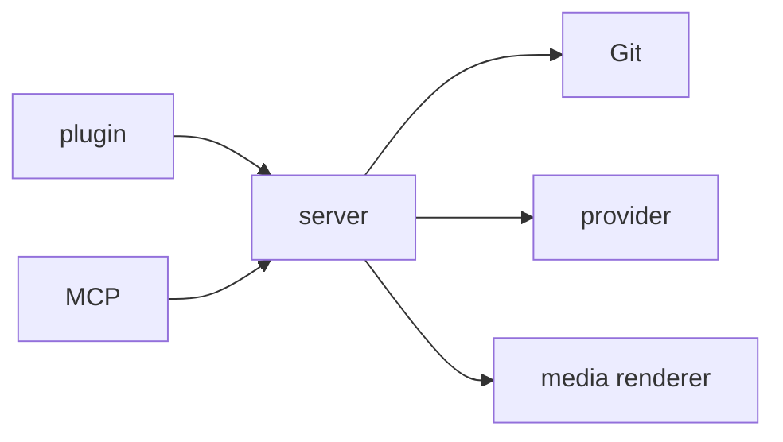

# mdctrl-protocol 外部端口

> 文档状态：草案 · 最后复核：2026-11-27

> external 定义 plugin、MCP、Git、provider 与 media renderer 如何映射到服务原语、领域结果与事件。

## 1 定位

external 是 protocol 的外部端口层。它把外部系统的协议接入 server，也把 server 对外部能力的调用组织为稳定映射：入站端口把外部请求转换为服务原语调用，出站端口把外部结果转换为协议结果与事件。

external 覆盖 plugin、MCP、Git、provider 与 media renderer。plugin 与 MCP 提供入站调用，plugin 同时承载宿主到插件的出站调用；Git、provider 与 media renderer 是出站端口，由 server 代表当前工作区调用。client 与 server 之间的 embedded/daemon 传输由 [runtime.md](runtime.md) 与 server transport 文档负责。

external 使用 [base.md](base.md) 的标识、版本、错误与限制模型，使用 [runtime.md](runtime.md) 的会话、事件与取消语义，使用 [domain.md](domain.md) 的服务原语目录。外部协议类型留在端口内部；mdctrl wire 只暴露服务原语、领域结果与事件。

## 2 端口模型

| 端口 | 方向 | 外部协议 | 映射到 | 当前形态 |
| --- | --- | --- | --- | --- |
| plugin | 入站 + 出站 | 插件进程协议 | 服务原语、命令总线、write 提案、PluginView | 设计完成 |
| MCP | 入站 | MCP tools/resources/prompts | 只读服务原语 | 只读 |
| Git | 出站 | Git 只读调用 | history 的 `GitAnchor`、`GitRef` 与变更元数据 | 可选 |
| provider | 出站 | 模型 HTTP/API | agent 的模型请求、流式输出、工具调用与错误 | 按配置启用 |
| media renderer | 出站 | 外部渲染器 | media 资源生成、缓存与降级 | 按终端能力启用 |

入站端口建立 session 时绑定 principal、能力与订阅；出站端口由 server 代表工作区执行，不向 client 暴露外部会话。外部协议版本与能力在各自端口内部协商，mdctrl 的 `ProtocolVersion`、`CapabilitySet` 与事件语义保持独立。

## 3 Plugin 端口

plugin 同时是服务域与外部端口。[plugin.md](domain/plugin.md) 定义插件声明、能力、状态与管理原语；external 定义插件与宿主之间的调用映射。

### 3.1 入站调用

插件通过宿主调用服务原语，服务原语 ID 与载荷语义与 client 保持一致；消息封装、分帧与进程通信由 plugin 端口负责。

| 插件请求 | 映射 | 能力 |
| --- | --- | --- |
| 读取文档、搜索、反链、健康、历史与媒体资源 | 对应只读服务原语 | `workspace.read` |
| 提交写入提案 | `write.propose` | `workspace.propose` |
| 撤回提案 | `write.withdraw` | `workspace.propose` |
| 撤销已执行写入 | `write.undo` | `workspace.undo` |
| 调用其他命令 | 命令总线 | `command.invoke` |
| 访问网络 | external 网络能力 | `network.access` |

插件提案的 `principal` 为 `Plugin`，保持 `Pending`，由 User 审批。插件命令注册为 `plugin.<plugin_id>.<command>`，进入 `runtime.catalog`；命令结果使用 `PluginCommandResult`，其中 `data` 承载结构化数据，`view` 承载纯文本插件视图。client 在插件面板显示 `PluginView`，文档 View 保持文档专属。

### 3.2 出站调用

宿主向插件发起命令调用、视图或导出请求、心跳与关闭，也可以取消进行中的请求。插件状态通过 `plugin.status` 通知，命令目录通过 `runtime.catalog` 刷新。插件失败、超时或禁用分别通过 `plugin.failed`、`plugin.timeout` 与 `plugin.disabled` 表达。

## 4 MCP 端口

MCP 是外部 agent 的入站端口。MCP host 把外部 agent 的 tools、resources 与 prompts 映射为只读服务原语，外部 agent 使用 `Principal = Mcp`。

| MCP 能力 | 映射 |
| --- | --- |
| 文档读取 | `document.view`、`document.metadata`、`document.outline` |
| 文档列表 | `document.list` |
| 全文搜索与路径查找 | `search.query`、`search.find` |
| 健康检查 | `health.check` |
| 出链与反链 | `document.links`、`document.backlinks` |
| 文档资源 | MCP resource 映射到文档路径，读取时进入 `document.view` |

MCP 的 tools、resources 与 prompts 属于 MCP 协议；mdctrl 只定义它们到服务原语的映射。资源 URI 的具体形式由 MCP 端口定义，文档内容仍以 `DocumentPath` 表示。MCP 当前保持只读，写入暂缓；开放后沿用 write 的提案、审批与归属规则。

MCP 错误转换为 MCP 错误响应，mdctrl 错误码保留在详情中。历史与 Git 信息按接入策略开放；默认只读范围聚焦文档、搜索、健康与反链。

## 5 Git 端口

Git 是出站只读适配器，为 history 提供提交、分支、工作区状态与差异元数据。Git 元数据进入 [history.md](domain/history.md)，由 history 承载。

| Git 数据 | 映射 |
| --- | --- |
| HEAD、branch、tag、detached HEAD | `GitRef` 与 `GitAnchor` |
| commit、父提交、作者、提交时间 | `GitAnchor` 与 `DocHistoryNode` |
| 工作区状态 | `worktree_state` |
| 文档差异 | history 与 agent 上下文 |

Git 缺失时，history 继续记录本地变化；health 使用 frontmatter 与 history 时间。Git 不可用通过 `git_available` 与缺失的 Git 字段表达，历史存储失败使用 `history.unavailable`。提交、分支切换、合并与推送由用户或外部工具完成；mdctrl 读取元数据并记录观察。

## 6 Provider 端口

Provider 是 agent 的出站端口，负责模型请求、流式输出、工具调用与错误分类。provider 的具体 DTO、流式格式与厂商差异留在端口内部，协议只暴露 `AgentRun`、`AgentReport` 与 `agent.progress`。

| Provider 能力 | 映射 |
| --- | --- |
| 请求与响应 | `agent.run` 的模型阶段 |
| 流式输出 | `agent.progress.delta` |
| 工具调用 | Agent 内部工具循环 |
| 错误分类 | `provider.*` |
| 用量信息 | `AgentRun` 展示字段 |

provider 端点、模型名与凭据引用来自配置，凭据只保存在本地。未配置 provider 时返回 `provider.unavailable`；远程 provider 的首次使用由 client 确认端点。provider 错误映射到 `provider.unavailable`、`provider.auth_failed`、`provider.rate_limited`、`provider.context_overflow` 与 `provider.invalid_response`。

## 7 Media Renderer 端口

Media renderer 是 media 的出站端口，负责公式、Mermaid 与 SVG 的位图化。renderer 协议、进程隔离与安装方式留在 server 与 external port 内部；协议侧只暴露媒体资源、缓存结果与降级内容。

| Renderer 输出 | 映射 |
| --- | --- |
| 位图资源 | `ResourceId` 与 `media.read` |
| 实际尺寸 | `MediaDescriptor.actual` 与 `media.ready.extent` |
| 失败与降级 | `media.failed` 与 `MediaFallback` |
| 渲染参数 | 资源身份与缓存键 |

server 侧位图化；client 只负责终端图片协议编码与显示。终端能力、主题与目标尺寸进入资源身份，不同参数产生新的 `ResourceId`。renderer 缺失、超时或资源过大时进入 `Failed`，View 使用 `fallback`。本地图片经 workspace 校验；远程图片在 View 中显示 `alt` 与链接。

## 8 通用规则

### 8.1 身份与会话

入站端口在建立会话时绑定 principal、能力与订阅：plugin 使用 `Plugin`，MCP 使用 `Mcp`。出站端口由 server 代表当前工作区调用，不新增 principal。插件写入进入 write 域，审批由 User 完成；MCP 写入暂缓，开放后进入同一路径。

### 8.2 版本与能力

外部协议版本与能力独立于 mdctrl 协议。plugin manifest 声明插件协议范围与能力，MCP 端口协商 MCP 能力，Git 适配器探测 Git 可用性，provider 按配置的接口工作，media renderer 按终端与主题参数生成资源。mdctrl 的 `ProtocolVersion`、`CapabilitySet`、`DocumentVersion` 与 `IndexVersion` 由 protocol 与对应域维护。

### 8.3 错误

| 端口 | 错误映射 |
| --- | --- |
| plugin | `plugin.*` |
| MCP | MCP 错误响应；详情保留 mdctrl 错误码 |
| Git | `git_available`、缺失字段与 `history.unavailable` |
| provider | `provider.*` |
| media renderer | `media.*` |
| 通用 | `path.rejected`、`permission.denied`、`protocol.limit_exceeded`、`internal` |

`retryable` 指导 client 重试；CLI 退出码由 CLI 定义，protocol 保持结构化错误。外部错误保留稳定错误码；凭据、完整环境变量与工作区外绝对路径留在 server 内部。

### 8.4 安全与限制

外部输入按不可信内容校验：消息大小、查询长度、视图深度、资源大小与超时使用统一限制；路径统一经过 workspace 校验；插件视图与外部文本清理控制字符和终端转义序列；协议、日志、事件与溯源保留稳定标识，凭据、绝对路径、进程句柄与渲染器命令留在 server 内部。

插件以独立进程运行，宿主按授予能力校验服务原语调用；进程隔离提供故障隔离，插件代码以当前用户权限运行，安装即信任。MCP 保持只读，外部 agent 通过服务原语访问工作区内容。

## 9 与其他文档的关系

| 文档 | 关系 |
| --- | --- |
| [base.md](base.md) | 标识、版本、错误、限制与通用值 |
| [runtime.md](runtime.md) | 会话、Job、事件、取消与流控 |
| [domain.md](domain.md) | 服务原语目录与跨域流程 |
| [domain/plugin.md](domain/plugin.md) | 插件声明、能力、管理与 PluginView |
| [domain/agent.md](domain/agent.md) | Agent 运行、上下文、报告与 provider 协作 |
| [domain/media.md](domain/media.md) | 媒体资源、读取、缓存、事件与降级 |
| [domain/history.md](domain/history.md) | Git 元数据、观察、变更与溯源 |
| [domain/write.md](domain/write.md) | 插件提案审批与撤销；MCP 写入开放后沿用同一路径 |
| server 文档 | 插件进程、MCP host、Git 调用、provider HTTP 与 renderer 实现 |

external 定义外部端口的方向、映射、权限、错误与事件；进程管理、分帧、Git 调用、HTTP 与渲染器实现由 server 文档承接。
