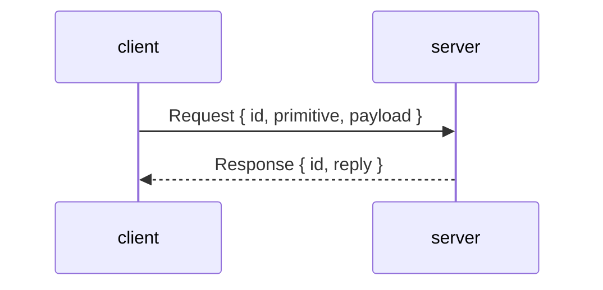
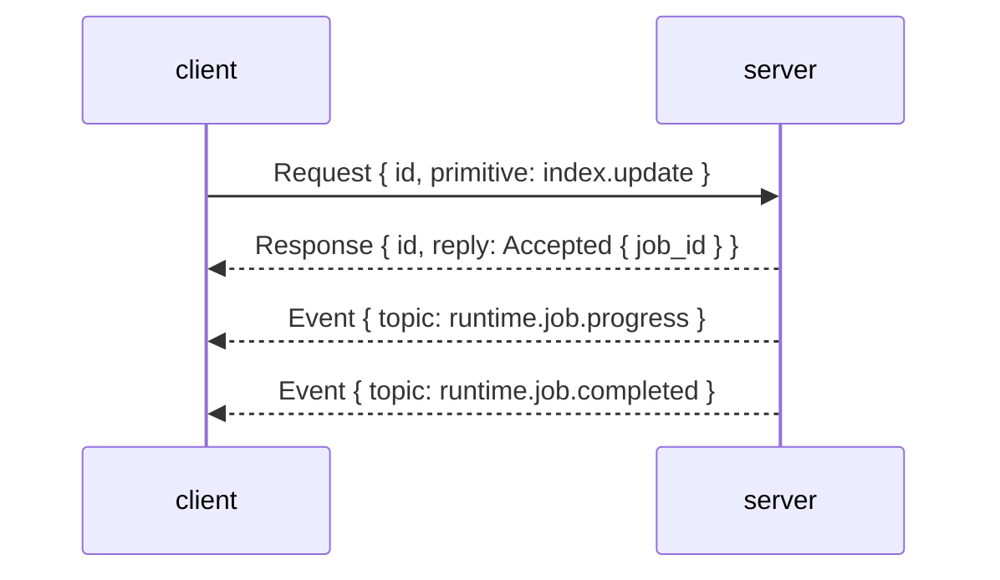
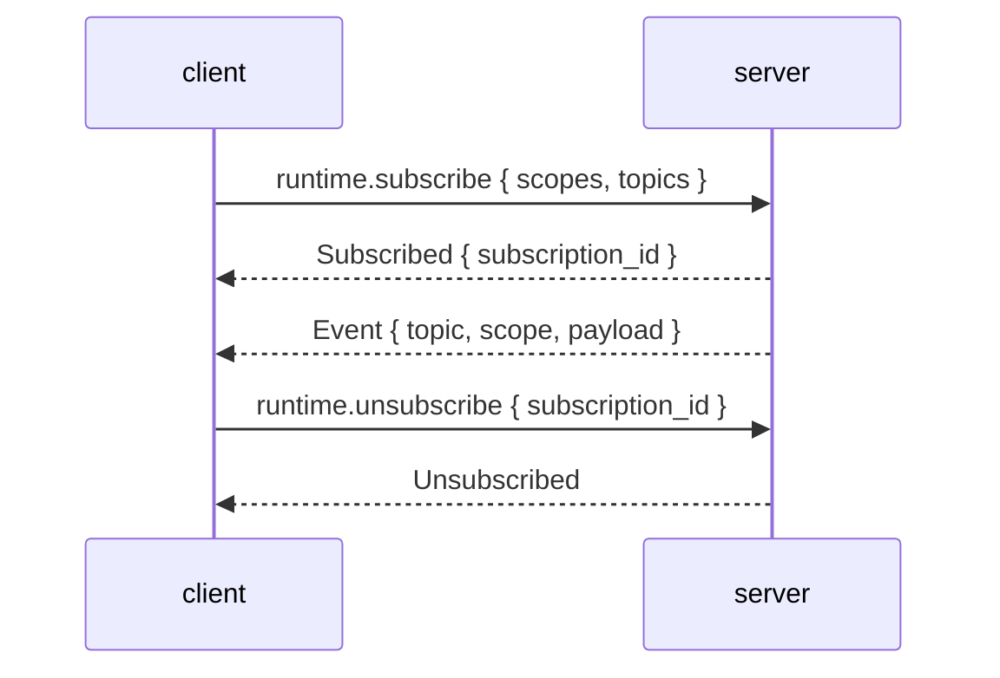
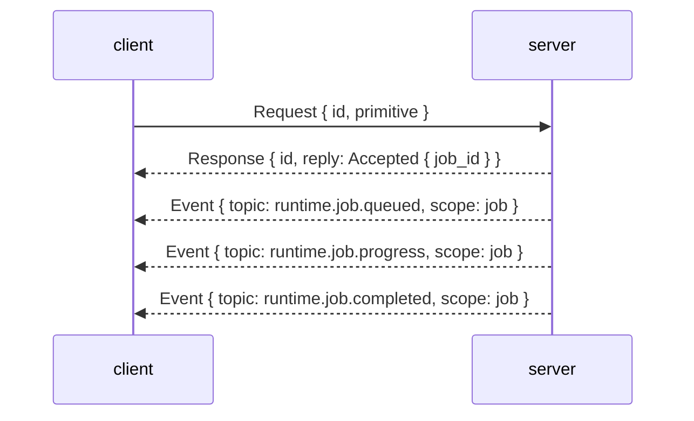

# mdctrl-protocol 运行时控制

> 文档状态：草案 · 最后复核：2026-11-23

> runtime 定义控制原语、握手、会话、请求生命周期、订阅、Job 与流控，是 client 使用 server 服务的控制面。

## 1 定位

runtime 是 protocol 的控制面。它规定 client 如何建立会话、协商能力、调用控制原语、接收事件、管理 Job 与处理运行时错误。服务原语表达业务能力，控制原语管理连接与运行时；两类原语共享 [base.md](base.md) 的标识、版本、时间、错误与通用值。

[concepts.md](concepts.md) 定义原语、消息、主体与状态的概念；[domain.md](domain.md) 与 `domain/*.md` 定义服务原语；[external.md](external.md) 定义外部端口映射；[implementation.md](implementation.md) 定义 Rust 类型、请求表与测试。runtime 负责这些文档之间的控制语义。

一条连接承载一个会话。多个 client 各自拥有独立会话，`RequestId` 在会话内唯一，server 按会话隔离请求命名空间。控制原语以会话为作用域，资源归属与权限检查按会话执行。

runtime 的语义与传输解耦。embedded 使用进程内 typed channel，daemon 使用本地 IPC，未来 remote 复用同一套消息。传输分帧、端点发现与访问控制留在 server transport 文档。

## 2 消息与元数据

client 与 server 通过三种消息交互：

```text
Request  { id, primitive, meta?, payload }
Response { id, primitive, meta?, reply: Reply<Payload> }
Event    { topic, scope, payload }
```

`Request` 指定 `PrimitiveId`、请求 ID、元数据与载荷；`Response` 回传请求 ID、原语 ID 与 `Reply`；`Event` 携带 topic、scope 与载荷。`RequestId` 由 client 生成，在会话内唯一；`Response` 回传同一个 ID，用于关联。响应可以乱序到达，事件异步推送。

`RequestMeta` 承载本次调用相关的运行时信息：

```text
RequestMeta {
  generation?,       // 视图请求代次，server 回传
  timeout_ms?,       // 请求超时
  idempotency_key?   // 命令重试去重
}
```

`ResponseMeta` 回传 `generation`。`generation`、`timeout_ms` 与 `idempotency_key` 的语义在本篇定义；`Reply`、`ErrorInfo` 与 `Warning` 的结构见 [base.md](base.md)。

`EventScope` 表达事件关注范围：

```text
EventScope { kind, id? }
```

`kind` 保留 `session`、`workspace`、`document`、`index`、`health`、`job`、`agent` 与 `plugin`。`id` 在 document、job、agent、plugin 等 scope 中承载对应标识；session 与 workspace scope 省略 `id`。

`EventTopic` 使用 `domain.event` 命名。runtime 事件 topic 在本篇定义，domain 事件 topic 与载荷由 domain 文档定义。client 按订阅的 scope 与 topic 过滤事件。

## 3 握手与会话

`runtime.hello` 是第一个控制原语。握手完成前，其他请求返回 `runtime.handshake_required`。`Hello` 携带：

```text
Hello {
  protocol: ProtocolVersion,
  wire_schema_version: WireSchemaVersion,
  client: ClientInfo,
  required_primitives: [PrimitiveId],
  optional_primitives: [PrimitiveId],
  required_capabilities: [CapabilityId],
  optional_capabilities: [CapabilityId],
  terminal: TerminalProfile
}
```

`Welcome` 返回：

```text
Welcome {
  protocol: ProtocolVersion,
  wire_schema_version: WireSchemaVersion,
  session_id: SessionId,
  server: ServerInfo,
  workspace: WorkspaceInfo,
  principal: Principal,
  primitives: [PrimitiveId],
  capabilities: [CapabilityId],
  limits: RuntimeLimits
}
```

版本协商以 major 与 minor 为单位。major 一致时，双方使用较低的 minor；major 不同时返回 `protocol.version_mismatch`。daemon 同时校验 `WireSchemaVersion`，embedded 使用 typed 值并沿用同一语义。

原语协商以 `PrimitiveSet` 为单位。client 声明 required 与 optional 原语；server 返回支持集合。required 原语缺失时返回 `protocol.unsupported_primitive`，并列出缺失项。optional 原语缺失时 client 使用降级路径。

能力协商以 `CapabilitySet` 为单位，表达原语内部的可选行为，例如 `view.incremental`、`media.image`、`write.diff_hunks`、`agent.stream` 与 `plugin.management`。`CapabilityId` 使用 `area.feature` 命名；`PrimitiveSet` 与 `CapabilitySet` 分别表示原语与能力集合。required 能力缺失时返回 `protocol.unsupported_capability`；optional 能力缺失时 client 选择兼容行为。

`ClientInfo` 包含 `kind`、`name` 与 `version`。`ServerInfo` 包含 `name` 与 `version`。`WorkspaceInfo` 包含 `workspace_id`、`workspace_schema_version` 与展示名，工作区路径留在 server 内部。

`TerminalProfile` 描述 client 终端：

```text
TerminalProfile {
  width,
  height,
  color_depth,     // Mono | Ansi16 | Ansi256 | TrueColor
  image_protocol,  // None | HalfBlock | Kitty | Sixel | ITerm2
  theme_mode       // Light | Dark | Unknown
}
```

握手提供初始 profile；View 请求可以更新宽度与主题。`RuntimeLimits` 公布会话的生效上限：

| 限制 | 含义 |
| --- | --- |
| `max_message_bytes` | 单条消息大小 |
| `max_inflight_requests` | 会话内并行请求数量 |
| `max_event_queue` | 会话事件队列长度 |
| `max_results` | 单次结果数量 |
| `max_view_lines` | 单次 View 的布局行数 |

其余限制沿用 [base.md](base.md) 的常量或由对应服务原语说明。

握手超时返回 `runtime.handshake_timeout`。重复握手返回 `protocol.invalid_message`。会话绑定工作区、client 类型与 principal；principal 由接入方式确定，client 协议通常对应 `User`，MCP 对应 `Mcp`，plugin 对应 `Plugin`。

`runtime.ping` 用于连接存活检查，返回 `Pong { server_time }`。`runtime.status` 返回 server 版本、协议版本、运行时长、会话数、限制与能力。`runtime.catalog` 返回控制原语与服务原语的描述符与能力集合。

## 4 控制原语

控制原语以会话为作用域，管理连接与运行时。它们使用 `runtime.*` 命名空间，使用 `Unary` 与 `Subscription` 执行方式。

| 原语 | 作用 | 主要输入 | 主要输出 |
| --- | --- | --- | --- |
| `runtime.hello` | 建立会话与协商 | `Hello` | `Welcome` |
| `runtime.ping` | 连接存活检查 | 空载荷 | `Pong` |
| `runtime.status` | server 状态 | 空载荷 | `ServerStatus` |
| `runtime.catalog` | 原语与能力目录 | 空载荷 | `Catalog` |
| `runtime.subscribe` | 建立事件订阅 | `Subscribe` | `Subscribed` |
| `runtime.unsubscribe` | 结束事件订阅 | `Unsubscribe` | `Unsubscribed` |
| `runtime.cancel` | 取消进行中的请求 | `CancelRequest` | `CancelResult` |
| `runtime.job.status` | 查询 Job 状态 | `JobStatusRequest` | `JobInfo` |
| `runtime.job.cancel` | 取消 Job | `JobCancelRequest` | `JobInfo` |

`ServerStatus` 包含 `protocol_version`、`server`、`uptime_ms`、`session_count`、`limits` 与 `capabilities`。`Catalog` 包含 `primitives` 与 `capabilities`；`PrimitiveDescriptor` 提供 `id`、`kind`、`access?`、`execution`、`since` 与可选 `deprecated`。

`Subscribe` 携带 scope 列表与可选 topic 过滤：

```text
Subscribe { scopes: [EventScope], topics?: [EventTopic] }
Subscribed { subscription_id, scopes, topics }
```

`CancelRequest` 携带 `request_id`；`CancelResult` 返回 `request_id`，表示取消请求已受理。`JobStatusRequest` 与 `JobCancelRequest` 携带 `job_id`，返回 `JobInfo`。

控制原语在握手完成后可用。`runtime.hello` 在会话建立阶段使用；其余控制原语在 `Active` 状态使用。订阅、取消与 Job 的详细行为分别在第 5、6、7 节展开。

## 5 请求生命周期与请求 ID 命名空间

### 5.1 生命周期

Unary 请求发送 `Request`，server 返回一个 `Response`，`Reply` 携带结果。Job 请求返回 `Accepted { job_id }`，随后通过 Job 事件报告进度与结果，client 可以用 `runtime.job.status` 查询。订阅由 `runtime.subscribe` 建立，返回 `subscription_id`，事件到达后由 `runtime.unsubscribe` 结束。

同一会话可以并行多个请求。响应乱序到达，client 按 `RequestId` 关联。同一 scope 内的事件保持顺序，不同 scope 之间按到达顺序。写入的串行化由服务原语与 server 写入路径负责。

### 5.2 请求 ID 命名空间

`RequestId` 由 client 生成，在会话内唯一。server 以 `(SessionId, RequestId)` 作为请求键，并为每个请求维护内部状态；实现可以分配内部 `RequestHandle`，用于分派、日志与追踪。

同一会话内 in-flight 请求复用 `RequestId` 时返回 `runtime.request_id_conflict`，原请求继续执行。请求完成、取消或失败后释放映射；会话关闭时清空整个命名空间。请求完成后允许复用 `RequestId`；重试语义由 `idempotency_key` 承担。

请求表、Job 表与幂等表分开维护。请求表随请求完成释放，Job 表管理长任务，幂等表保留重试结果。请求表受 `max_inflight_requests` 约束，达到上限时返回 `runtime.overloaded`。

### 5.3 超时、取消与幂等

`timeout_ms` 从 server 接收请求起算，到返回 `Reply` 结束。Job 在 `Accepted` 后继续执行，超时只作用于请求阶段。超时返回 `runtime.timeout`；server 尽力取消后续工作，已进入提交阶段的写入按服务规则完成。

`runtime.cancel` 按 `RequestId` 取消进行中的请求，尽力停止执行并返回 `CancelResult`。请求已完成或未知时返回 `runtime.request_not_found`。取消成功后，原请求以 `runtime.cancelled` 结束。取消与完成存在竞态，client 以最终响应为准。Job 取消使用 `runtime.job.cancel`。

`idempotency_key` 按 session 与 primitive 去重。重复请求在原请求完成后返回缓存结果；原请求仍在执行时返回 `runtime.request_in_progress`，client 可以重试或等待。幂等记录在会话内保留，server 可以按内存上限淘汰最旧记录。

`generation` 由 client 维护，server 在响应中回传。client 用它丢弃过期响应；server 按不透明值处理。请求与响应的关联始终使用 `RequestId`。





## 6 订阅与事件

`runtime.subscribe` 接收 scope 列表与可选 topic 过滤，返回 `subscription_id`。`runtime.unsubscribe` 结束订阅；未知订阅返回 `runtime.subscription_not_found`。一个会话可以持有多个订阅，每个订阅独立管理 scope 与 topic。

事件按投递语义分类：

| 类别 | 示例 | 合并策略 | 丢失处理 |
| --- | --- | --- | --- |
| 状态变化 | `document.changed`、`index.updated` | 同 scope 合并 | 重新同步 |
| 进度 | `runtime.job.progress`、`agent.progress` | 保留最新 | 查询状态 |
| 生命周期 | `runtime.session_closing`、`runtime.job.completed` | 尽力送达 | 重连或查询 |
| 控制 | `runtime.resync_required` | 优先发送 | 关闭会话 |

同一 scope 内保持事件顺序。server 为每个会话维护有界事件队列；慢 client 通过合并、限频与丢弃进度事件隔离，其他会话与 server 内部任务继续运行。

队列溢出时，server 清空该会话的事件队列并发送 `runtime.resync_required { scopes }`。client 按 scope 重新查询当前状态；订阅关系保持。resync 事件发送失败时，server 关闭会话。

runtime 事件 topic 包括：

```text
runtime.session_closing
runtime.resync_required
runtime.job.queued
runtime.job.progress
runtime.job.cancelling
runtime.job.completed
runtime.job.failed
runtime.job.cancelled
```

domain 事件 topic 使用各自命名空间，例如 `document.changed`、`index.updated`、`health.updated`、`media.ready`、`proposal.changed`、`agent.progress` 与 `plugin.status`。事件载荷由对应文档定义。



## 7 Job

Job 表示长任务的服务原语执行。状态包括 `Queued`、`Running`、`Cancelling`、`Succeeded`、`Failed` 与 `Cancelled`。

```text
JobInfo {
  job_id,
  primitive,
  state,
  progress: { done, total?, message? },
  result?
}
```

`primitive` 标识发起 Job 的服务原语；`result` 的类型由该原语定义。runtime 负责状态、进度与结果投递，结果载荷按原语输出类型解释；大结果通过 `ResourceId` 或服务查询获取。

Job 事件使用 `job` scope：

```text
runtime.job.queued
runtime.job.progress
runtime.job.cancelling
runtime.job.completed
runtime.job.failed
runtime.job.cancelled
```

`runtime.job.status` 返回当前 `JobInfo`；`runtime.job.cancel` 请求取消。取消发生时，Job 进入 `Cancelling`，随后进入 `Cancelled`；取消与完成的竞态以 server 最终状态为准。未知 Job 返回 `runtime.job_not_found`。

Job 归属发起会话。会话关闭时，运行中的 Job 取消，已完成结果在会话内保留。Job 表与请求表分开维护；请求在返回 `Accepted` 后完成，Job 继续由 Job 表管理。



## 8 流控与重新同步

流控以会话为单位。server 限制并行请求数量、事件队列长度与进度事件频率，client 按 `RuntimeLimits` 调整请求节奏。

请求达到 `max_inflight_requests` 时返回 `runtime.overloaded`，client 可以退避后重试。事件队列达到上限时，server 按事件类别合并或丢弃低优先级事件；状态变化事件保留最新一条，进度事件只保留最新进度。

慢 client 通过合并与限频隔离，server 继续服务其他会话。队列溢出时，server 发送 `runtime.resync_required`，client 重新查询受影响 scope 的当前状态；订阅关系保持。resync 事件发送失败时，server 关闭会话，client 重新握手。

重新同步覆盖三类状态：文档与索引的当前版本、Job 状态与进度、订阅范围。client 完成重新查询后继续使用原订阅；需要调整范围时重新调用 `runtime.subscribe`。

## 9 会话生命周期、重连与传输

会话状态包括 `Handshaking`、`Active`、`Draining` 与 `Closed`。

`Handshaking` 阶段只接受 `runtime.hello`；握手完成后进入 `Active`。`Active` 阶段处理请求、事件与 Job。`Draining` 阶段停止接受新请求，等待在途请求完成或取消，并向 client 发送 `runtime.session_closing`。`Closed` 阶段释放会话资源。

client 断开时，server 取消进行中的请求与 Job，移除订阅，清空请求表与幂等表，并释放会话持有的临时资源。工作区、文档、历史与索引状态保留在 server；client 重连后重新握手、重新订阅并刷新 View。

重连建立新会话与新 `RequestId` 命名空间。旧会话的请求 ID 随会话关闭失效；client 按新会话重新生成 ID。embedded 形态下 client 退出触发 server 关闭；daemon 形态下 server 保持运行，等待新连接。

外部端口由 host 管理。MCP 与 plugin host 在 server 内部映射为会话，具体映射与外部协议适配见 [external.md](external.md)。Git、provider 与 media 是出站适配器，向 server 内部服务提供数据或能力。

状态归属保持在 server 与 client 之间：server 持有会话、请求表、Job、订阅与工作区状态；client 持有视图状态、焦点、滚动、选择与 `generation`。传输分帧、端点发现与访问控制留在 server transport 文档。

## 10 运行时错误

运行时错误使用 [base.md](base.md) 的 `ErrorInfo` 结构，通过 `Reply.error` 返回。`retryable` 指导 client 重试或重连。

| 错误码 | 场景 | retryable |
| --- | --- | --- |
| `protocol.version_mismatch` | 握手版本冲突 | false |
| `protocol.unsupported_primitive` | required 原语缺失 | false |
| `protocol.unsupported_capability` | required 能力缺失 | false |
| `protocol.invalid_message` | 消息结构非法 | false |
| `protocol.limit_exceeded` | 消息、查询或值超出限制 | false |
| `runtime.handshake_required` | 握手前发送其他请求 | false |
| `runtime.handshake_timeout` | 握手超时 | true |
| `runtime.session_closed` | 会话已关闭 | true |
| `runtime.cancelled` | 请求或 Job 被取消 | false |
| `runtime.timeout` | 请求超时 | true |
| `runtime.request_id_conflict` | 同会话 in-flight 请求复用 ID | false |
| `runtime.request_in_progress` | 幂等键对应请求仍在执行 | true |
| `runtime.request_not_found` | 取消未知请求 | false |
| `runtime.job_not_found` | 查询或取消未知 Job | false |
| `runtime.subscription_not_found` | 结束未知订阅 | false |
| `runtime.overloaded` | in-flight 请求达到上限 | true |
| `internal` | 未预期错误 | false |

未知原语返回 `protocol.unsupported_primitive`；非法消息返回 `protocol.invalid_message`；超出限制返回 `protocol.limit_exceeded`。可重试错误按退避策略重试；会话关闭类错误通过重新握手恢复。诊断细节进入日志，`ErrorInfo` 保持面向调用方的结构化信息。
