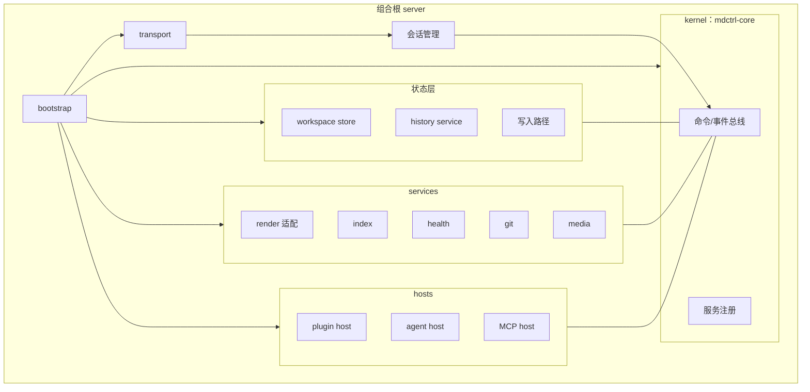
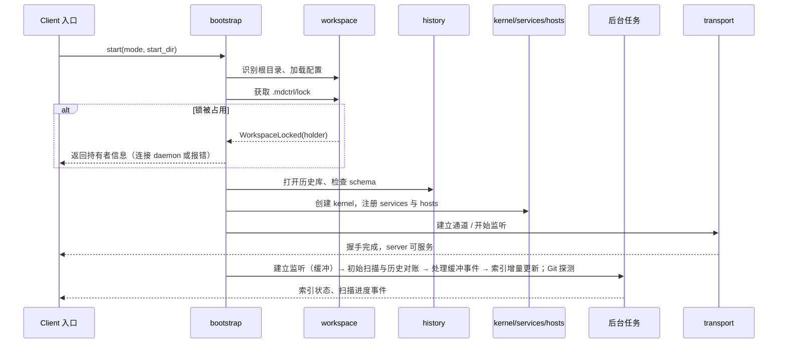

# mdctrl-server 技术文档

> 文档状态：草案 · 最后复核：2026-11-14

> server 是 mdctrl 唯一的文档状态所有者：它装配 kernel、services、hosts 与 transport，把工作区变化转换成事件与视图。

**相关文档**：[架构](../../architecture.md) · [技术选型](../../techStack.md) · [开发模式](../../devMode.md) · [开发计划](../../devPlan.md) · [待确认事项](open-questions.md)

**目录**

- [1 定位与当前状态](#1-定位与当前状态)
  - [1.1 当前实现](#11-当前实现)
  - [1.2 陈述标记](#12-陈述标记)
- [2 职责与非职责](#2-职责与非职责)
- [3 组合根与装配](#3-组合根与装配)
  - [3.1 装配结构](#31-装配结构)
  - [3.2 内部模块划分](#32-内部模块划分)
  - [3.3 注册与分发](#33-注册与分发)
- [4 状态所有权](#4-状态所有权)
- [5 与其他 crate 的边界](#5-与其他-crate-的边界)
- [6 并发模型](#6-并发模型)
- [7 主要数据流](#7-主要数据流)
- [8 启动与关闭](#8-启动与关闭)
  - [8.1 启动](#81-启动)
  - [8.2 关闭](#82-关闭)
  - [8.3 异常退出后的恢复](#83-异常退出后的恢复)
  - [8.4 验证场景](#84-验证场景)
- [9 错误模型](#9-错误模型)
- [10 阶段对应](#10-阶段对应)
- [11 文档索引](#11-文档索引)
- [12 待确认事项](#12-待确认事项)

## 1 定位与当前状态

`mdctrl-server` 是[架构 5.4](../../architecture.md#54-server) 定义的组合根，承载 workspace store、history service、内置 services、hosts 与传输层。本文档目录把总体架构细化到 server 内部模块，服务后续实现、协作与评审。总体结构、核心概念与部署形态以[架构](../../architecture.md)为准，本文只补充 server 层需要的细节，不重复基线内容。

### 1.1 当前实现

截至最后复核日期，仓库中 server 的实际实现只有：

- `crates/mdctrl-server/src/lib.rs` 的模块级文档注释 `Server composition for mdctrl services, hosts, and transport.`；
- `crates/mdctrl-server/Cargo.toml` 声明依赖 `mdctrl-core`、`mdctrl-render`、`mdctrl-protocol`，与 [AGENTS.md](../../../AGENTS.md) 的依赖表一致。

server 没有公共 API、类型、外部依赖或测试；`mdctrl-cli` 只提供 `--version` 与 `--help`，尚未调用 server。本目录描述的所有运行时行为都属于设计，**没有任何能力已实现或已验证**。

### 1.2 陈述标记

为区分事实与设计，各文档在表格与小节中使用以下标记：

| 标记 | 含义 | 约束力 |
| --- | --- | --- |
| `已实现` | 仓库代码当前具备的行为 | 事实 |
| `基线` | [架构](../../architecture.md)或[技术选型](../../techStack.md)已确认的结论 | 修改需按基线文档流程 |
| `建议` | 本目录提出的接口形状、状态机、字段或存储结构 | 待评审，**不是公共契约** |
| `待验证` | 需要微型验证或集成验证才能确定的技术方案 | 结论未定，保留回退 |

未加标记的叙述默认是 `建议`。引用技术选型中的版本号时，均指 [techStack.md](../../techStack.md) 2026-11-09 复核记录的桌面核查结论，不代表当前最新版本；引入依赖前需要重新核查，并按 [AGENTS.md](../../../AGENTS.md) 获得人工确认。

## 2 职责与非职责

| 职责 | 说明 | 详见 |
| --- | --- | --- |
| 工作区 | 根目录识别、配置加载、`.mdctrl/` 管理、锁、扫描、路径校验 | [workspace.md](workspace.md) |
| 文档历史 | 观察记录、内容指纹、变更来源与溯源、Git 元数据合并 | [history.md](history.md) |
| 索引与查询 | 全文索引、链接图、文件名查找、增量更新与重建 | [index.md](index.md) |
| 健康检查 | 断链、孤立、过期、缺失元数据规则与结果 | [health.md](health.md) |
| Git 元数据 | 读取与刷新，Git 缺失时降级 | [git.md](git.md) |
| 写入路径 | 编辑提案、diff、审批、版本检查、原子写入 | [write-path.md](write-path.md) |
| Agent / MCP | agent host、provider、工作流、MCP host | [agent-mcp.md](agent-mcp.md) |
| 媒体 | 公式、Mermaid、图片的后台生成、缓存与降级 | [media.md](media.md) |
| 插件 | manifest、权限、进程生命周期与故障隔离 | [plugin.md](plugin.md) |
| 传输与会话 | embedded / daemon 传输、会话、连接生命周期 | [transport.md](transport.md) |
| 视图装配 | 调用 render 生成布局，组合语义 token、媒体引用与诊断形成 View | 本文 [§5](#5-与其他-crate-的边界) |

非职责：

- **终端栅格化、焦点、滚动、选择、键位、主题选择**：client 负责（[架构 7](../../architecture.md#7-状态所有权)）；
- **Markdown 解析与布局算法**：`mdctrl-render` 负责，server 只调用并缓存结果；
- **协议类型定义**：只放在 `mdctrl-protocol`，server 不定义对外消息类型；
- **领域类型与总线机制**：`mdctrl-core`（kernel）定义，server 使用；
- **命令行参数、退出码与输出格式**：`mdctrl-cli` 负责，server 提供结构化结果与错误类别；
- **Git 写操作**（提交、切换分支、合并）：不在 server 范围内；
- **操作系统级沙箱**：插件与外部渲染器只做进程隔离与接口权限校验，见 [plugin.md](plugin.md#4-能力与权限)。

## 3 组合根与装配

### 3.1 装配结构

组合根负责“按顺序构造、按依赖注入、按逆序关闭”。kernel 是唯一的注册中心；services 与 hosts 只通过 kernel 的命令总线、事件总线与查询接口互相访问，避免模块之间形成隐式依赖。

装配顺序（`建议`）：

1. workspace：识别根目录、加载配置、获取锁（失败即终止，不初始化其他模块）；
2. history：打开历史库，检查 schema；
3. kernel：创建总线与注册表；
4. 状态层与写入路径注册到 kernel；
5. services 注册：render 适配、index、health、git、media；
6. hosts 注册：plugin host、agent host、MCP host，进程与网络资源延迟启动；
7. 后台任务：先建立文件监听并缓冲事件，再初始扫描与历史对账，然后处理缓冲事件，最后索引增量更新；Git 探测并行（交接规则见 [workspace 5](workspace.md#5-生命周期)）；
8. transport 开始接受连接或建立进程内通道。

### 3.2 内部模块划分

index、health、git、media、plugin、agent、MCP 先作为 server 内部模块（`基线`，[架构 12](../../architecture.md#12-模块与-crate)）。Rust 模块划分与 owner（`建议`，owner 来自 [devPlan 6.1](../../devPlan.md#61-crate-主责)）：

| 模块（建议路径） | 内容 | owner |
| --- | --- | --- |
| `bootstrap` | 组合根、装配顺序、关闭流程 | `ylgd0915` |
| `workspace` | 根目录、配置、锁、扫描、监听、路径校验 | `ylgd0915` |
| `history` | 历史库、观察记录、溯源、Git 元数据合并 | `ylgd0915` |
| `write` | 提案、diff、审批、版本检查、原子写入 | `ylgd0915` |
| `view` | 调用 render、组合 View、布局缓存 | `ylgd0915`（与 `field` 协商 View 形状） |
| `index` | 全文索引、链接图、文件名查找 | `ylgd0915` |
| `health` | 规则与结果 | `ylgd0915` |
| `git` | Git CLI 适配 | `ylgd0915` |
| `media` | 媒体任务、缓存、降级 | `field` |
| `plugin` | plugin host | `silkage15` |
| `agent`、`mcp` | agent host、provider、MCP host | `ylgd0915` |
| `transport`、`session` | 传输、会话、连接生命周期 | `silkage15` |

模块对外只暴露 crate 内可见（`pub(crate)`）接口；`mdctrl-server` 的公共 API 预计只有“启动 embedded server / 启动 daemon / 获取 client 端通道”几个入口，具体形状属于公共 API 变更，需要人工确认（SRV-2）。

### 3.3 注册与分发

- client 的 command / query 经 transport 解码、会话校验后进入 kernel 总线，由注册的处理者执行；
- services 与 hosts 发布内部事件（如“文档已变化”“索引已更新”），会话管理按订阅主题转换为协议 event 推送给 client；
- 插件命令与内置命令注册到同一总线（`基线`，[devPlan 4.4](../../devPlan.md#44-mvp4-扩展与自动化)），命名空间规则见 [plugin.md](plugin.md#10-命令总线)；
- 总线的类型与注册机制由 `mdctrl-core` 定义（foundation，Issue #2），server 只约定“谁注册什么”。

## 4 状态所有权

在[架构 7](../../architecture.md#7-状态所有权)的基础上细化到 server 内部模块，并标注持久化类别：

| 状态 | 内部所有者 | 持久化类别 | 位置（建议） |
| --- | --- | --- | --- |
| 文档正文 | 工作区文件（事实来源） | 用户文件 | 工作区内 `.md` 文件 |
| 工作区根、配置快照 | workspace | 内存（来源是配置文件） | — |
| 文档清单、指纹快照 | workspace | 内存，可由扫描重建 | — |
| 文档历史与溯源 | history | **持久、不可完全重建** | `.mdctrl/history/` |
| Git 元数据快照 | git → history | 可重建 | `.mdctrl/history/`（派生表） |
| 全文索引、链接图 | index | 可重建缓存 | `.mdctrl/cache/` |
| 健康结果 | health | 内存，可重建 | — |
| 媒体资源 | media | 可重建缓存 | `.mdctrl/cache/media/` |
| 媒体资源依赖（本地图片 → 引用文档） | media | 内存，可由重新解析重建 | — |
| 布局缓存 | view | 内存，按版本、视口、主题失效 | — |
| 待审批提案 | write | 内存（是否持久化见 WR-3） | — |
| 工作区会话 | session | 内存；可选持久化 | `.mdctrl/sessions/` |
| 插件运行状态 | plugin host | 内存 | — |
| agent 运行状态 | agent host | 内存 | — |
| 焦点、滚动、选择、输入组合、窗格布局 | client | client 自行决定 | — |
| 终端能力、Cell Grid | client | — | — |

原则：

- 每类状态只有一个写入者；其他模块通过查询或事件获取；
- “可重建”的状态可以随时删除，server 在下次启动或显式命令时重建；“持久”状态删除即丢失信息，需要备份与迁移策略（见 [history.md](history.md#7-持久化与可重建缓存)）；
- client 发来的视口与终端能力是请求参数，server 不长期持有视图状态。

## 5 与其他 crate 的边界

| crate | server 使用什么 | server 提供什么 | 对接点（负责方） |
| --- | --- | --- | --- |
| `mdctrl-protocol` | command / query / event / view / 错误类型、握手与能力协商 | — | 错误类别、索引状态、健康结果、提案与 diff 的消息形状（`field` 定义，server 提需求） |
| `mdctrl-core` | 工作区模型、文档身份、元数据、生命周期、历史模型、配置模型、总线与注册 | 运行时实例与持久化 | workspace/history 领域语义（`ylgd0915` 参与 Issue #2） |
| `mdctrl-render` | 解析、文档模型、布局树、源位置 | 文档文本、视口、主题 token 集 | 索引所需的纯文本/标题/链接/锚点抽取，媒体节点标识（`field`） |
| `mdctrl-tui` | 不依赖 | 通过协议提供 View、事件、搜索与健康结果 | 搜索、健康、跳转界面（`ylgd0915` 参与 Issue #4） |
| `mdctrl-cli` | 不依赖（cli 依赖 server） | 启动入口、结构化结果、错误类别 | `check` / `index` 数据命令、退出码映射（`ylgd0915` 参与 Issue #4） |

边界规则：

- server 不依赖 `mdctrl-tui` 与 `mdctrl-cli`，依赖方向保持 [AGENTS.md](../../../AGENTS.md) 规定的单向无环；
- 对 client 的所有输出都经过协议类型，即使在 embedded 形态下也不暴露 server 内部类型；
- PR #5（clients 文档草案，尚未合并）提出的 `check` 结果字段、规则 id、索引状态、`index_busy`、View 请求代次 `generation` 与 `latest` / `exact` 请求模式等候选契约，本目录在 [health.md](health.md)、[index.md](index.md)、[transport.md](transport.md) 中按同一方向设计，待 PR #5 与本文双方评审后统一固化到 protocol；
- 请求代次 `generation`（client 管理）、文档版本（server 管理）、索引版本（server 管理）是三个独立的概念，定义见 [transport 6](transport.md#6-请求与响应)。

## 6 并发模型

[AGENTS.md](../../../AGENTS.md) 与[技术选型 3.2](../../techStack.md#32-并发与错误)确定：核心路径使用线程与 channel，渲染与输入路径同步，异步集中在网络、流式输出与 Agent/MCP（`基线`）。server 内部落实为（`建议`）：

| 执行单元 | 内容 | 形式 |
| --- | --- | --- |
| 分发循环 | 接收 command / query，串行处理状态变更，查询可并发读快照 | 专用线程 |
| 写入者 | 所有文档写入与历史提交串行执行 | 分发循环内或专用线程 |
| 扫描 / 监听 | 初始扫描、`notify` 事件去抖 | 后台线程 |
| 索引写入者 | 单一索引写线程，避免 SQLite 写冲突 | 后台线程 |
| 媒体任务池 | 有界线程池 + 外部子进程 | 后台线程 |
| 插件 I/O | 每个插件一组读写线程，或共享异步运行时 | 待 `silkage15` 决定（PLG-6） |
| Agent / MCP / daemon 传输 | 网络与流式 I/O | 异步运行时，限定在这些模块 |

关键约束：

- 文档版本检查与写入必须在同一个串行写入者中完成，避免 server 内部的其他写入在检查后抢先；外部进程（编辑器、Git）的写入不受该约束，残余竞争窗口与处理见 [write-path 6](write-path.md#6-版本检查与冲突)；
- 工作区锁的释放以所有写入者确认停止为前提，见 [§8.2](#82-关闭)；
- 后台任务不持有对状态层的可变引用，通过消息提交结果；
- 引入异步运行时属于新增依赖，需要人工确认（SRV-3）。

## 7 主要数据流

| 流程 | 主线 | 详见 |
| --- | --- | --- |
| 打开并阅读 | client `open(path, viewport, caps)` → 路径校验 → 读取快照 → 记录观察 → render 布局 → 组合 View（媒体占位）→ client 栅格化 | [架构 13.1](../../architecture.md#131-打开并阅读文档)、[media.md](media.md#3-处理流程) |
| 文件变化刷新 | 监听 → 去抖 → 读取与指纹 → 历史 → 索引 → 健康失效 → 事件 → client 重新请求 View | [index.md](index.md#4-增量更新与刷新流程) |
| 编辑与写入 | 提案 → diff → 审批 → 版本检查 → 原子写入 → 历史与溯源 → 广播 | [write-path.md](write-path.md) |
| 搜索 | query → index → 结果（含索引版本与截断标记） | [index.md](index.md#5-查询) |
| 体检 | `check` / 健康面板 → health 读取链接图、元数据、历史 → 结果 | [health.md](health.md) |
| Agent | 工作流 → 只读工具读取上下文 → provider → 报告或提案 | [agent-mcp.md](agent-mcp.md) |
| 插件 | 命令总线 → plugin host → 插件进程 → 结构化视图或提案 | [plugin.md](plugin.md) |

## 8 启动与关闭

### 8.1 启动

要点（`建议`）：

- 锁获取在任何写操作之前，失败时不改动 `.mdctrl/` 中的任何文件；
- 握手完成即可服务“按路径打开文档”，不等待初始扫描与索引；索引未就绪时搜索返回明确状态（见 [index.md](index.md#6-重建与状态)）；
- 插件进程、provider 连接与外部渲染器延迟到首次使用时启动，符合[技术选型 3.3](../../techStack.md#33-构建与依赖) 的延迟初始化策略；
- 启动失败按 [§9](#9-错误模型) 归类，CLI 据此映射退出码。

### 8.2 关闭

**核心约束**：工作区锁只能在“所有写入者已确认停止”或“整个持锁进程已终止”之后释放。否则新 server 可能在旧写入线程仍在运行时获得锁，破坏单写入者原则。发出取消、等待超时都**不等于**任务已经停止；只有线程已返回（join 完成）、子进程已退出并被回收，才算停止。

关闭时把任务分为两类（`建议`）：

| 类别 | 内容 | 关闭方式 |
| --- | --- | --- |
| 可取消任务 | 查询、扫描、未提交的索引事务、媒体渲染、Git 刷新、provider 请求、插件请求 | 发出取消，等待确认退出；事务回滚，子进程终止并回收 |
| 写入者 | 已进入提交阶段的文档写入（从最终复核到 history 提交，见 [write-path 7](write-path.md#7-原子写入)）；历史库、索引库的事务提交；媒体缓存与临时文件写入 | 不中途打断，等待完成 |

关闭按装配的逆序执行（`建议`）：

1. transport 停止接受新连接与新请求，向所有会话推送“server 即将关闭”事件；
2. 写入路径进入排空：拒绝新的审批与应用请求；已批准但尚未进入提交阶段的提案不再开始，保持原状态（是否持久化见 WR-3）；
3. 对可取消任务发出取消，等待确认退出；
4. plugin host 发送关闭请求，宽限期后终止插件进程树并等待回收；媒体渲染子进程同样终止并回收；agent host 取消 provider 请求；
5. 等待所有写入者完成，提交历史库中的待写观察；
6. 写入者全部确认停止后，关闭数据库连接；
7. 删除端点信息，释放 `.mdctrl/lock`（锁守卫最后释放）。

**排空超时**（写入者或不响应取消的写入类任务在超时内未停止，例如磁盘或网络文件系统挂起）：

- server **不释放锁**，也不关闭仍被写入者使用的数据库连接；向 client 报告“关闭被写入阻塞”，并记录阻塞任务；
- 不允许在进程内跳过仍在运行的写入线程、先释放锁；
- 唯一安全的后续手段是**终止整个持锁进程**：embedded 形态下即 client 进程退出；daemon 形态下由进程退出、第二次中断信号或用户/服务管理器终止（[transport 9](transport.md#9-daemon)）。进程终止后，同进程的所有写入线程随之结束，操作系统释放锁；
- 进程被终止时正在进行的写入可能留下中间状态，恢复边界见 [§8.3](#83-异常退出后的恢复)：只保证不出现两个并发写入者、文档要么是旧内容要么是新内容，不保证该次写入完成。

只读且不写工作区或 `.mdctrl/` 的任务（如等待 provider 响应的线程）超时未退出时，记录日志即可，不阻止释放锁；但它们在进程内持有的结果不再被提交。

### 8.3 异常退出后的恢复

进程崩溃或被终止时，操作系统释放文件锁（`fd-lock` 基于操作系统文件锁，见 [workspace.md](workspace.md#6-锁与单写入者)）。下次启动时：

- 清理 `.mdctrl/cache/tmp/` 中属于已终止实例的半成品（索引重建临时库、媒体临时文件）。建议每个 server 实例使用独立的临时子目录（如以实例标识命名），避免与可能残留的旧子进程输出相互覆盖；
- 工作区内同目录残留的原子写临时文件按命名规则识别并清理（见 [write-path.md](write-path.md#7-原子写入)）；
- SQLite 自身的日志恢复保证事务一致；
- 历史对账把崩溃期间的文件变化记为“启动对账”来源，未完成的写入意图按 [history.md](history.md#4-更新流程) 归因、放弃或标记为待核对。

### 8.4 验证场景

| 场景 | 期望 |
| --- | --- |
| 关闭时写入者被人为阻塞（注入延迟）且未超时 | 等待写入完成后再释放锁 |
| 关闭时写入者阻塞超过排空超时 | 锁不释放；第二个进程无法获得锁；client 收到“关闭被写入阻塞” |
| 阻塞状态下终止持锁进程 | 锁被操作系统释放；重启后按 §8.3 恢复，文档为旧内容或新内容之一 |
| 任务忽略取消请求 | 不被视为已停止；属于写入类时阻止释放锁 |
| 插件与媒体子进程在关闭时仍在运行 | 进程树被终止并回收后才释放锁；残留输出不进入新实例的临时目录 |
| 提交阶段中途终止进程（故障注入） | 临时文件被清理；写入意图被正确归因或标记待核对 |

## 9 错误模型

库错误使用 `thiserror`，每个模块定义自己的错误枚举；跨模块与对外时归类为稳定的错误类别（`基线`：[AGENTS.md](../../../AGENTS.md) 错误规则）。错误类别的最终名称与字段由 `mdctrl-protocol` 定义，以下为 server 提出的候选（`建议`，SRV-1）：

| 类别（候选） | 典型来源 | 与 PR #5 CLI 退出码草案的对应 |
| --- | --- | --- |
| `workspace_not_found` | 未找到工作区根 | 3 |
| `workspace_locked` | 锁被 embedded 实例持有 | 3（待定，WS-3） |
| `config_invalid` | `mdctrl.toml` 或本地配置无效 | 3 |
| `schema_unsupported` | 本地 schema 比程序新 | 3 |
| `path_rejected` | 路径越界或非法 | 2 或 1（待定） |
| `document_not_found` | 文档不存在 | 1 |
| `version_conflict` | 写入时版本不匹配 | 1 |
| `index_unavailable` / `index_busy` | 索引缺失、损坏或正在构建 | 4 |
| `permission_denied` | 插件或 MCP 越权 | 1 |
| `plugin_failed` / `provider_unavailable` / `media_unavailable` | 外部进程或服务失败 | 1 |
| `timeout` / `cancelled` | 超时、用户取消 | 1 |
| `internal` | 未预期错误 | 1 |

错误消息使用英文（源代码语言规则），面向用户的中文文案由 client 按类别映射。错误中不得包含凭据、完整环境变量或工作区外的绝对路径。

## 10 阶段对应

| 阶段 | server 范围（依据 [devPlan 4](../../devPlan.md#4-五个-mvp)） |
| --- | --- |
| MVP1 | bootstrap、workspace（init、锁、扫描、监听、路径校验）、history 基础、view 装配、index（全文、中文、文件名、链接图）、embedded transport |
| MVP2 | media 有限支持、health 四类规则、git 元数据、agent host 只读工作流、MCP 只读 |
| MVP3 | 写入路径（提案、diff、审批、版本检查）、Agent 写作、溯源 |
| MVP4 | plugin host、命令总线扩展、CLI 自动化所需结构化输出 |
| MVP5 | 性能基线、损坏恢复、已知限制文档 |
| 未定 | daemon 进入哪个 MVP 尚未在 devPlan 中明确（TRN-1）；remote 为远期 |

## 11 文档索引

| 文件 | 内容 | owner | 覆盖 Issue #3 验收项 |
| --- | --- | --- | --- |
| [README.md](README.md) | 职责、组合根、状态所有权、边界、数据流、启动关闭、错误模型 | `ylgd0915` | 组合根、service/host 装配与状态所有权 |
| [workspace.md](workspace.md) | 根目录识别、`mdctrl.toml`、`.mdctrl/`、初始化、锁、生命周期、扫描、路径校验 | `ylgd0915` | 工作区、`mdctrl.toml`、`.mdctrl/`、锁与生命周期 |
| [history.md](history.md) | 历史数据、更新与查询、Git 合并、持久化与缓存 | `ylgd0915` | 文档历史 |
| [index.md](index.md) | 扫描建库、增量更新、刷新流程、查询、重建、中文检索 | `ylgd0915` | 索引、查询与刷新 |
| [health.md](health.md) | 规则边界、结果模型、TUI/CLI 消费 | `ylgd0915` | 健康检查 |
| [git.md](git.md) | Git 获取、刷新、不可用降级 | `ylgd0915` | Git 元数据 |
| [write-path.md](write-path.md) | 提案、diff、审批、版本检查、冲突、原子写入、溯源存储 | `ylgd0915` | 审批与溯源（与 agent、plugin 共用） |
| [agent-mcp.md](agent-mcp.md) | agent host、provider、上下文、工作流、MCP host、凭据 | `ylgd0915` | agent host、MCP host、审批与溯源 |
| [media.md](media.md) | 公式、Mermaid、图片、缓存、降级 | `field` | media |
| [plugin.md](plugin.md) | manifest、权限、进程协议、视图转换、故障隔离 | `silkage15` | plugin |
| [transport.md](transport.md) | embedded、daemon、remote、会话与连接生命周期 | `silkage15` | 传输边界 |
| [open-questions.md](open-questions.md) | 全部待确认事项按确认人汇总 | `ylgd0915` | 协作确认 |

media、plugin、transport 三篇由 `ylgd0915` 起草初稿，模块 owner 评审修订后接管维护。

## 12 待确认事项

- **SRV-1**（`field`）：§9 的错误类别是否作为 protocol 错误类型的基础？类别名与 PR #5 的 `kind` 字段是否统一使用 snake_case？
- **SRV-2**（三人）：`mdctrl-server` 公共 API 是否只保留“启动 embedded / 启动 daemon / 取得 client 通道”三个入口？建议 MVP1 只实现 embedded 入口。
- **SRV-3**（三人）：异步运行时的引入时机。建议 MVP1 不引入，MVP2 随 agent/MCP 引入，并限定在 agent、MCP、daemon 传输模块。
- **SRV-4**（`ylgd0915`）：media、plugin、transport 三篇由模块 owner 接管后，本 README 的索引 owner 栏同步更新。

全部事项汇总见 [open-questions.md](open-questions.md)。
