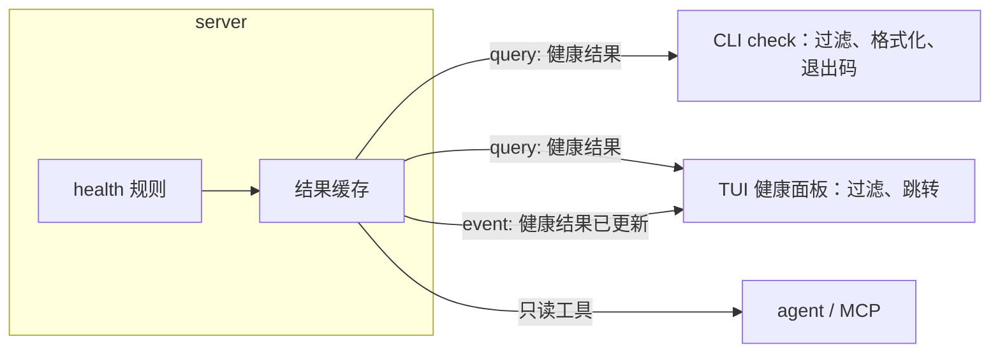

# 健康检查

> 文档状态：草案 · 最后复核：2026-11-14

> 健康检查只做判定：规则在 server，展示与退出码在 client，两边共享同一份结果。

**相关文档**：[server 总览](README.md) · [索引](index.md) · [文档历史](history.md) · [Git](git.md) · [架构 13.3](../../architecture.md#133-搜索体检与-agent) · [devPlan 4.2](../../devPlan.md#42-mvp2-深度阅读与审阅)

**目录**

- [1 职责与非职责](#1-职责与非职责)
- [2 规则边界](#2-规则边界)
- [3 输入与依赖](#3-输入与依赖)
- [4 执行方式](#4-执行方式)
- [5 结果模型](#5-结果模型)
- [6 TUI 与 CLI 的使用](#6-tui-与-cli-的使用)
- [7 异常与降级](#7-异常与降级)
- [8 关键取舍](#8-关键取舍)
- [9 验证方法](#9-验证方法)
- [10 待确认事项](#10-待确认事项)

## 1 职责与非职责

职责（`基线`：[架构 5.2](../../architecture.md#52-services) “断链、过期、孤立、缺失元数据等规则”）：

- 定义并执行健康规则，产出结构化结果（问题列表 + 汇总）；
- 支持全工作区检查与按路径范围检查；
- 文件变化后对受影响文档增量重算，并通知 client；
- 保证同一输入下结果确定、排序稳定。

非职责：

- 退出码、`--fail-on`、`--severity` 的展示过滤、人类可读格式：`mdctrl-cli` 负责（PR #5 草案）；
- 健康面板交互：`mdctrl-tui` 负责；
- 自动修复：不在当前范围；修复建议可以由 agent 以提案形式提出，走[写入路径](write-path.md)；
- 外部 URL 可达性检查：不在当前范围（检查不访问网络，与 PR #5 草案“外部渲染与网络不在数据命令中发生”一致）。

当前状态：未实现；属于 MVP2 范围。PR #5 草案把健康面板归入 MVP2，与 [devPlan 4.2](../../devPlan.md#42-mvp2-深度阅读与审阅) 一致。

## 2 规则边界

规则 id 与默认严重度采用 PR #5 CLI 草案提出的候选值（`建议`，需本文 owner 与 clients 双方确认后固化到 protocol，HLT-1）：

| 规则 id | 默认严重度 | 判定 | 检查范围之外 |
| --- | --- | --- | --- |
| `broken-link` | error | 内部相对链接指向的文件不存在；或锚点在目标文档中不存在；或链接越出工作区根、指向内部状态目录 | 外部 URL；目标位于扫描失败区域时状态未知，不报断链；被 `exclude` 排除的目标（见 HLT-3）；代码块与行内代码中的“链接” |
| `orphan` | info | 没有来自其他文档的入链，且不在入口文档列表中 | 自身链接自身不算入链；入口文档由配置给出 |
| `stale` | warning | 距离“最近复核时间”超过配置周期 | 生命周期为已归档的文档不检查 |
| `missing-metadata` | warning | 缺少配置要求的 frontmatter 字段 | 未配置必需字段时规则不产生结果 |

各规则的细节（`建议`）：

- **`broken-link`**：链接解析规则与 render 的跳转实现一致（相对文档所在目录、URL 解码、锚点标识规则见 IDX-1）；链接到图片、其他文件时同样检查存在性；越界链接单独给出原因，不读取越界目标；
- **`orphan`**：入口文档默认包括工作区根的 `README.md`，可通过 `[health]` 配置的 glob 列表扩展（如 `docs/README.md`）；被 `.gitignore` 排除的文档不参与；
- **`stale`**：“最近复核时间”的来源按优先级取：frontmatter 中配置的复核字段 → history 的 `last_changed_at` 或 Git 最近提交时间（二选一由配置决定，默认使用较新的一个）。**发现的问题**：本仓库自己的文档在正文头部用 `> 文档状态：… · 最后复核：YYYY-MM-DD` 记录复核日期，而不是 frontmatter；只支持 frontmatter 会让项目自身的文档无法被正确检查。是否支持可配置的头部模式提取需要确认（HLT-2）；
- **`missing-metadata`**：必需字段按 glob 分组配置（如 `docs/**` 要求 `status`、`reviewed`）；字段存在但为空视为缺失；
- 生命周期状态（如草案、已确认、已归档）的字段名与取值由 core 的生命周期模型定义（foundation，Issue #2），health 只消费。

规则参数来自 `mdctrl.toml` 的 `[health]`，不在命令行重复定义（与 PR #5 一致）。

## 3 输入与依赖

| 输入 | 来源 | 用于 |
| --- | --- | --- |
| 链接图、锚点 | [index](index.md#2-数据与存储) | `broken-link`、`orphan` |
| 文档清单 | [workspace](workspace.md) | 全部规则的范围 |
| frontmatter 与生命周期字段 | render 解析 → history `lifecycle` 快照 | `stale`、`missing-metadata` |
| 最近变更、最近提交 | [history](history.md#5-查询)（含 Git 快照） | `stale` |
| 规则参数 | `mdctrl.toml` `[health]` | 全部规则 |

health 不直接读取文件系统或调用 Git，全部输入经由上述模块，保证结果与索引、历史一致。

## 4 执行方式

| 方式 | 触发 | 范围 |
| --- | --- | --- |
| 全量检查 | CLI `check`、TUI 显式刷新 | 全工作区或指定路径 |
| 增量重算 | 索引更新后的“受影响集合”（[index 4.1](index.md#41-刷新管线)） | 受影响文档 |
| 配置变化 | `[health]` 配置变化 | 全工作区 |

规则（`建议`）：

- 全量检查前确认索引版本；索引有待处理变化时，先等待增量更新完成（有超时），或在结果中标注“基于索引版本 N，索引滞后”；
- 结果在内存中缓存，按文档存储，增量重算时替换对应文档的问题；健康结果属于可重建状态，不持久化（是否为 TUI 快速启动缓存到 `cache/` 见 HLT-4）；
- 每个问题有稳定标识：`规则 id + 路径 + 源位置 + 目标`，用于前后两次结果的比较与后续的“忽略”功能；
- `stale` 依赖当前时间，结果中记录检查时间，同一时间点的结果确定。

## 5 结果模型

PR #5 CLI 草案提出了 `check` 的 JSON 信封与字段。server 侧语义承诺（`建议`）：

| 字段语义 | server 承诺 |
| --- | --- |
| 问题：规则、严重度、路径、行列、消息、目标、相关项 | 由 server 生成；行列从 1 开始，未知时为空；路径为工作区相对路径 |
| 排序 | 严重度降序、路径升序、行号升序（与 PR #5 一致），server 返回时即已排序 |
| 汇总 | 按严重度、按规则的完整计数；始终基于完整结果，不受展示过滤影响 |
| 截断 | server 接受数量上限，超过时截断问题列表并标记，汇总保持完整 |
| 范围 | 回显检查的路径与规则 |
| 数据来源说明 | 新增建议：标注索引版本、Git 是否可用（影响 `stale` 精度）、检查时间（HLT-5） |

展示层过滤（`--severity`）由 CLI 在 server 结果上进行，还是作为查询参数传给 server，均不影响汇总语义；建议作为查询参数传给 server，减少大结果集的传输（HLT-6）。

消息文本使用英文且不保证稳定，脚本应依赖规则 id 与严重度（与 PR #5 一致）。

## 6 TUI 与 CLI 的使用

- CLI 与 TUI 使用同一查询与同一规则，保证两边一致（PR #5 草案的一致性要求）；
- TUI 订阅“健康结果已更新”事件，事件只携带受影响路径与计数，TUI 需要时再查询详情；
- agent 与 MCP 通过只读工具读取健康结果，作为审阅工作流的上下文（[agent-mcp.md](agent-mcp.md#7-只读工具)）。

## 7 异常与降级

| 情况 | 行为 |
| --- | --- |
| 索引不可用 | 返回 `index_unavailable`（PR #5：CLI 退出码 4） |
| 索引构建中 | 使用旧索引检查并在结果中标注；无旧索引则返回 `index_unavailable` |
| 配置无效 | 返回 `config_invalid`（PR #5：CLI 退出码 3） |
| Git 不可用 | `stale` 只使用 history 时间，结果中说明 |
| 单篇文档 frontmatter 解析失败 | 对该文档产生一条诊断（规则 id 待定，见 HLT-7），继续其他文档 |
| 结果过大 | 截断问题列表，汇总完整 |

## 8 关键取舍

- **health 不直接读文件**：结果与索引、历史一致；代价是索引滞后时结果也滞后，需要标注索引版本。
- **外部链接不检查**：检查可离线、可重复；代价是外部断链发现不了，后续可作为显式联网选项。
- **规则 id 稳定、消息不稳定**：脚本可依赖；代价是消息改进不能用于机器判断。

## 9 验证方法

- 示例仓库夹具包含四类问题的正例与反例，期望清单作为快照（对应 [devPlan 4.2](../../devPlan.md#42-mvp2-深度阅读与审阅) 验收“四类健康问题与期望清单一致”）；
- 链接解析边界：URL 编码、CJK 锚点、全角标点标题、相对路径 `..`、越界链接、链接到目录；
- 增量重算与全量检查结果一致（属性测试：随机修改序列后比较）；
- `stale` 在 Git 可用与不可用两种环境下的行为；
- 结果排序与截断。

## 10 待确认事项

- **HLT-1**（`silkage15`）：采用 PR #5 中的四个规则 id 与默认严重度；`orphan` 默认 info 是否合适。
- **HLT-2**（三人）：`stale` 是否支持从正文头部（如本仓库的 `最后复核：` 行）提取复核日期；支持则需要在 `[health]` 中配置提取模式。
- **HLT-3**（`ylgd0915`）：链接到被 `exclude` 或 `.gitignore` 排除的现存文件，算断链还是正常。建议正常（文件存在），可选规则提示。
- **HLT-4**（`silkage15`）：健康结果是否缓存到 `cache/` 以加快 TUI 启动。建议 MVP2 不缓存。
- **HLT-5**（`silkage15`、`field`）：结果中增加数据来源说明（索引版本、Git 可用性、检查时间）。
- **HLT-6**（`silkage15`）：严重度过滤作为 server 查询参数还是 CLI 本地过滤。
- **HLT-7**（`silkage15`）：frontmatter 解析失败是否作为第五类诊断（如 `invalid-metadata`）输出，还是并入 `missing-metadata`。
