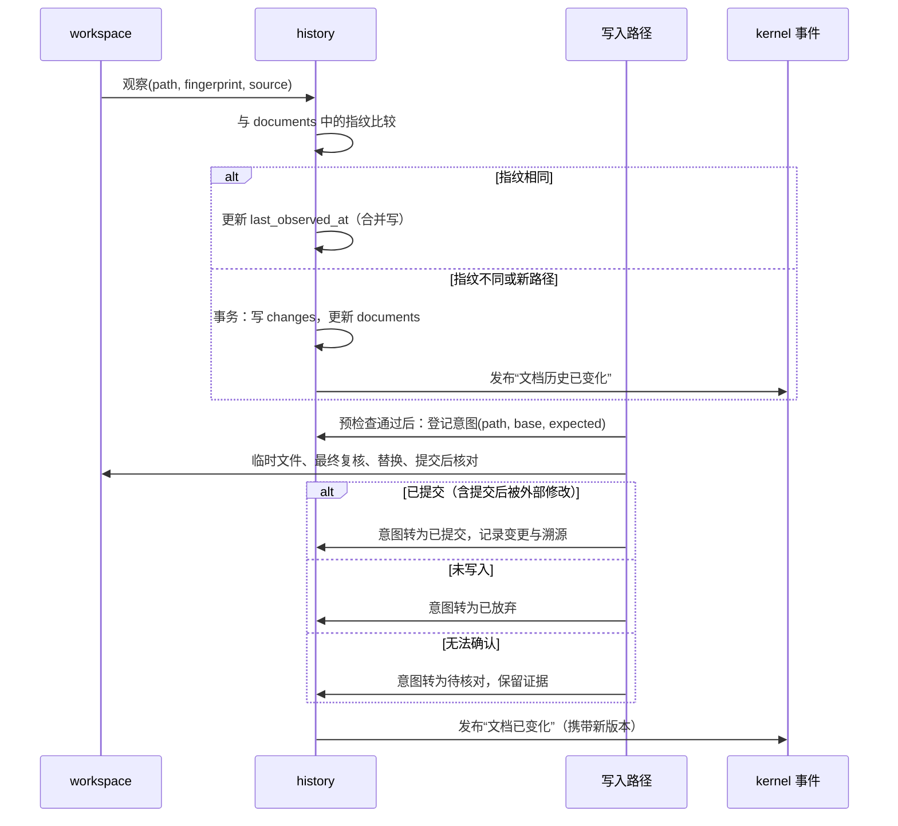

# 文档历史

> 文档状态：草案 · 最后复核：2026-11-14

> 文档历史记录“server 观察到了什么、何时、因何变化”；正文在工作区，版本信息在 Git，历史把两者在本地串起来。

**相关文档**：[server 总览](README.md) · [工作区](workspace.md) · [Git](git.md) · [写入路径](write-path.md) · [索引](index.md) · [架构 6.3](../../architecture.md#63-文档历史) · [技术选型 7](../../techStack.md#7-存储与文档历史)

**目录**

- [1 职责与非职责](#1-职责与非职责)
- [2 与正文、Git、缓存的关系](#2-与正文git缓存的关系)
- [3 数据模型](#3-数据模型)
  - [3.1 文档身份](#31-文档身份)
  - [3.2 内容指纹](#32-内容指纹)
  - [3.3 时间](#33-时间)
  - [3.4 变更来源](#34-变更来源)
  - [3.5 存储结构](#35-存储结构)
- [4 更新流程](#4-更新流程)
- [5 查询](#5-查询)
- [6 Git 元数据合并](#6-git-元数据合并)
- [7 持久化与可重建缓存](#7-持久化与可重建缓存)
- [8 异常流程](#8-异常流程)
- [9 模块接口](#9-模块接口)
- [10 关键取舍](#10-关键取舍)
- [11 验证方法](#11-验证方法)
- [12 待确认事项](#12-待确认事项)

## 1 职责与非职责

职责：

- 记录每篇文档的路径、内容指纹、首次发现、最近观察、最近变更（`基线`，[架构 6.3](../../architecture.md#63-文档历史)）；
- 记录每次变更的来源、观察时间与变更前后指纹；
- 保存写入的溯源信息（来源、模型、时间等，[架构 11](../../architecture.md#11-agent-与-mcp)）；
- 合并 Git 元数据，形成统一的文档历史视图；
- 为 view（生命周期提示）、health（过期规则）、agent（上下文）提供查询。

非职责：

- 不保存文档正文（`基线`：“文档历史保存元数据，正文以工作区文件为准”）；
- 不读取 Git：由 [git 模块](git.md)获取后交给 history 合并；
- 不决定写入是否发生：由[写入路径](write-path.md)决定，history 只记录结果；
- 历史模型的领域类型由 `mdctrl-core` 定义（foundation，Issue #2，`ylgd0915` 参与），本文描述 server 侧的存储与流程。

当前状态：未实现。存储选型为 SQLite（`基线`，[技术选型 7.1](../../techStack.md#71-存储选择)）；文档历史 schema 为“待微型验证”（[技术选型 7.3](../../techStack.md#73-验证状态)）。

## 2 与正文、Git、缓存的关系

| 信息 | 事实来源 | history 的角色 |
| --- | --- | --- |
| 文档正文 | 工作区文件 | 不保存，只保存指纹 |
| 路径与当前指纹 | 工作区文件 | 记录最近一次观察到的值 |
| 首次发现、最近观察、最近变更 | history | 唯一来源，删除后无法恢复 |
| 变更来源与溯源 | history | 唯一来源 |
| 提交、作者、提交时间 | Git | 保存派生快照，可随时从 Git 重新获取 |
| 工作区状态与差异 | Git 可用时为 Git；否则为 history 的前后指纹 | Git 缺失时只能给出“指纹变了”，无法给出内容差异 |
| 生命周期元数据 | frontmatter + history | 保存 frontmatter 解析结果的快照，供过期规则使用 |
| 索引、健康结果 | 派生 | 不在 history 中 |

关键点：Git 缺失时，history 只能记录“变更前后指纹”，**不能重建内容差异**；只有经由 server 写入的变更，在写入那一刻同时持有旧内容与新内容，可以生成 diff（diff 属于[写入路径](write-path.md)的产物，是否持久保存见 HIS-5）。

## 3 数据模型

本节字段与结构均为 `建议`，未被基线确认，不构成公共契约。

### 3.1 文档身份

- 以规范化的工作区相对路径作为文档身份键；
- **默认不迁移历史**：路径 A 消失、路径 B 出现时，分别记录 A 的删除与 B 的新建；B 的首次发现时间为观察到它的时间，A 的历史保留在 A 名下；
- **相同指纹只是可能关联的证据**：去抖窗口内“A 消失、B 出现且指纹相同”也可能是两个无关操作（删除一个模板、复制出另一个同内容文件；多个文件内容相同）。这种情况只在 `identity_links` 中记录一条“候选关联”（A、B、证据、时间），查询时作为“可能由 A 重命名而来（未确认）”的提示，不改写任何历史；
- **确认身份延续需要额外依据**，至少满足其一（`建议`）：
  - 重命名由 server 自己执行（如未来的重命名提案，见 WR-5），server 确知前后路径；
  - core 文档身份模型中的稳定标识（如 frontmatter id）在 A、B 上一致（依赖 HIS-1）；
  - 用户显式确认；
  - 文件系统重命名事件成对出现且指向同一文件身份（如 inode / 文件索引）——平台差异大，作为证据前需要验证（`待验证`）；
- Git 报告的重命名基于内容相似度判断，同样只作为候选证据，不单独确认；
- 确认后不搬移或改写 A 的记录，而是记录“B 延续自 A”的关联，使查询可以把两段历史串起来，也可以撤销；
- 多个候选同时成立（多个同指纹文件被删除或被创建）时，不选择任何一个，只保留候选列表；不确定就保留不确定性。

### 3.2 内容指纹

- 对文件原始字节计算哈希，不做换行或编码归一化：版本检查需要精确判断“磁盘上的内容是否与基准一致”；
- 哈希算法待定。标准库没有稳定的密码学哈希实现，选择算法意味着新增依赖，需要说明用途、许可证与体积并获得人工确认（HIS-2）；
- 指纹同时作为写入路径的版本检查依据（见 [write-path.md](write-path.md#6-版本检查与冲突)），以及索引增量更新的跳过依据（见 [index.md](index.md#4-增量更新与刷新流程)）。

### 3.3 时间

| 字段 | 含义 | 注意 |
| --- | --- | --- |
| `first_seen_at` | server 第一次观察到该路径 | 不等于文件创建时间 |
| `last_observed_at` | 最近一次确认指纹 | 频繁更新，见 §4 的合并策略 |
| `last_changed_at` | 最近一次观察到指纹变化 | 是“观察到变化的时间”，不是“变化发生的时间” |
| `observed_at`（变更记录） | 该次变化被观察到的时间 | 启动对账时，变化实际发生在上次观察与本次之间 |
| 文件修改时间 | 文件系统提供 | 只作参考，可被工具改写，不作为事实 |

时间统一以 UTC 存储，序列化为 RFC 3339（与 PR #5 CLI 草案一致）。系统时钟回拨时不修正历史，只保证单条记录内部的一致性。

### 3.4 变更来源

| 来源（候选） | 含义 | 溯源 |
| --- | --- | --- |
| `initial_scan` | 首次初始化时发现 | 无 |
| `reconcile` | 启动对账发现离线期间的变化 | 无，或匹配未完成的写入意图 |
| `watch` | 运行期间监听到外部变化（编辑器、Git、其他工具） | 无；可附加 Git 上下文（如“分支切换期间”） |
| `server_write` | 经写入路径落盘 | 必有：操作者类型、标识、提案 id 等 |

`server_write` 的溯源细分为人工编辑、agent、插件、MCP（未来），字段见 [write-path.md](write-path.md#8-溯源)。

### 3.5 存储结构

`基线`：历史与索引使用独立数据库文件，索引可以重建，历史持久保存（[技术选型 7.2](../../techStack.md#72-文档历史)）。

建议位置：`.mdctrl/history/history.db`。建议的表：

| 表 | 主要列 | 性质 |
| --- | --- | --- |
| `meta` | schema 版本、创建时间、程序版本 | 持久 |
| `documents` | 路径、当前指纹、大小、首次发现、最近观察、最近变更、状态（存在 / 不可访问 / 已删除） | 持久 |
| `changes` | 变更 id、路径、观察时间、类型（新建 / 修改 / 删除）、前后指纹、来源、溯源 id | 持久，追加写 |
| `identity_links` | 前路径、后路径、类型（候选 / 已确认）、证据（相同指纹、server 重命名、稳定标识、用户确认等）、时间 | 持久 |
| `provenance` | 溯源 id、操作者类型与标识、工作流、provider、模型、提案 id、审批会话、时间、基准指纹、预期新指纹、状态（意图 / 已提交 / 已放弃 / 待核对） | 持久 |
| `lifecycle` | 路径、frontmatter 中生命周期字段的解析快照、解析时间 | 派生，可由重新解析恢复 |
| `git_snapshot` | 路径、最近提交、作者、提交时间、工作区状态、刷新时间 | 派生，可由 Git 恢复 |

`lifecycle` 与 `git_snapshot` 是派生数据，放在历史库是为了让查询一次取全；它们可以清空重建，不参与备份必要性判断（HIS-3）。

## 4 更新流程

规则（`建议`）：

- **观察合并**：只更新 `last_observed_at` 的操作在内存中合并，按时间间隔或关闭时批量提交，避免每次打开文档都写盘；
- **变更事务**：`changes` 追加与 `documents` 更新在同一事务中提交；
- **事件顺序**：history 提交成功后才发布“文档已变化”，保证 client 收到事件时能查询到新的历史；
- **写入意图**：写入路径在预检查通过后、写临时文件之前登记“意图”（目标路径、基准指纹、预期新指纹、溯源），结束时按 [write-path 7](write-path.md#7-原子写入) 的结果转为已提交、已放弃或待核对；
- **未完成意图的对账**：进程在提交阶段中断后，下次启动读取目标当前指纹：
  - 等于预期新指纹：归因到该意图，转为已提交；
  - 等于基准指纹：替换未发生，转为已放弃；
  - 两者都不等：无法判断是“已写入后又被外部修改”还是“未写入且已被外部修改”，转为待核对，变更按 `reconcile` 来源记录且不归因，向 client 报告；
- **启动对账**：扫描结果与 `documents` 比较，规则受扫描完整性约束（扫描报告见 [workspace 7](workspace.md#7-扫描与忽略规则)）：
  - 新路径记为新建，指纹不同记为修改，来源 `reconcile`；
  - 已知文档只有在其所在目录本次被成功列出且文件不在其中，或单独确认“文件不存在”时，才记为删除；
  - 位于扫描失败区域（权限错误、临时不可访问）或读取失败的文档，状态改为“不可访问”，不追加删除记录，`last_observed_at` 不更新；之后成功访问时恢复为“存在”，指纹不同才记为修改；
- **删除**：文档删除后保留 `documents` 行（状态为已删除）与全部 `changes`，便于恢复或审计；同一路径再次出现时恢复为“存在”并记一条新建变更。

## 5 查询

| 查询（候选） | 使用方 | 返回 |
| --- | --- | --- |
| 文档历史摘要 | view（生命周期提示）、TUI | 首次发现、最近观察、最近变更、最近提交、生命周期字段 |
| 变更列表 | TUI、agent | 某文档的变更记录，按时间倒序，可分页 |
| 最近变化文档 | TUI、agent | 时间窗口内有变更的文档 |
| 溯源详情 | TUI、审计 | 某次写入的操作者、模型、时间、提案 |
| 身份关联 | TUI、agent | 某路径的候选关联与已确认延续，候选项明确标注“未确认” |
| 待核对写入 | TUI | 状态为待核对的写入意图及其证据 |
| 过期判断输入 | health | 最近变更时间、最近提交时间、生命周期字段 |

查询只读历史库，不触发 Git 调用；Git 快照过期时返回已有快照并标注刷新时间。

## 6 Git 元数据合并

Git 元数据的获取与刷新见 [git.md](git.md)。合并规则（`建议`；“本地历史合并”为技术选型中的待微型验证项，[技术选型 9.4](../../techStack.md#94-验证状态)）：

- Git 快照按路径覆盖写入 `git_snapshot`，不改写 `documents` 与 `changes`；
- 展示“最近变更”时同时提供两类时间：history 的观察时间与 Git 的提交时间，由使用方选择；health 的过期规则使用哪一个，见 [health.md](health.md#2-规则边界)；
- Git 显示文件未修改而 history 记录了指纹变化：以 history 为准（例如 `git stash` 后恢复、换行转换），不认为冲突；
- Git 不可用时 `git_snapshot` 为空或保留最后一次快照并标注过期（HIS-4），history 其他功能不受影响（`基线`，[架构 6.3](../../architecture.md#63-文档历史)）。

## 7 持久化与可重建缓存

| 类别 | 内容 | 删除后果 | 恢复方式 |
| --- | --- | --- | --- |
| 持久 | `documents`、`changes`、`provenance` | 观察时间与溯源永久丢失 | 只能从备份恢复；可以用扫描与 Git 重新播种，但观察时间会变成“现在” |
| 派生（在历史库内） | `lifecycle`、`git_snapshot` | 无 | 重新解析、重新读取 Git |
| 可重建缓存 | `.mdctrl/cache/` 下的索引、媒体 | 无 | 重建 |

持久化规则（`建议`）：

- **schema 版本**：`meta` 表记录版本；程序启动时比较，较旧则迁移，较新则拒绝启动（`schema_unsupported`）；
- **迁移前备份**：迁移前复制历史库到 `.mdctrl/history/` 下带时间戳的备份文件，保留最近若干份；
- **完整性检查**：打开时执行轻量完整性检查；失败时把损坏文件改名保留（不删除），新建空库并重新播种，向 client 报告“历史已重置”，不静默处理（技术选型回退为“历史备份”，[技术选型 7.3](../../techStack.md#73-验证状态)）；
- **增长控制**：`changes` 只记录指纹变化，纯观察不追加记录；保留策略（时间或条数上限）由 `mdctrl.toml` 的 `[history]` 配置，默认不清理（HIS-6）；
- **日志模式**：SQLite 的日志模式在 WSL 访问 Windows 盘符路径时的行为需要验证（`待验证`）。

## 8 异常流程

| 情况 | 行为 |
| --- | --- |
| 历史库无法打开（权限、锁、损坏） | 损坏：按 §7 重置并报告；权限：server 不启动 |
| 单次写事务失败 | 重试一次；仍失败则报告并保留内存中的待写记录，下次对账补齐 |
| 文件读取失败导致无法计算指纹 | 状态改为“不可访问”，不记录变更，记录扫描警告 |
| 扫描失败区域内的已知文档 | 状态改为“不可访问”，不记为删除 |
| 重命名识别不确定 | 按删除 + 新建记录，最多记录候选关联，不迁移历史 |
| 写入后提交历史失败 | 文档已写入，历史保留“意图”；下次对账归因（§4） |
| 未完成意图对账时指纹既非基准也非预期 | 意图转为待核对，变更不归因，向 client 报告 |
| 磁盘空间不足 | 停止追加观察，报告；不影响阅读 |

## 9 模块接口

| 方向 | 接口（示意） | 说明 |
| --- | --- | --- |
| workspace → history | `observe(path, fingerprint, source)` | 扫描、对账、监听都走这一入口 |
| 写入路径 → history | `begin_write(intent)` / `commit_write(intent_id, new_fingerprint)` | 写入意图与提交 |
| git → history | `apply_git_snapshot(entries)` | 批量覆盖派生表 |
| history → kernel | 事件“文档历史已变化”“文档已变化” | 供 index、health、session 订阅 |
| view、health、agent → history | 第 5 节的查询 | 只读 |

## 10 关键取舍

- **只存元数据不存正文**：遵守基线，历史库小且不复制敏感内容；代价是 Git 缺失时无法提供内容差异。
- **原始字节指纹**：版本检查精确；代价是只改换行的变更也会被记为修改。
- **写入意图两阶段**：崩溃后仍能归因；代价是多一次事务。
- **不按指纹迁移历史**：避免把首次发现时间与溯源错误归给无关文件；代价是真实重命名在没有额外依据时会显示为删除 + 新建，只附候选提示。
- **扫描失败不等于删除**：避免权限或临时故障造成虚假删除；代价是需要维护“不可访问”状态。
- **派生数据放进历史库**：查询简单；代价是需要明确区分可清空的表与必须备份的表。

## 11 验证方法

| 项目 | 方法 |
| --- | --- |
| schema 与查询性能 | 微型验证：1 万篇文档、10 万条变更下的查询延迟与库体积（对应技术选型“文档历史 schema 待微型验证”） |
| 身份关联 | 真实重命名（`mv`、编辑器、`git mv`）只产生候选关联；重复模板（删除模板 A、从另一模板复制出同内容 B）、多个同内容文件同时新建、删除与复制同时发生，都不迁移历史，多候选时不选择任何一个 |
| 写入意图归因 | 故障注入：在替换后、提交前终止进程，重启后归因为已提交；在替换前终止，归为已放弃；终止后再注入外部修改，归为待核对 |
| 对账 | 离线修改、删除、新增文件后启动，检查来源与时间 |
| 不完整扫描 | 目录权限失败时，其下已知文档变为“不可访问”而非删除；权限恢复后状态恢复且不产生虚假变更 |
| 损坏恢复 | 人为截断数据库文件，检查改名保留、重置与报告 |
| Git 缺失 | 在非 Git 目录与无 `git` 可执行文件的环境运行 |

## 12 待确认事项

- **HIS-1**（`field`）：core 的文档身份是否只用路径？是否预留 frontmatter id 等稳定标识？身份延续（“B 延续自 A”）在 core 模型中如何表达？history 只在 §3.1 列出的依据下确认延续。
- **HIS-2**（三人）：内容指纹的哈希算法与对应依赖（需新增依赖确认）。
- **HIS-3**（`ylgd0915`）：`lifecycle`、`git_snapshot` 放在历史库还是放在 `cache/`。放在 `cache/` 更符合“可重建”的分类，代价是查询需要跨库。
- **HIS-4**（`ylgd0915`）：Git 变得不可用时，是清空 `git_snapshot` 还是保留并标注过期。建议保留并标注。
- **HIS-5**（`ylgd0915`）：经 server 写入时生成的 diff 是否持久保存到历史库？保存有助于 Git 缺失时回看，但会在本地复制正文片段。建议默认不保存，可配置。
- **HIS-6**（三人）：历史保留策略的默认值。
