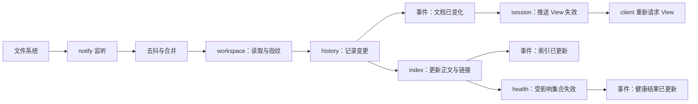

# 索引

> 文档状态：草案 · 最后复核：2026-11-14

> 索引是可以随时丢弃的派生数据：它让搜索、反链与健康检查变快，但从不成为事实来源。

**相关文档**：[server 总览](README.md) · [工作区](workspace.md) · [文档历史](history.md) · [健康检查](health.md) · [技术选型 8](../../techStack.md#8-索引与搜索) · [技术选型 9](../../techStack.md#9-文件监听与-git-元数据)

**目录**

- [1 职责与非职责](#1-职责与非职责)
- [2 数据与存储](#2-数据与存储)
- [3 扫描与初次建立](#3-扫描与初次建立)
- [4 增量更新与刷新流程](#4-增量更新与刷新流程)
  - [4.1 刷新管线](#41-刷新管线)
  - [4.2 事件顺序与一致性](#42-事件顺序与一致性)
  - [4.3 监听异常](#43-监听异常)
- [5 查询](#5-查询)
- [6 重建与状态](#6-重建与状态)
- [7 中文检索](#7-中文检索)
  - [7.1 默认方案与依据](#71-默认方案与依据)
  - [7.2 两字查询验证需求](#72-两字查询验证需求)
  - [7.3 回退路径](#73-回退路径)
- [8 异常与降级](#8-异常与降级)
- [9 与 client 的接口](#9-与-client-的接口)
- [10 关键取舍](#10-关键取舍)
- [11 验证方法](#11-验证方法)
- [12 待确认事项](#12-待确认事项)

## 1 职责与非职责

职责（`基线`：[架构 5.2](../../architecture.md#52-services) “全文索引、链接图与查询”）：

- 全文索引：正文、路径、标题、元数据字段；
- 链接图：文档间链接、反链、锚点；
- 文件名与路径模糊查找；
- 增量更新、全量重建与索引状态；
- 文件变化后驱动索引更新，并把结果通知 health 与 client。

非职责：

- Markdown 解析：调用 `mdctrl-render`，索引只消费解析结果；
- 健康规则：由 [health](health.md) 基于链接图判断；
- 结果展示、查询去抖与再过滤：client 负责（PR #5 TUI 草案）；
- 文件读取与监听：由 [workspace](workspace.md) 提供变化流，索引只订阅。

当前状态：未实现；所有方案停留在技术选型的桌面核查层面，见 [§7](#7-中文检索)。

## 2 数据与存储

`基线`：SQLite FTS5；保存全文、路径、标题与元数据字段；增量更新使用文件元数据与内容指纹；索引可以删除重建（[技术选型 8.1](../../techStack.md#81-索引)）；索引与历史使用独立数据库文件（[技术选型 7.2](../../techStack.md#72-文档历史)）。

建议位置：`.mdctrl/cache/index.db`。建议的表（`建议`）：

| 表 | 内容 |
| --- | --- |
| `index_meta` | 索引 schema 版本、分词器标识与版本、索引版本（单调计数；不是 client 的请求代次 `generation`）、建立时间 |
| `docs` | 路径、已索引指纹、索引时间、标题 |
| `fts`（FTS5 虚表） | 路径、标题、各级标题、正文纯文本、元数据文本 |
| `blocks` | 文档内块的纯文本偏移到源行号的映射，用于把命中片段定位回源文件 |
| `links` | 源文档、原始目标、解析后目标、锚点、源位置、类型（内部文档 / 内部资源 / 外部 URL） |
| `anchors` | 文档、锚点标识、标题文本、源位置 |

文件名模糊查找使用 `nucleo`（`基线`，[技术选型 8.3](../../techStack.md#83-模糊查找)），在内存中对 workspace 文档清单匹配，不写入数据库，因此在全文索引不可用时仍然可用。

索引输入依赖 `mdctrl-render` 提供（需与 `field` 协商，IDX-1）：

- 去除 Markdown 标记后的纯文本，以及块到源行号的映射；
- 标题列表与锚点标识（锚点生成规则需与 render 的跳转实现一致）；
- 链接列表及源位置；
- frontmatter 解析结果。

## 3 扫描与初次建立

1. 订阅 workspace 的初始扫描结果（文档清单 + 指纹 + 扫描报告，见 [workspace 7](workspace.md#7-扫描与忽略规则)）；
2. 打开 `index.db`：不存在则创建；`index_meta` 中的 schema 或分词器与当前不一致则转为全量重建（§6）；
3. 对清单中每篇文档比较 `docs.已索引指纹`：相同则跳过，不同或不存在则读取、解析、写入；
4. 已索引但不在本次清单中的文档：只有当扫描报告表明其所在目录已成功列出（确认不存在）时才从索引删除；位于失败区域或读取失败的文档保留原索引项并标记为过期，查询结果中标注；
5. 分批提交事务（每批若干文档），每批完成后发布进度事件；
6. 完成后递增索引版本，状态转为 `ready`（扫描不完整时同时标注覆盖不完整，见 IDX-7），发布“索引已更新”。

进度事件的阶段划分（扫描、索引）与 PR #5 CLI 草案的 NDJSON `phase` 字段对应，最终字段由 protocol 定义。

## 4 增量更新与刷新流程

### 4.1 刷新管线

规则（`建议`）：

- **去抖**：同一路径在窗口内的多次事件合并为一次；编辑器原子保存（写临时文件再改名）合并为对目标路径的一次修改（`基线`：处理编辑器原子保存与临时文件，[技术选型 9.1](../../techStack.md#91-文件监听)）；
- **跳过未变化**：指纹与已索引指纹相同则不重建索引条目；
- **删除需确认**：删除事件经 workspace 再次确认文件不存在后才移除索引项；权限错误、临时不可访问只把索引项标记为过期；
- **单一索引写入者**：所有索引写入由一个线程串行执行，读查询使用独立连接；
- **链接图差量**：更新一篇文档时比较新旧链接集合，得出“新增 / 移除的链接目标”；
- **健康受影响集合**：变化文档本身、链接到它的文档（断链可能修复或产生）、它链接到的文档（孤立状态可能改变）；
- **批量变化**：短时间内变化数超过阈值（如分支切换）时，停止逐条处理，改为一次全量对账（比较指纹），减少事件风暴；
- **配置变化**：`[index]` 配置变化（如分词器）触发全量重建；`[workspace].include/exclude` 变化触发清单对账。

### 4.2 事件顺序与一致性

- “文档已变化”在 history 提交后立即发布，**早于**索引更新完成。client 可能先看到新内容、搜索结果仍是旧的；
- 索引维护自己的**索引版本**（`index_meta` 中的单调计数，每次提交一批更新或完成重建时递增），每个查询结果携带索引版本；索引队列非空时，状态查询返回 `stale`；
- 索引版本与 client 的请求代次 `generation`、server 的文档版本是三个独立概念（定义见 [transport 6](transport.md#6-请求与响应)）。索引版本**不**用于 View 的过期判断，也不替代 client 的请求代次；
- 索引更新本身不改变文档版本，也不产生 View 失效。仅当某文档的 View 中包含依赖索引或健康结果的派生内容（如反链计数、断链诊断）且该内容发生变化时，server 才对该文档发送 View 失效事件；client 收到后按自己的规则递增请求代次（PR #5 TUI 草案）。其他情况下视口请求代次不变，已有 View 继续有效；
- 搜索结果的过期丢弃由 client 用自己的查询会话标识完成（PR #5 TUI 草案“查询带会话标识，过期响应丢弃”），server 原样回传该标识。

### 4.3 监听异常

| 情况 | 行为（建议） |
| --- | --- |
| 监听器无法启动 | 扫描后执行校准，此后周期性对账（`基线` 回退：轮询监听），状态中标注“监听不可用”；交接顺序见 [workspace 5](workspace.md#5-生命周期) |
| 事件队列溢出或丢事件（含初始扫描期间的缓冲区溢出） | 触发一次全量对账 |
| 对账时目录不可访问 | 该区域索引项标记过期，不删除 |
| WSL 访问 Windows 盘符路径时事件不可靠 | `待验证`（[技术选型 9.4](../../techStack.md#94-验证状态)：notify 的 WSL 行为待微型验证）；必要时对该类路径默认使用轮询 |
| 单篇文档解析失败 | 该文档以纯文本降级入索引或跳过，记录错误，不影响其他文档 |

## 5 查询

| 查询（候选） | 输入 | 输出 |
| --- | --- | --- |
| 全文搜索 | 查询串、路径范围、数量上限、偏移、client 的查询会话标识 | 命中列表（路径、行号、片段、高亮范围、得分、命中文档是否过期）、总数、截断标记、索引版本、原样回传的会话标识 |
| 文件名查找 | 查询串、数量上限 | 路径候选与匹配位置 |
| 反链 | 文档路径 | 链接到该文档的源文档与源位置 |
| 出链 | 文档路径 | 链接目标与解析状态 |
| 锚点解析 | 文档路径 + 锚点 | 源位置或未找到 |
| 索引状态 | — | 状态、文档数、索引版本、更新时间、覆盖是否完整、最近错误 |

规则（`建议`）：

- **排序**：BM25 + 字段权重（标题高于正文），路径权重作为补充（`基线`，[技术选型 8.2](../../techStack.md#82-中文检索)）；排序规则属于契约，同分时按路径升序，保证稳定；
- **片段定位**：FTS5 片段基于索引文本偏移，通过 `blocks` 映射回源行号；映射精度在表格、列表等结构中需要验证（`待验证`）；
- **查询安全**：用户输入不直接拼入 FTS5 `MATCH` 表达式。通过分词器提供的查询构造函数（如 `libsimple` 的 `simple_query` / `jieba_query`）生成表达式，所有值使用参数绑定；无法构造时把输入当作短语处理，不把 FTS 语法错误暴露为内部错误；
- **结果上限**：默认上限与截断标记与 PR #5 的 `truncated` 语义一致；
- **只读**：查询不触发索引写入；索引缺失时返回 `index_unavailable`，不隐式开始构建（是否在查询时自动构建见 IDX-4）。

## 6 重建与状态

重建流程（`建议`，与 PR #5 CLI 草案的“保留旧索引，临时构建后原子替换”一致）：

1. 检查是否已有索引任务在运行；有则立即返回 `index_busy`，不排队（与 PR #5 一致）；
2. 在 `.mdctrl/cache/tmp/` 创建新库，使用当前分词器与 schema 全量构建；扫描报告不完整时，失败区域内的文档从旧索引复制过来并标记过期，不因重建而消失；
3. 构建期间旧索引继续提供查询；期间到达的文件变化记录到待处理队列；
4. 校验新库：完整性检查、文档数与清单一致、抽样查询可执行；
5. 切换：暂停查询连接，关闭旧库，用新库替换 `index.db`，重新打开，递增索引版本；
6. 应用待处理队列中的变化（按指纹比较补齐）；
7. 失败时删除临时库，继续使用旧索引，记录 `last_error`。

切换注意：Linux 上可以在打开的文件上执行改名替换；Windows 上被打开的文件通常无法被替换，必须先关闭所有连接（`待验证`）。

重建触发：用户命令、`index_meta` 中的 schema 或分词器不匹配、完整性检查失败、索引文件缺失。

状态模型（PR #5 候选值：`missing`、`building`、`ready`、`stale`、`error`）。**发现的问题**：重建期间旧索引仍可读，单一 `state` 无法同时表达“可读”与“正在构建”。建议拆为两个字段（IDX-3）：

| 字段 | 取值 |
| --- | --- |
| `state`（可读索引的状态） | `missing`、`ready`、`stale`、`error` |
| `task`（进行中的任务） | `none`、`building`、`rebuilding`、`updating`，附进度 |

## 7 中文检索

### 7.1 默认方案与依据

以下结论来自[技术选型 8.2 与 8.4](../../techStack.md#82-中文检索)，基于 2026-11-09 复核记录，不代表当前最新：

| 方案 | 角色 | 技术选型记录的状态 |
| --- | --- | --- |
| SQLite FTS5 + `libsimple` 的 `simple` tokenizer | 默认 | 桌面核查通过（存在限制）：0.10.0 MIT，rusqlite 0.32～0.41；两字查询、词典资源、auto-extension 待微型验证 |
| `tantivy` + `tantivy-jieba` | 备选 | 待微型验证：0.27.0 MIT 与 0.21.0 MIT，兼容性待验证 |
| FTS5 trigram + 查询扩展 | 回退 | 桌面核查通过（存在限制）：三字查询命中，两字查询需要扩展 |

server 侧需要额外验证的集成点（`待验证`）：

- `libsimple` 通过 auto-extension 注册到 rusqlite bundled SQLite 的方式，以及与 `SQLITE_ENABLE_FTS5` 的组合；
- 词典资源随发行包分发的路径与加载失败时的行为；
- 拼音匹配是否默认关闭：拼音提高召回，但可能给全文搜索带来噪声，建议默认关闭并作为可选配置；
- 中英混排（如 `FTS5 索引`）、全角标点、全角字母数字的归一化；
- 繁体中文不在 MVP1 验收范围内，只记录行为。

### 7.2 两字查询验证需求

MVP1 验收要求“中文两字与多字查询可用”（[devPlan 4.1](../../devPlan.md#41-mvp1-基础阅读与检索)）。建议的验证设计（测试执行人 `field`，阈值待确认，IDX-5）：

| 项 | 内容 |
| --- | --- |
| 语料 | 本仓库 `docs/` + 中文测试夹具（覆盖技术文档、表格、代码块、中英混排、全角标点） |
| 查询集 | 两字词至少 30 个（如“索引”“历史”“插件”“审批”“布局”“文档”）、三字及以上词、中英混排、纯英文、路径片段 |
| 基准 | 对同一语料做子串匹配，得到“包含该串的文档集合”作为召回上限 |
| 指标 | 召回率（相对子串基准）、前 10 条精确率、p95 查询延迟、索引体积、建库时间 |
| 已知差异 | 分词器可能不在较长词内部切出两字子串（如“文档化”整体成词时，查询“文档”可能不命中），这类差异逐条记录并判断是否可接受，而不是简单视为失败 |
| 结论去向 | 写回[技术选型 8.4](../../techStack.md#84-验证状态)的验证状态表（由技术选型维护者更新）与 MVP1 的 `testing.md` |

### 7.3 回退路径

- 索引模块内部定义搜索后端抽象，FTS5 + `libsimple`、Tantivy、FTS5 trigram 三种实现共享同一组查询与结果类型；后端类型不出现在 protocol 中；
- `libsimple` 两字查询不达标 → 评估 `tantivy` + `tantivy-jieba`（独立索引目录，仍放在 `.mdctrl/cache/`）；
- 两者都不达标或集成成本过高 → FTS5 trigram：三字及以上走 trigram，两字查询走扩展路径（对正文做子串扫描，适合中小仓库，大仓库性能需要标注限制）；
- 运行时 `libsimple` 加载失败 → 记录错误，索引状态为 `error` 并给出原因；是否自动降级到 trigram 见 IDX-6。

## 8 异常与降级

| 情况 | 行为 |
| --- | --- |
| 索引文件缺失 | 状态 `missing`；启动后台构建（启动时）或返回 `index_unavailable`（查询时） |
| 索引损坏 | 状态 `error`，触发重建；重建期间全文搜索不可用，文件名查找可用 |
| 分词器不可用 | 状态 `error`，见 IDX-6 |
| 重建进行中再次请求 | `index_busy` |
| 磁盘空间不足 | 当前事务回滚，状态 `error`，旧数据保留 |
| 查询语法无法构造 | 作为短语查询；仍失败则返回空结果与说明 |
| 扫描不完整 | 索引可用；失败区域内的文档保留并标记过期，状态标注覆盖不完整 |

## 9 与 client 的接口

- TUI 搜索、反链、跳转与 CLI `index status/update/rebuild` 共享第 5、6 节的查询与状态；
- PR #5 草案中由 CLI 定义的退出码（索引不可用或已有构建为 4）依赖 server 返回 `index_unavailable` / `index_busy` 两个类别，见 [README 9](README.md#9-错误模型)；
- 字段名、枚举与信封由 protocol 定义；本文只承诺语义。PR #5 合并前，两边的字段均为候选。

## 10 关键取舍

- **索引与历史分库**：索引可以随时删除重建，不影响历史；代价是跨库查询需要两次访问。
- **文件名查找放在内存**：与全文索引解耦，索引故障时仍能导航；代价是大仓库需要内存中的路径列表。
- **重建时保留旧索引**：查询不中断；代价是磁盘上短时存在两份索引。
- **“文档已变化”先于索引更新发布**：阅读路径不等待索引；代价是搜索结果短暂滞后，需要索引版本与 `stale` 状态说明。

## 11 验证方法

| 项目 | 方法 |
| --- | --- |
| 中文检索 | §7.2 的语料与查询集 |
| 增量更新 | 修改、新建、删除、重命名后检查索引与链接图 |
| 扫描与监听交接 | 初始扫描期间修改已扫描文件、扫描结束前新建文件，索引最终与磁盘一致 |
| 不完整扫描 | 目录权限失败后已索引文档不被删除、标记过期；权限恢复后恢复正常，重建时也不丢失 |
| 监听异常 | 监听启动失败与事件溢出后，全量对账补齐遗漏 |
| 版本概念分离 | 索引更新后索引版本递增，但无派生内容变化的文档不收到 View 失效 |
| 编辑器保存模式 | vim、VS Code 等原子保存的事件序列夹具 |
| 分支切换 | 大量文件同时变化，检查是否转为全量对账 |
| 重建 | 构建中途注入失败，旧索引保留且可查询；Linux 与 Windows 上的替换 |
| 并发 | 构建中再次请求返回 `index_busy` |
| 查询安全 | 含 FTS5 特殊字符、引号、括号、`NEAR`、`*` 的输入不报内部错误 |
| 性能与体积 | 对应技术选型“中文召回与延迟”“索引体积”待微型验证项 |

## 12 待确认事项

- **IDX-1**（`field`）：render 提供给索引的抽取接口：纯文本 + 块到源行映射、标题与锚点、链接、frontmatter；锚点标识规则与跳转实现保持一致。
- **IDX-2**（`field`、`silkage15`）：索引版本是否对外暴露、字段名如何命名，以便与 client 的请求代次 `generation`、文档版本明确区分；搜索请求中 client 查询会话标识的回传字段。三者的定义见 [transport 6](transport.md#6-请求与响应)，本问题只涉及索引版本。
- **IDX-3**（`silkage15`）：索引状态拆为 `state` + `task` 两个字段，替代 PR #5 中单一的 `state`。
- **IDX-4**（`silkage15`）：查询时索引缺失，是返回 `index_unavailable` 还是自动开始构建并返回“构建中”。建议返回错误并在 TUI 提供构建入口（与 PR #5 TUI 草案“索引未建立，提供触发入口”一致）。
- **IDX-5**（`field`）：两字查询验收阈值。建议以子串基准召回率为主要指标，阈值在第一次微型验证后由三人确定，而不是现在拍定数字。
- **IDX-6**（`ylgd0915`）：`libsimple` 运行时不可用时是否自动降级到 trigram。自动降级需要重建索引，建议不自动，给出明确错误与切换配置的提示。
- **IDX-7**（`silkage15`）：索引状态中是否增加“覆盖是否完整”与失败区域摘要，供 `index status` 与 TUI 提示扫描不完整。
