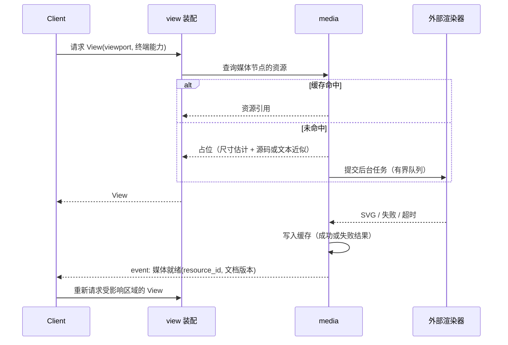

# 媒体

> 文档状态：草案 · 最后复核：2026-11-14

> 媒体资源慢且可能失败，所以它永远不挡住阅读：先给占位，就绪再通知，失败就退回源码。

> 模块 owner：`field`。本文由 `ylgd0915` 起草初稿，待 `field` 评审修订后接管维护。

**相关文档**：[server 总览](README.md) · [工作区](workspace.md) · [传输](transport.md) · [架构 9.2](../../architecture.md#92-主题媒体与缓存) · [技术选型 6](../../techStack.md#6-数学公式与-mermaid)

**目录**

- [1 职责与非职责](#1-职责与非职责)
- [2 与 render、View、client 的边界](#2-与-renderviewclient-的边界)
- [3 处理流程](#3-处理流程)
- [4 公式](#4-公式)
- [5 Mermaid](#5-mermaid)
- [6 图片](#6-图片)
- [7 缓存](#7-缓存)
- [8 后台任务](#8-后台任务)
- [9 资源就绪通知](#9-资源就绪通知)
- [10 降级](#10-降级)
- [11 安全](#11-安全)
- [12 关键取舍](#12-关键取舍)
- [13 验证方法](#13-验证方法)
- [14 待确认事项](#14-待确认事项)

## 1 职责与非职责

职责（`基线`：[架构 5.2](../../architecture.md#52-services) “数学公式、Mermaid 与图片资源”；[架构 9.2](../../architecture.md#92-主题媒体与缓存) “后台生成资源，先占位，就绪后事件替换，能力不足时文本近似或源码”）：

- 从文档模型中识别需要生成资源的媒体节点；
- 调度后台生成任务，管理外部渲染器子进程；
- 按内容哈希缓存资源；
- 在 View 中提供资源引用或降级内容；
- 资源就绪时通知 client。

非职责：

- 终端图片协议编码（kitty、sixel、iTerm2、半块字符）：client 负责（TUI 的栅格化）；
- 媒体节点的识别语法与布局占位尺寸计算：render 负责（需协商，MED-2）；
- 远程图片下载：默认不做；
- 外部渲染器的安装：发布文档说明安装与检测方式（`基线`，[技术选型 12.2](../../techStack.md#122-ci-与发布)）。

当前状态：未实现。MVP1 中公式与 Mermaid 只显示源码或占位，MVP2 提供有限支持，支持矩阵与降级路径是交付的一部分（[devPlan 3](../../devPlan.md#3-范围边界)、[devPlan 4.2](../../devPlan.md#42-mvp2-深度阅读与审阅)）。

## 2 与 render、View、client 的边界

`基线`：server 生成布局，client 栅格化（[AGENTS.md](../../../AGENTS.md) 架构不变量）。

| 环节 | 负责方 | 内容 |
| --- | --- | --- |
| 识别媒体节点 | render | 行内公式、行间公式、Mermaid 代码块、图片引用；带源位置 |
| 行内简单公式的文本近似 | render（建议） | 属于排版问题，不需要外部渲染 |
| 生成资源（SVG / 位图） | server media | 调用外部渲染器、缓存 |
| 在 View 中放置资源 | server view 装配 | 资源引用（标识、尺寸、替代文本）或降级块 |
| 把资源转换为终端图片 | client | 按终端能力选择协议，缩放到 Cell 尺寸 |

**待确认的关键边界（MED-1）**：SVG 转位图在哪一侧？

| 方案 | 说明 | 取舍 |
| --- | --- | --- |
| A server 转位图 | client 在握手或 View 请求中报告单元格像素尺寸，server 按目标尺寸生成 PNG 并缓存 | client 简单；缓存键包含尺寸，终端缩放后需要重新生成 |
| B client 转位图 | server 只提供 SVG，client 自己栅格化 | 尺寸适配灵活；client 需要 SVG 栅格化依赖，TUI 变重 |

建议采用 A：与“server 负责重计算、client 负责终端”的分工一致，技术选型中的 SVG 栅格化库（0.49.0，[技术选型 6.4](../../techStack.md#64-验证状态)）放在 server 侧。大资源通过句柄或文件路径传递，避免大块内联（`基线`，[技术选型 10.1](../../techStack.md#101-通信编码)）。

## 3 处理流程



## 4 公式

`基线`：MathJax 主路线，Typst 备选，原生文本作为行内与回退；链路为“公式源码 → MathJax / Typst → SVG → 栅格化 → 终端图片”（[技术选型 6.1](../../techStack.md#61-数学公式)）。技术选型记录（2026-11-09 复核）：MathJax 4.1.3 Apache，使用 `@mathjax/src`，需要 Node 运行时；Typst 0.15.1，CLI 待安装。

server 侧要点（`建议`）：

- 行内简单公式交给 render 做文本近似；行间公式与复杂行内公式走图片链路；
- MathJax 需要 Node：每个任务启动一次 Node 进程成本较高，常驻 Node 工作进程可以摊薄成本，但增加生命周期管理（`待验证`，MED-3）；
- 主题（明 / 暗）影响前景色，进入缓存键；
- 公式语法错误：缓存失败结果，View 显示源码与错误摘要。

## 5 Mermaid

`基线`：`mermaid-cli` 主路线，源码与占位回退；结果按内容哈希缓存；Puppeteer 与 Chromium 作为 peer 依赖（[技术选型 6.2](../../techStack.md#62-mermaid)）。技术选型记录：`mermaid-cli` 12.2.0 MIT，Node ≥22.13，Puppeteer ^25，Chromium 待安装。

server 侧要点（`建议`）：

- Mermaid 渲染启动无头浏览器，成本高：并发度默认 1，单任务超时较长但有上限；
- 输入通过临时文件传递，不通过命令行参数或 shell；
- 禁止渲染过程访问网络（浏览器参数与 Mermaid 配置均需设置，`待验证`）；
- 浏览器沙箱参数：不使用关闭沙箱的参数运行（某些容器环境可能要求关闭，需要在发布文档中说明风险，`待验证`）。

## 6 图片

- 只加载工作区内的本地图片，路径相对文档目录解析，经 workspace 的**受控资源访问**入口校验（[workspace 8](workspace.md#8-路径校验)）：越界、指向 `.mdctrl/` 或 `.git/`（含经符号链接解析后）的路径拒绝，只允许图片类型；media 不因此获得读取任意内部路径的能力；
- 读取图片时计算其内容指纹，作为缓存输入（§7）并登记依赖（§9）；
- 远程 URL 默认不下载，View 显示替代文本与链接（是否提供显式开关见 MED-4）；
- 设置文件字节上限与像素尺寸上限，防止解压炸弹；超限显示占位与说明；
- 文档中的 SVG 图片同样经过栅格化；SVG 中引用的外部资源不加载；
- 支持的位图格式由所选解码依赖决定（`待验证`）。

## 7 缓存

`基线`：渲染结果按内容哈希缓存（[技术选型 6.2](../../techStack.md#62-mermaid)）；缓存位于 `.mdctrl/cache`，可以随时重建（[架构 6.2](../../architecture.md#62-mdctrl)）。

缓存键按媒体类型区分输入（`建议`）：

| 类型 | 缓存键输入 | 说明 |
| --- | --- | --- |
| 公式、Mermaid | 媒体类型、源码文本、渲染器标识与版本、渲染选项、主题、目标尺寸档位 | 源码嵌在 Markdown 中，正文不变即输入不变 |
| 本地图片 | 媒体类型、**图片文件的内容指纹**、解码 / 栅格化器标识与版本、变换参数（目标尺寸档位、缩放方式、透明背景使用的主题色、SVG 栅格化选项） | Markdown 中只有路径；图片被替换而路径不变时，内容指纹变化，缓存键随之变化 |

```text
公式/Mermaid：hash(类型, 源码, 渲染器与版本, 选项, 主题, 尺寸档位)
本地图片：    hash(类型, 图片内容指纹, 解码/栅格化器与版本, 变换参数)
```

- 图片路径不进入缓存键：同一内容的图片在多个路径或多个文档中共享缓存条目；路径只用于依赖关系（§9）；
- 内容指纹与 history 使用同一算法（HIS-2）；为避免反复对大图片做哈希，可以用文件大小与修改时间作为“可能未变”的快速判断，但收到变化事件或打开文档时必须以内容指纹为准（修改时间不可靠）。

规则（`建议`）：

- 位置：`.mdctrl/cache/media/`，按键分目录；写入使用临时文件后改名；
- 失败结果也缓存（负缓存）：语法错误长期有效（源码不变即不变）；超时与工具缺失短期有效，到期后可重试；
- 同一键的并发请求合并为一个任务；
- 容量上限可配置，按最近使用淘汰；
- 渲染器版本变化使旧缓存自然失效（键不同），旧条目由淘汰清理；
- 目标尺寸按档位取整，避免终端尺寸微小变化导致缓存全部失效。

## 8 后台任务

- 有界任务队列 + 有界并发；队列满时新任务直接降级为源码显示，不阻塞；
- 优先级：当前视口内 > 相邻视口 > 其他；视口信息来自 View 请求；
- 外部渲染器以子进程运行：超时后终止进程树；内存等资源限制（`基线`提及“子进程隔离、超时与资源限制”，[技术选型 6.3](../../techStack.md#63-终端图片)；具体手段按平台 `待验证`）；
- 文档关闭且没有任何会话关注时，取消该文档未开始的任务；已开始的任务完成后照常写入缓存；
- 外部工具可用性在首次需要时探测并缓存结果，配置变化后重新探测；
- 子进程环境清理：不传递凭据相关环境变量（见 [agent-mcp 11](agent-mcp.md#11-凭据与权限边界)）。

## 9 资源就绪通知

- 事件携带资源标识、所属文档与文档版本；
- client 收到后重新请求包含该资源的视图区域；文档版本已变化的事件被 client 丢弃；
- 事件只发给关注该文档的会话（订阅关系见 [transport](transport.md#7-事件与背压)）。

**本地图片的依赖与失效**（`建议`）：图片文件不是 Markdown 文档，图片内容变化时文档版本不变，必须单独跟踪：

- media 维护依赖表：图片资源路径 → 引用它的文档集合、最近一次内容指纹、对应缓存条目。依赖表属于 media 的内存状态，可由重新解析文档重建（见 [README 4](README.md#4-状态所有权)）；
- media 通过 workspace 登记需要关注的图片路径（[workspace 10](workspace.md#10-模块接口)），这些路径的变化事件会投递给 media，即使它们不在文档清单中；
- 图片被修改：重新计算内容指纹；指纹变化时，对每个引用它的文档发送“媒体资源已变化”与 View 失效事件（文档版本不变）；client 收到失效事件后按自己的规则递增请求代次并重新请求（PR #5 TUI 草案）；
- 图片被删除（经确认不存在）：引用文档的 View 失效，对应位置显示“图片缺失”占位与路径；
- 图片恢复：重新计算指纹；若与删除前相同则命中原缓存条目，否则生成新条目；同样使引用文档的 View 失效；
- 文档关闭期间图片发生变化：下次生成 View 时以内容指纹判断，不依赖当时是否收到事件；
- 依赖表与文档正文同步更新：文档不再引用某图片时移除依赖，无引用的图片路径取消关注。

**与 PR #5 TUI 草案的潜在冲突（MED-2）**：TUI 草案写明“媒体就绪后替换对应区域并重绘受影响的行，不重排其他内容”。这要求占位在生成前就占据最终尺寸，但公式与图表的最终尺寸在渲染完成前未知。候选：

| 方案 | 说明 |
| --- | --- |
| 固定高度占位 | render 按类型估计行数（如 Mermaid 固定若干行），资源按占位尺寸缩放；不重排，但小图浪费空间、大图过度缩小 |
| 允许重排 | 资源就绪后，server 用实际尺寸重新布局受影响的块，发送 View 失效；视口可能跳动，client 需要按源位置保持滚动锚点 |

建议默认固定高度占位（不跳动），用户可以切换到“适应尺寸”。需要 `field`（render）与 `silkage15`（TUI）共同确认。

## 10 降级

| 情况 | 行为 |
| --- | --- |
| 终端不支持任何图片协议 | client 报告能力后，server 在 View 中直接提供文本近似或源码，不生成位图 |
| 仅支持半块字符 | 生成低分辨率位图，client 以半块字符显示（`基线` 回退） |
| 外部工具缺失（Node、Chromium、Typst） | 显示源码 + 一次性提示安装方式；负缓存短期有效 |
| 超时 | 显示源码 + “渲染超时”；负缓存短期有效 |
| 语法错误 | 显示源码 + 错误摘要；负缓存长期有效 |
| 资源过大 | 显示占位与说明 |
| 队列满 | 显示源码，不排队 |
| 缓存目录不可写 | 结果只保存在内存中，记录警告 |

支持矩阵（哪些公式与图表类型达到可用质量）作为 MVP2 交付物，由 `field` 基于样本集给出（[技术选型 6.4](../../techStack.md#64-验证状态)：公式与图表渲染质量待微型验证）。

## 11 安全

- 公式与 Mermaid 源码来自不可信 Markdown：只作为数据文件传给渲染器，不拼接命令；
- 渲染器不允许访问网络与工作区外文件（能否强制取决于渲染器配置与平台手段，不宣称已实现沙箱）；
- 图片路径校验与尺寸上限见 [§6](#6-图片)；
- 渲染器的标准错误输出截断后写日志，不原样进入 View。

## 12 关键取舍

- **后台 + 占位**：阅读不等待外部工具；代价是视觉上的延迟替换。
- **server 转位图（建议）**：client 轻；代价是缓存键包含尺寸。
- **负缓存**：避免反复失败消耗资源；代价是用户修复环境后需要等待过期或手动清理。

## 13 验证方法

| 项目 | 方法 |
| --- | --- |
| 支持矩阵 | 公式与 Mermaid 样本集，在 MathJax / Typst / mermaid-cli 下的输出质量与耗时 |
| 降级 | 移除 Node、Chromium，模拟超时与语法错误 |
| 缓存 | 命中、失效、负缓存过期、并发合并 |
| 图片内容变化 | 同路径替换图片（Markdown 不变）：缓存不命中旧条目，引用文档收到 View 失效并显示新图片 |
| 多文档引用 | 多个文档引用同一图片：图片变化后所有引用文档都收到失效；同内容图片在不同路径下共享缓存条目 |
| 图片删除与恢复 | 删除后显示“图片缺失”；以相同内容恢复命中原缓存，以不同内容恢复生成新条目，均触发 View 失效 |
| 文档关闭期间变化 | 文档关闭时替换图片，重新打开后显示新图片 |
| 子进程 | 超时后进程树被终止；无僵尸进程 |
| 安全 | 越界图片路径、超大图片、引用外部资源的 SVG |
| 终端 | 半块字符、kitty、sixel 环境（技术选型：终端图片协议待微型验证） |

## 14 待确认事项

- **MED-1**（`field`）：SVG 转位图在 server 还是 client。建议 server。
- **MED-2**（`field`、`silkage15`）：占位尺寸策略（固定高度 / 允许重排），与 PR #5 TUI 草案对齐。
- **MED-3**（`field`）：MathJax 使用一次性 Node 进程还是常驻工作进程。
- **MED-4**（三人）：是否提供下载远程图片的显式开关。
- **MED-5**（`field`）：媒体模块是否需要感知 client 的终端能力（用于跳过不必要的生成），还是总是生成、由 client 决定是否显示。建议感知。
