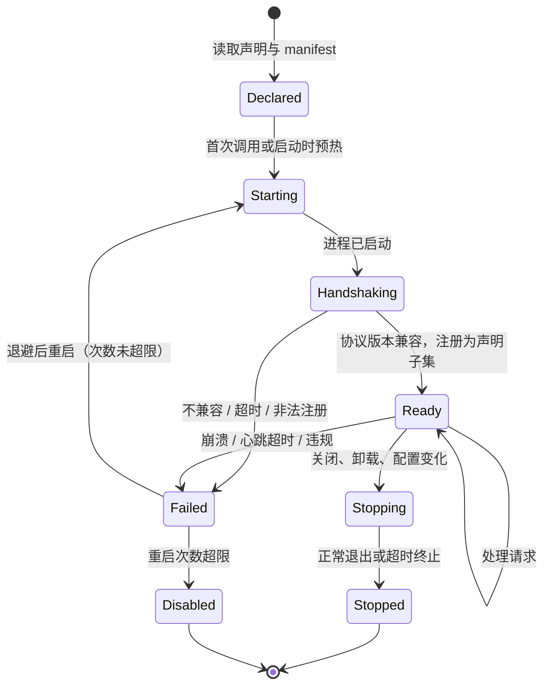

# 插件宿主

> 文档状态：草案 · 最后复核：2026-11-14

> 插件在边界之外运行：宿主按 manifest 校验接口权限，按进程隔离故障。宿主权限校验不是操作系统沙箱。

> 模块 owner：`silkage15`。本文由 `ylgd0915` 起草初稿，待 `silkage15` 评审修订后接管维护。

**相关文档**：[server 总览](README.md) · [写入路径](write-path.md) · [传输](transport.md) · [架构 10](../../architecture.md#10-插件架构) · [技术选型 10.2](../../techStack.md#102-插件技术)

**目录**

- [1 职责与非职责](#1-职责与非职责)
- [2 阶段与当前状态](#2-阶段与当前状态)
- [3 manifest](#3-manifest)
- [4 能力与权限](#4-能力与权限)
  - [4.1 宿主接口权限](#41-宿主接口权限)
  - [4.2 不是操作系统沙箱](#42-不是操作系统沙箱)
- [5 生命周期](#5-生命周期)
- [6 通信](#6-通信)
- [7 结构化视图转换](#7-结构化视图转换)
- [8 故障隔离](#8-故障隔离)
- [9 写入提案](#9-写入提案)
- [10 命令总线](#10-命令总线)
- [11 管理操作](#11-管理操作)
- [12 关键取舍](#12-关键取舍)
- [13 验证方法](#13-验证方法)
- [14 待确认事项](#14-待确认事项)

## 1 职责与非职责

职责（`基线`：[架构 5.3](../../architecture.md#53-hosts)、[架构 10](../../architecture.md#10-插件架构)）：

- 读取插件声明与 manifest，校验身份、版本与能力；
- 启动插件进程、握手、注册命令、查询、视图与导出器；
- 在每次插件请求时按授予的能力校验；
- 转换插件返回的结构化视图为标准 View/Layout；
- 隔离插件崩溃、超时与非法消息；
- 把插件的写入提案交给统一审批路径；
- 提供安装、列表、移除、诊断操作。

非职责：

- 内置 service 的注册（内置 service 直接通过 kernel 注册，不经过 plugin host）；
- 插件市场与分发（[devPlan 3](../../devPlan.md#3-范围边界) 列为后续规划）；
- 操作系统级沙箱（见 [§4.2](#42-不是操作系统沙箱)）；
- 插件管理命令的 CLI 形态：`mdctrl-cli` 负责。

## 2 阶段与当前状态

属于 MVP4（[devPlan 4.4](../../devPlan.md#44-mvp4-扩展与自动化)）。当前未实现。技术选型中插件 JSON-RPC、进程生命周期、权限校验、结构化视图序列化均为“待微型验证”（[技术选型 10.3](../../techStack.md#103-验证状态)）。

## 3 manifest

`基线`：manifest 描述身份、版本、入口、能力与权限（[架构 10](../../architecture.md#10-插件架构)）；`mdctrl.toml` 保存插件声明与锁（[架构 6.1](../../architecture.md#61-mdctrltoml)）；manifest 格式由技术文档承接（[架构 16](../../architecture.md#16-架构决策) 末段）。

字段（`建议`，格式待定，PLG-1）：

| 字段 | 含义 |
| --- | --- |
| `id` | 全局唯一标识，小写 kebab-case |
| `name`、`description` | 展示用 |
| `version` | 插件版本，SemVer |
| `protocol` | 支持的插件协议版本范围 |
| `entry` | 可执行入口与参数，路径相对插件目录 |
| `capabilities` | 申请的能力列表（§4） |
| `contributes` | 声明的命令、查询、视图、导出器（握手时再次注册，必须是声明的子集） |

插件声明与锁（`建议`）：

- `mdctrl.toml` 的 `[plugins]` 声明团队使用的插件 id、版本约束与来源；
- 锁记录确切版本与插件文件的校验和；启动时校验和不匹配则拒绝启动该插件；
- 插件文件的安装位置（用户级目录或 `.mdctrl/` 下）待确认（PLG-2）。

## 4 能力与权限

### 4.1 宿主接口权限

`基线` 能力（[架构 10](../../architecture.md#10-插件架构)、[技术选型 10.2](../../techStack.md#102-插件技术)）：

| 能力 | 宿主接口上的含义 |
| --- | --- |
| `workspace.read` | 可以调用宿主的读取文档、搜索、反链等查询；读取经由 workspace 文档访问接口，内部状态目录（`.mdctrl/`、`.git/`，含符号链接别名）不可读（[workspace 8](workspace.md#8-路径校验)） |
| `workspace.propose` | 可以调用宿主的提交写入提案接口 |
| `command.invoke` | 可以通过宿主调用命令总线上的其他命令 |
| `network.access` | 声明插件需要访问网络（见 §4.2 的限制） |

授予与校验（`建议`）：

- 授予的能力 = manifest 申请的能力 ∩ 用户批准的能力；安装或能力变化时向用户展示并请求批准；
- 批准记录保存位置：团队共享（`mdctrl.toml`）还是每台机器（`.mdctrl/config/`）待确认（PLG-3）；
- 握手时把授予的能力告知插件；
- 插件发往宿主的每个请求都检查对应能力，缺失时返回权限错误并记录；
- `command.invoke` 调用其他命令时，被调用命令的能力要求同样适用，防止借道提权（如通过命令间接写入）；
- 插件之间不能直接通信，只能经由命令总线。

### 4.2 不是操作系统沙箱

**宿主权限校验只约束插件通过 mdctrl 接口发出的请求。** 插件是以当前用户权限运行的普通进程，它可以：

- 直接读写当前用户可访问的任何文件，包括工作区外的文件与工作区内文档（绕过审批）；
- 直接打开网络连接，无论是否声明 `network.access`；
- 启动其他进程。

因此：

- `workspace.read`、`network.access` 等能力是**声明与接口层约束**，用于告知用户、约束诚实插件、限制宿主接口，不能阻止恶意插件；
- 安装插件等同于信任并运行其代码，安装界面必须明确说明这一点；
- 进程隔离提供的是**故障隔离**（崩溃不拖垮 server），不是安全隔离；
- 宿主能做的缓解：启动时清理环境变量（不传递凭据）、不继承多余的文件句柄、工作目录设为插件目录、只通过 stdio 通信；
- 操作系统级沙箱（Linux 命名空间 / seccomp / Landlock，Windows AppContainer / Job Object 等）作为后续研究项，不在当前范围内承诺（PLG-4）。

## 5 生命周期

步骤（`建议`）：

- **启动**：默认延迟到首次调用（符合延迟初始化）；manifest 可以申请预热；
- **握手**：宿主发送初始化请求（协议版本、授予的能力、最少的工作区信息）；插件返回其 manifest 摘要与注册项；注册项必须是 manifest `contributes` 的子集；
- **健康检查**：空闲时定期心跳，超时视为挂起；
- **退出**：宿主发送关闭请求，等待宽限期，超时后终止进程树（Unix 进程组、Windows Job Object，`待验证`）；
- **重启**：失败后指数退避重启，超过次数上限进入 `Disabled`，需要用户手动重新启用。

## 6 通信

`基线`：外部插件使用 JSON-RPC over stdio（[技术选型 10.2](../../techStack.md#102-插件技术)）。

- **分帧**：技术选型只规定了本地 IPC 使用长度前缀，插件 stdio 的分帧方式（长度前缀 / 头部 `Content-Length` / 行分隔）待定（PLG-5）；
- **方向**：

| 方向 | 请求（示意） |
| --- | --- |
| 宿主 → 插件 | 调用命令、请求视图、导出、关闭、心跳 |
| 插件 → 宿主 | 读取文档、搜索（`workspace.read`）；提交提案（`workspace.propose`）；调用命令（`command.invoke`）；日志、进度 |

- **限制**：单条消息大小上限；每个插件的并发请求上限；每个请求的超时；
- **取消**：宿主可以取消进行中的请求（发起会话断开或用户取消）；
- **stderr**：截断后写入日志，不进入 View；
- **I/O 模型**：每个插件独立线程还是共享异步运行时，待 `silkage15` 决定（PLG-6）。

## 7 结构化视图转换

`基线`：插件返回结构化视图，由 host 转换成标准 View/Layout，client 统一栅格化（[架构 10](../../architecture.md#10-插件架构)、[架构 16](../../architecture.md#16-架构决策)）；视图序列化格式由协议层定义（[技术选型 10.2](../../techStack.md#102-插件技术)）。

转换边界（`建议`）：

- 插件只能返回协议定义的有限结构（如标题、段落、列表、表格、代码块、链接、语义样式 token），不能返回终端 Cell、ANSI 序列或任意布局；
- 宿主校验结构：未知节点类型、超出深度或大小上限的视图被拒绝；
- 文本清理：删除控制字符与终端转义序列；
- 宿主把结构转换为文档模型，交给 render 布局，保证 CJK 宽度、换行、主题与内置文档一致；
- 插件视图中的链接按工作区路径校验，越界链接不可跳转。

结构化视图的节点集合需要 `field`（protocol / render）与 `silkage15` 共同确定（PLG-7）。

## 8 故障隔离

`基线`：插件异常影响单个进程，server 继续工作（[架构 10](../../architecture.md#10-插件架构)）；MVP4 验收包括崩溃、超时与非法消息隔离（[devPlan 4.4](../../devPlan.md#44-mvp4-扩展与自动化)）。

| 故障 | 检测 | 处理 |
| --- | --- | --- |
| 崩溃（进程退出） | 子进程退出事件 / 管道关闭 | 进行中的请求返回 `plugin_failed`；状态 `Failed`；按退避重启 |
| 挂起 / 请求超时 | 请求计时器、心跳 | 该请求返回 `timeout`；连续超时则终止进程并重启 |
| 非法消息（非 JSON、非法 JSON-RPC、未知方法、结构不符） | 解析与校验 | 返回协议错误；累计超过阈值则终止进程 |
| 超大消息 | 分帧层大小检查 | 丢弃并终止进程（分帧可能已失步） |
| 越权请求 | 能力检查 | 返回权限错误并记录；可配置累计超限后禁用 |
| 输出洪泛（日志、进度） | 速率限制 | 丢弃超出部分 |
| 协议版本不兼容 | 握手 | `Failed`，不重启，提示升级 |

插件状态变化通过事件通知 client；诊断操作可以查看最近的错误与 stderr 摘要。

## 9 写入提案

- 插件通过 `workspace.propose` 提交提案，进入[写入路径](write-path.md)，与人工编辑、agent 使用同一审批流程（`基线`）；
- 溯源记录插件 id、版本与触发的命令（见 [write-path 8](write-path.md#8-溯源)）；
- 插件不能审批提案；
- 插件直接写文件（绕过接口）无法被阻止，只能被监听发现并记为外部变化（见 §4.2）。

## 10 命令总线

- 插件命令与内置命令注册到同一总线（`基线`，MVP4 验收）；
- 命名空间（`建议`）：插件命令以插件 id 为前缀，避免与内置命令及其他插件冲突；重名注册被拒绝；
- 命令的输入输出结构由 protocol 定义；CLI 自动化输出（MVP4）对插件命令同样适用。

## 11 管理操作

server 侧提供（`建议`；CLI 形态由 `silkage15` 决定）：

| 操作 | 说明 |
| --- | --- |
| 安装 | 校验 manifest 与校验和，展示能力并请求批准，更新声明与锁 |
| 列表 | 声明、版本、状态、授予的能力 |
| 移除 | 停止进程，移除声明与锁；插件目录的清理策略待定 |
| 诊断 | 状态、最近错误、重启次数、stderr 摘要 |
| 启用 / 禁用 | 手动恢复 `Disabled` 的插件 |

修改 `mdctrl.toml` 的插件声明属于共享配置变更，不经过文档审批路径，但需要用户显式操作。

## 12 关键取舍

- **进程隔离 + 接口权限**：实现成本可控，故障隔离可靠；代价是安全边界有限，必须如实告知用户。
- **结构化视图而非自绘**：显示一致、CJK 与主题统一；代价是插件表达能力受限。
- **延迟启动**：启动快；代价是首次调用有延迟。

## 13 验证方法

- 示例插件与故障测试插件（[devPlan 4.4](../../devPlan.md#44-mvp4-扩展与自动化)）：故障插件按参数模拟崩溃、挂起、非法 JSON、超大消息、越权请求、输出洪泛；
- 每类故障后 server 仍可服务其他请求，其他插件不受影响；
- 进程树终止：插件派生子进程后被终止，无残留；
- 权限：缺少能力的请求被拒绝；借道 `command.invoke` 提权被拒绝；持有 `workspace.read` 时请求 `.mdctrl/config/`、`.git/config` 或经符号链接指向它们的路径被拒绝；
- 视图转换：含控制字符、超深嵌套、CJK 的插件视图。

## 14 待确认事项

- **PLG-1**（`silkage15`）：manifest 文件格式与字段。
- **PLG-2**（`silkage15`）：插件文件安装位置。
- **PLG-3**（三人）：能力批准记录团队共享还是每台机器。
- **PLG-4**（三人）：操作系统级沙箱是否进入后续规划；当前文档明确不承诺。
- **PLG-5**（`silkage15`）：插件 stdio 分帧方式。
- **PLG-6**（`silkage15`）：插件 I/O 线程模型。
- **PLG-7**（`field`、`silkage15`）：结构化视图节点集合。
