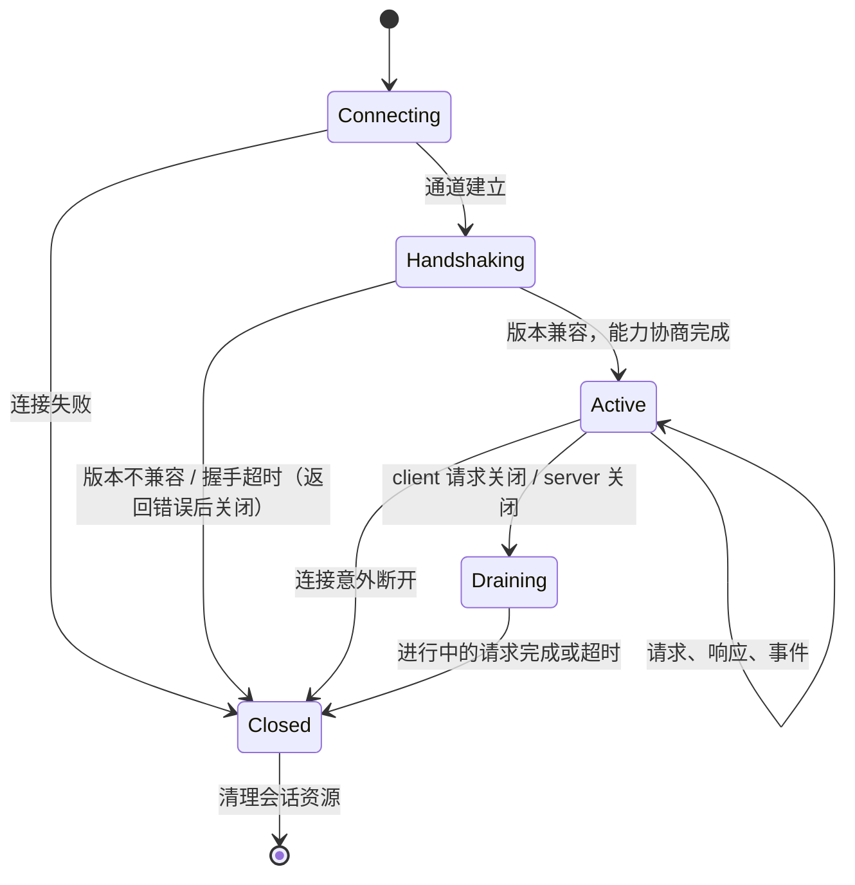

# 传输与会话

> 文档状态：草案 · 最后复核：2026-11-14

> 消息语义只有一套，传输可以有多种：embedded 走进程内通道，daemon 走本地 IPC，remote 留作远期边界。

> 模块 owner：`silkage15`。本文由 `ylgd0915` 起草初稿，待 `silkage15` 评审修订后接管维护。

**相关文档**：[server 总览](README.md) · [工作区](workspace.md) · [插件](plugin.md) · [Agent / MCP](agent-mcp.md) · [架构 8](../../architecture.md#8-协议边界) · [架构 14](../../architecture.md#14-部署形态) · [技术选型 10.1](../../techStack.md#101-通信编码)

**目录**

- [1 职责与非职责](#1-职责与非职责)
- [2 三种形态的边界](#2-三种形态的边界)
- [3 共享消息语义与传输差异](#3-共享消息语义与传输差异)
- [4 会话](#4-会话)
- [5 连接生命周期](#5-连接生命周期)
- [6 请求与响应](#6-请求与响应)
- [7 事件与背压](#7-事件与背压)
- [8 断开与资源清理](#8-断开与资源清理)
- [9 daemon](#9-daemon)
- [10 embedded](#10-embedded)
- [11 remote 远期边界](#11-remote-远期边界)
- [12 安全](#12-安全)
- [13 关键取舍](#13-关键取舍)
- [14 验证方法](#14-验证方法)
- [15 待确认事项](#15-待确认事项)

## 1 职责与非职责

职责：

- 在 client 与 server 内核之间传递协议消息；
- 握手、版本与能力协商的传输侧流程（`基线`，[架构 8.1](../../architecture.md#81-请求与订阅)）；
- 管理会话与连接生命周期；
- 事件分发与背压；
- daemon 的端点发布、发现与访问控制。

非职责：

- 消息类型与编码规则的定义：`mdctrl-protocol`；
- 命令与查询的业务处理：kernel 上注册的 services 与 hosts；
- MCP 的传输：MCP host 自己的 stdio 适配（[agent-mcp 10](agent-mcp.md#10-mcp-host)）；
- 插件通道：plugin host 的结构化消息通道（[plugin 6](plugin.md#6-通信)）；
- 视图状态：client 持有。

当前状态：未实现。MVP1 需要 embedded；daemon 进入哪个 MVP 尚未在 devPlan 中明确（TRN-1）；remote 为远期。

## 2 三种形态的边界

| 形态 | 进程关系 | 通道 | 编码 | 当前范围 |
| --- | --- | --- | --- | --- |
| embedded | server 与 client 同进程 | 进程内 channel | typed 消息，不序列化（`基线`，[技术选型 10.1](../../techStack.md#101-通信编码)） | MVP1 |
| daemon | server 独立进程，多 client | 本地 IPC：Unix 域套接字 / Windows 命名管道（`建议`） | JSON + 长度前缀分帧（`基线`，待微型验证） | 时间待定 |
| remote | 跨机器 | 远程连接，实现后续选择 | 复用 JSON 语义（`基线`） | **远期，仅定义边界** |

`基线`：四种传输（含插件）共享同一套消息语义（[架构 8.3](../../architecture.md#83-传输)）。

## 3 共享消息语义与传输差异

共享（所有形态一致）：

- 四类信息：command、query、event、view（`基线`，[架构 8](../../architecture.md#8-协议边界)）；
- 请求带唯一标识，响应与请求关联；
- 握手包含协议版本与能力协商；
- 订阅事件主题；
- 错误类别（见 [README 9](README.md#9-错误模型)）。

差异（传输层负责屏蔽或明确）：

| 方面 | embedded | daemon |
| --- | --- | --- |
| 序列化 | 无 | JSON |
| 消息大小 | 无硬限制（仍建议与 daemon 相同的逻辑上限，保证行为一致） | 分帧层上限 |
| 大资源 | 可以直接传递引用 | 句柄或文件路径（`基线`，[技术选型 10.1](../../techStack.md#101-通信编码)） |
| 连接失败 | 不存在（同进程） | 需要处理 |
| server 异常 | 整个进程受影响 | client 看到断开 |

为保证“embedded 下通过的测试在 daemon 下同样通过”，建议契约测试同时在两种传输上运行，并在 embedded 测试模式下可选启用序列化往返（`建议`）。

## 4 会话

`基线`：server 持有每个 client 的工作区会话；client 持有本端视图会话（[架构 7](../../architecture.md#7-状态所有权)）。

server 侧会话内容（`建议`）：

| 内容 | 说明 |
| --- | --- |
| 会话 id | server 分配 |
| client 类型 | TUI、CLI、MCP 等，用于权限集（MCP 只读）与诊断 |
| 协议版本与协商能力 | 握手结果 |
| 终端能力摘要 | client 报告，用于媒体降级决策（也可随每次 View 请求携带） |
| 订阅 | 事件主题与关注的文档 |
| 进行中的请求 | 用于取消与清理 |
| 关联资源 | 搜索结果游标、agent 运行、媒体任务关注计数、由会话发起的提案 |

不在会话中：焦点、滚动、选择、窗格布局（client 状态）；视口随每次 View 请求携带，server 不长期保存。

会话持久化到 `.mdctrl/sessions/`（`基线` 目录）的内容与用途待定（TRN-2）。

## 5 连接生命周期

- 握手必须是连接上的第一条消息；握手前收到的其他消息被拒绝；
- 握手有超时；
- 版本协商规则（主版本必须一致、次版本取交集等）由 protocol 定义；传输层只执行“不兼容即返回错误并关闭”。

## 6 请求与响应

- 同一会话内请求可以并发；响应可以乱序到达，client 用请求标识关联；
- client 可以发送取消（`建议`，需要 protocol 支持，TRN-3）；server 尽力取消，已进入提交阶段的写入不可取消；
- 事件与响应的顺序：同一会话内，server 保证“文档已变化”事件在由同一写入产生的其他事件之前发出；不保证事件与无关请求响应之间的顺序。

**三个独立的版本概念**（字段名与最终协议形状均为待协商建议，不修改 protocol）：

| 概念 | 管理方 | 何时变化 | 用途 |
| --- | --- | --- | --- |
| 请求代次 `generation` | client，每个文档视图一个 | 打开文档、视口尺寸变化、收到失效事件时递增（PR #5 TUI 草案） | client 丢弃过期响应 |
| 文档版本 | server（以内容指纹为准，可附 server 本地单调序号便于比较） | 文档内容变化并被 history 记录时 | `exact` 请求的版本匹配、写入的基准版本 |
| 索引版本 | server index | 索引提交更新或完成重建时（[index 4.2](index.md#42-事件顺序与一致性)） | 说明搜索、反链、健康结果基于哪一版索引 |

三者互不替代：server 不生成、不修改、不比较请求代次的新旧，只把请求中的 `generation`、请求标识与视口宽度原样回传在响应中；server 也不用索引版本代替请求代次或文档版本。

View 请求模式（依据 PR #5 `docs/crates/mdctrl-tui/view-state.md` §5 与 `rasterization.md` §1；2026-11-14 读取 PR #5 head `7936688`，PR 尚未合并）：

| 模式 | 请求携带 | server 处理（`建议`） | client 处理（PR #5） |
| --- | --- | --- | --- |
| `latest` | 不带文档版本 | 用当前文档版本生成 View，响应携带该版本与回传字段 | 原子更新文档版本与缓存；版本变化时清空选择、夹紧滚动 |
| `exact` | client 已有的文档版本 | 当前版本与请求一致：返回该版本的 View；不一致：返回“版本已变化”结果并携带当前版本，不生成 View（TRN-6） | 丢弃，并立即发起一次 `latest` 请求 |

过期响应的判断完全在 client：路径、`generation`、请求标识或宽度任一不匹配即丢弃（PR #5）。server 不尝试推断哪些请求已被后续请求取代；client 需要节省 server 资源时可以发送取消（TRN-3）。

## 7 事件与背压

- 每个会话一个有界事件队列；
- **合并**：同一文档的多个“View 失效”事件在队列中合并为一个；同一任务的进度事件只保留最新一条；
- **溢出**：队列满时清空该会话队列，发送一个“需要重新同步”事件（`建议`，TRN-4），client 收到后重新查询当前状态；不阻塞 server 内核；
- 慢 client 不影响其他 client 与 server 内部任务；
- 事件只发送给订阅了对应主题或关注对应文档的会话。

## 8 断开与资源清理

连接关闭（正常或异常）后（`建议`）：

| 资源 | 处理 |
| --- | --- |
| 进行中的查询 | 取消 |
| 进行中的写入 | 已进入提交阶段的写入照常完成（不可中途取消），结果写入历史，无人接收的响应丢弃；尚未进入提交阶段的按 WR-3 处理 |
| 订阅 | 移除 |
| 搜索游标等临时资源 | 释放 |
| 媒体任务关注计数 | 递减；归零时取消未开始的任务 |
| 该会话发起的 agent 运行 | 取消（见 [agent-mcp 12](agent-mcp.md#12-异常流程)） |
| 该会话发起的待审批提案 | 见 WR-3 |
| 会话记录 | 内存中删除；持久化内容见 TRN-2 |

embedded 形态下 client 退出即 server 关闭（[README 8.2](README.md#82-关闭)）。daemon 形态下最后一个 client 断开不导致 daemon 退出（空闲退出为后续选项，`基线`，[架构 14](../../architecture.md#14-部署形态)）。

client 侧：daemon 连接断开时，client 提示并可以尝试重连；重连后重新握手并全量重新同步，不恢复旧会话（`建议`）。

## 9 daemon

`基线`：由 `mdctrl serve` 显式启动；每工作区一个 server；多 client 共享文档状态；写入带版本检查；事件广播到所有 client（[架构 14](../../architecture.md#14-部署形态)）。

端点（`建议`）：

- 获得工作区锁后创建端点，并把端点信息写入 `.mdctrl/server.json`（见 [workspace 3.2](workspace.md#32-mdctrl)）；
- Unix 域套接字路径有长度上限：Linux 的 unix(7) 手册说明 `sun_path` 为 108 字节，并提醒部分实现短至 92 字节（2026-11-14 对照 man7.org 核对）；深层工作区路径下 `.mdctrl/` 内的套接字可能超长；需要回退到用户运行时目录并在 `server.json` 中记录实际路径（`待验证`）；
- Windows 命名管道名称由工作区路径派生（如哈希），避免冲突；
- 启动时如发现残留的套接字文件，只有在已持有锁的前提下才删除重建（锁保证没有其他 daemon）。

关闭：

- `mdctrl serve` 前台运行时响应中断信号；提供关闭命令；
- 关闭流程见 [README 8.2](README.md#82-关闭)：停止接受连接 → 通知 client → 取消可取消任务并等待确认退出 → 等待写入者排空 → 关闭数据库 → 删除端点 → 释放锁；
- 释放锁的前提是所有写入者已确认停止。排空超时时 daemon **不释放锁**，保持端点信息并报告“关闭被写入阻塞”；此后只能通过终止整个 daemon 进程（第二次中断信号、关闭命令的强制选项或服务管理器）释放锁，恢复按 [README 8.3](README.md#83-异常退出后的恢复) 进行。强制终止的具体交互（信号次数、命令选项）待定（TRN-7）。

与 embedded 的并发关系见 [workspace 6.2](workspace.md#62-embedded-与-daemon-的并发)（WS-3）。

## 10 embedded

- client 进程内启动 server，server 内部线程按 [README 6](README.md#6-并发模型) 运行；
- client 退出触发关闭；写入者排空超时时 server 不释放锁，client 进程退出（整个持锁进程终止）是最终的释放方式，见 [README 8.2](README.md#82-关闭)；
- client 与 server 之间仍只交换协议消息，client 代码不访问 server 内部类型，保证将来切换 daemon 不改 client 逻辑；
- server 内部 panic 不应破坏工作区状态：写入依赖原子替换与事务，panic 后进程退出时数据保持一致；server 线程 panic 时 client 应得到明确的断开错误，而不是挂起（`建议`，具体捕获方式待定）。

## 11 remote 远期边界

remote 只在此定义边界，**不扩大当前实现范围**，不在任何 MVP 中实现：

- 复用同一套消息语义（`基线`）；
- 需要额外解决：身份认证、传输加密、多用户权限（谁可以审批写入）、文件句柄与路径类资源在远程不可用（需要内容传输）、延迟与断线重连；
- 当前设计中与 remote 相关的约束仅有两条：消息语义不依赖“同一台机器”（例如不要求 client 能直接读取 server 的文件路径才能完成基本功能）；会话与权限模型中预留“client 身份”的位置。

## 12 安全

- daemon 端点只允许当前用户访问：Unix 套接字文件权限仅所有者可读写，所在目录同样限制；Windows 命名管道设置仅当前用户的访问控制（`待验证`）；
- 握手中校验工作区身份，防止连接到错误工作区的 daemon；
- 所有来自连接的消息按不可信输入解析：大小上限、结构校验、路径校验；
- 解析失败或协议违规累计超过阈值时关闭连接；
- 日志中不记录消息中的文档正文与凭据。

## 13 关键取舍

- **embedded 不序列化**：启动快、开销低；代价是可能掩盖序列化问题，用双传输契约测试弥补。
- **溢出即重新同步**：server 永不被慢 client 阻塞；代价是 client 需要实现全量重新同步。
- **重连不恢复旧会话**：实现简单；代价是 client 需要重新建立订阅。

## 14 验证方法

| 项目 | 方法 |
| --- | --- |
| 双传输契约 | 同一组契约测试在 embedded 与 daemon 上运行 |
| 分帧 | JSON + 长度前缀的边界：超大消息、半包、粘包（对应技术选型“JSON + 长度前缀 framing 待微型验证”） |
| 握手 | 版本不兼容、握手超时、握手前发送其他消息 |
| 背压 | 慢 client 不影响其他 client；溢出后收到重新同步事件 |
| 断开清理 | 断开后查询取消、订阅移除、媒体任务取消 |
| 请求代次回传 | 同一文档版本下连续缩放：多个 `latest` 请求各带不同 `generation` 与宽度，响应逐一原样回传；旧请求的响应晚于新请求到达时，client 按 `generation` 与宽度丢弃 |
| 旧请求晚到 | 文档版本变化后，变化前发出的请求的响应才到达，被 client 丢弃，且不覆盖新版本缓存 |
| `exact` 版本不符 | 返回“版本已变化”与当前版本，不返回 View |
| 索引更新但请求代次不变 | 索引版本递增、搜索结果携带新索引版本；无派生内容变化的文档不收到失效事件，其视口请求代次不变，已有 View 继续有效 |
| daemon 关闭时写入阻塞 | 排空超时后锁不释放，端点保留并报告；强制终止进程后锁释放，重启后恢复 |
| daemon 端点 | 深层路径下的套接字长度回退；权限；残留文件 |
| 多 client 写入 | 两个 client 同时提交，版本检查生效，事件广播到双方 |

## 15 待确认事项

- **TRN-1**（三人）：daemon 进入哪个 MVP。WS-3 与 MCP 使用场景都依赖 daemon，建议不晚于 MVP2。
- **TRN-2**（`silkage15`）：`.mdctrl/sessions/` 持久化的内容与用途（如恢复上次打开的文档列表，还是只用于诊断）。
- **TRN-3**（`field`、`silkage15`）：protocol 是否定义取消消息。
- **TRN-4**（`field`、`silkage15`）：“需要重新同步”事件是否进入 protocol。
- **TRN-5**（`silkage15`）：daemon 本地 IPC 的具体实现与依赖选择（需新增依赖确认）。
- **TRN-6**（`silkage15`、`field`）：`exact` 请求版本不符时，server 返回“版本已变化 + 当前版本”（建议，省去生成无用 View），还是返回新版本的 View 由 client 丢弃（与 PR #5 当前描述字面一致）。两者对 client 行为的影响相同。
- **TRN-7**（`silkage15`）：daemon 排空超时后强制终止的交互方式（第二次中断信号、关闭命令的强制选项）。
