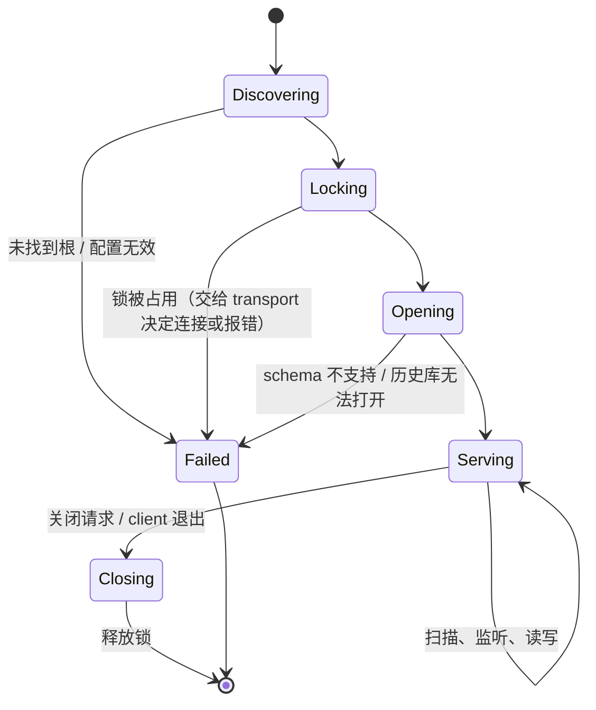
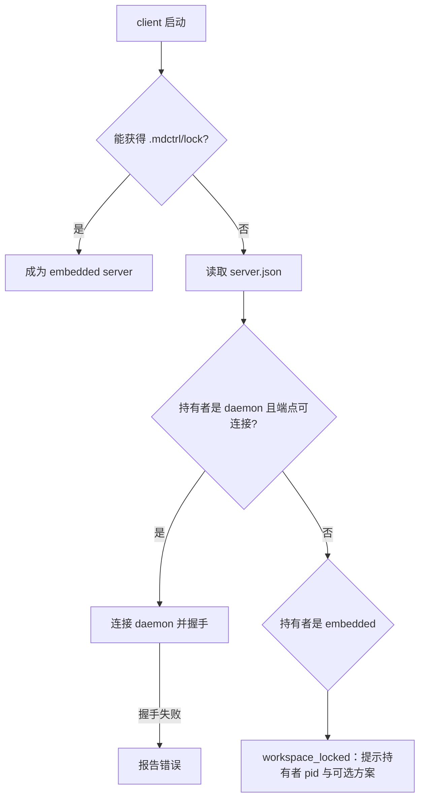

# 工作区

> 文档状态：草案 · 最后复核：2026-11-14

> 工作区是 server 的状态落点：先找到根，再确认配置与锁，然后才允许读写任何东西。

**相关文档**：[server 总览](README.md) · [文档历史](history.md) · [写入路径](write-path.md) · [传输](transport.md) · [架构 6](../../architecture.md#6-工作区与文档历史)

**目录**

- [1 职责与非职责](#1-职责与非职责)
- [2 根目录识别](#2-根目录识别)
- [3 `mdctrl.toml` 与 `.mdctrl/`](#3-mdctrltoml-与-mdctrl)
  - [3.1 `mdctrl.toml`](#31-mdctrltoml)
  - [3.2 `.mdctrl/`](#32-mdctrl)
  - [3.3 配置优先级](#33-配置优先级)
- [4 初始化](#4-初始化)
- [5 生命周期](#5-生命周期)
- [6 锁与单写入者](#6-锁与单写入者)
  - [6.1 锁的语义](#61-锁的语义)
  - [6.2 embedded 与 daemon 的并发](#62-embedded-与-daemon-的并发)
- [7 扫描与忽略规则](#7-扫描与忽略规则)
- [8 路径校验](#8-路径校验)
- [9 错误处理](#9-错误处理)
- [10 模块接口](#10-模块接口)
- [11 关键取舍](#11-关键取舍)
- [12 验证方法](#12-验证方法)
- [13 待确认事项](#13-待确认事项)

## 1 职责与非职责

职责：

- 识别工作区根目录，判断初始化状态；
- 加载并校验 `mdctrl.toml` 与 `.mdctrl/config`，形成配置快照；
- 管理 `.mdctrl/` 目录结构与本地 schema 版本；
- 实现 `mdctrl init` 的 server 侧逻辑；
- 获取并持有 `.mdctrl/lock`，保证每个工作区一个 server（`基线`，[架构 6.4](../../architecture.md#64-初始化与工作区生命周期)）；
- 扫描工作区、维护文档清单、监听文件变化；
- 读取文档快照（内容 + 内容指纹）；
- 为所有模块提供统一的路径校验。

非职责：

- 文档写入的审批与版本检查：由[写入路径](write-path.md)负责，workspace 只提供底层原子写原语；
- 观察记录与溯源：由[文档历史](history.md)负责；
- 配置模型的类型定义：由 `mdctrl-core` 定义（foundation，Issue #2），workspace 负责加载与校验；
- client 侧配置（键位、主题选择、视图布局）：client 负责（`基线`，[架构 7.2](../../architecture.md#72-主题与配置)）；
- `mdctrl init` 的命令行形态：`mdctrl-cli` 负责。

当前状态：以上全部未实现。

## 2 根目录识别

`基线`：[架构 6.2](../../architecture.md#62-mdctrl) 规定 `.mdctrl` 同时作为工作区根标记，从当前目录向上查找最近的 `.mdctrl`。

**发现的问题**：`.mdctrl/` 被 `.gitignore` 忽略（本仓库 `.gitignore` 已包含 `/.mdctrl/`），新克隆的仓库只有 `mdctrl.toml` 而没有 `.mdctrl/`。仅以 `.mdctrl` 为标记时，团队成员克隆后无法识别工作区，必须重新执行 `mdctrl init`。这与“`mdctrl.toml` 提交共享”的目的有张力，需要确认（WS-1）。

识别算法（`建议`）：

1. 起点为显式参数（如 CLI 的工作区参数或打开的文件所在目录），缺省为当前目录；
2. 规范化起点（解析符号链接），逐级向上；
3. 在每一级检查 `.mdctrl/`（目录）与 `mdctrl.toml`（文件），**第一个包含任一标记的目录**即为根；
4. 到达文件系统根仍未找到时，返回 `workspace_not_found`。

识别结果分四种状态：

| 状态 | 条件 | 行为（建议） |
| --- | --- | --- |
| 已初始化 | `.mdctrl/` 与 `mdctrl.toml` 都存在 | 正常启动 |
| 仅本地 | 只有 `.mdctrl/` | 使用内置默认配置启动，提示可执行 `mdctrl init` 补充共享配置 |
| 仅共享 | 只有 `mdctrl.toml`（典型：新克隆） | 待确认（WS-1）：建议自动完成本地部分初始化（创建 `.mdctrl/` 子目录与 schema 版本），不修改 `mdctrl.toml` 与 `.gitignore`，并向 client 报告 |
| 未找到 | 都不存在 | 返回 `workspace_not_found`，提示执行 `mdctrl init`（WS-2） |

其他规则：

- **嵌套工作区**：最近的标记优先；外层工作区扫描时跳过包含自身标记的子目录（WS-4）；
- **与 Git 根的关系**：工作区根可以是 Git 仓库根、子目录，或不在任何 Git 仓库中；Git 根由 [git 模块](git.md#2-探测)单独探测，不参与工作区识别；
- 根目录在启动时规范化一次，此后所有路径以该规范化根为基准。

## 3 `mdctrl.toml` 与 `.mdctrl/`

### 3.1 `mdctrl.toml`

`基线`：位于仓库根目录，提交到 Git，保存工作区级设置、插件声明与锁、文档历史与索引策略、团队共享选项（[架构 6.1](../../architecture.md#61-mdctrltoml)）；技术选型为 TOML（[技术选型 7.1](../../techStack.md#71-存储选择)）。

server 关心的配置分区（`建议`，键名与结构未确定，配置模型由 core 定义）：

```toml
# 示例：仅说明分区与归属，不是已确认的 schema
[workspace]
schema = 1
include = ["**/*.md"]
exclude = ["vendor/**"]

[history]
# 观察记录保留策略

[index]
# 分词器选择、字段权重

[health]
# 规则参数：过期周期、必需元数据字段、入口文档

[media]
# 外部渲染器路径与超时

[plugins]
# 插件声明与锁

[agent]
# 共享的工作流设置；不含凭据
```

校验规则（`建议`）：

- 语法错误或类型错误：返回 `config_invalid`，携带文件、行号与键路径，server 不启动；
- 未知键：记录警告，继续启动，保留向前兼容；
- 疑似凭据（键名包含 `key`、`token`、`secret` 等且值非空）：警告并提示迁移到本地配置，不读取其值作为凭据（[架构 15](../../architecture.md#15-基本约束与安全)）；
- 配置文件变化：监听到 `mdctrl.toml` 变化后重新校验；有效则发布“配置已变化”事件，由各模块决定是否需要重建（如分词器变化触发索引重建）；无效则保留旧配置并报告。

### 3.2 `.mdctrl/`

`基线`：位于仓库根目录，整体加入 `.gitignore`，包含 `history`、`cache`、`sessions`、`config`、`lock`（[架构 6.2](../../architecture.md#62-mdctrl)）。

细化布局（`建议`；带 * 的条目超出基线列表，需确认，WS-5）：

```text
.mdctrl/
  lock               工作区锁（操作系统文件锁）
  server.json *      当前持有者信息：pid、形态、启动时间、程序版本、daemon 端点
  schema *           本地 schema 版本
  history/
    history.db       文档历史（持久）
  cache/
    index.db         全文索引与链接图（可重建）
    media/           媒体资源（可重建）
    tmp/ *           重建与渲染的临时产物
  sessions/          工作区会话（可选持久化）
  config/
    local.toml       本机配置与凭据引用
  logs/ *            结构化日志（技术选型 3.2 要求日志写入本地状态目录）
```

- `cache/` 下全部内容可以随时删除，server 负责重建；
- `history/` 删除即丢失观察记录，见 [history.md](history.md#7-持久化与可重建缓存)；
- `server.json` 与 `lock` 分开：在 Windows 上，被锁定的文件可能无法被其他进程读取，持有者信息需要独立文件（`待验证`）。

### 3.3 配置优先级

server 侧配置从低到高（`建议`）：内置默认 → `mdctrl.toml` → `.mdctrl/config/local.toml` → 启动参数。本机配置可以覆盖共享配置中的本地偏好（如外部渲染器路径），不能覆盖团队约定的规则语义（如健康规则的必需字段）；哪些键允许本地覆盖需要逐项标注（WS-6）。

## 4 初始化

`基线`：`mdctrl init` 显式创建工作区，五个步骤，重复执行保持幂等（[架构 6.4](../../architecture.md#64-初始化与工作区生命周期)）。server 侧每一步的幂等与异常规则（`建议`）：

| 步骤 | 已存在时 | 失败时 |
| --- | --- | --- |
| 1 确定根目录 | 已有标记则沿用；否则使用起点目录 | 起点不可写：`workspace_not_found` 并说明权限 |
| 2 创建 `.mdctrl/` 与子目录 | 保留现有内容，只补缺失目录 | 中途失败可以重新执行，已创建目录不回滚 |
| 3 确保 `.gitignore` 忽略 `.mdctrl/` | 已被忽略（Git 可用时用 `git check-ignore` 判断，否则逐行匹配）则跳过；否则追加 `/.mdctrl/` | 不在 Git 仓库中：跳过并提示；文件不可写：报告，不中断 |
| 4 创建 `mdctrl.toml` | **从不覆盖**已有文件 | 写入使用临时文件 + 原子替换 |
| 5 写入本地 schema 版本 | 版本相同则跳过；较旧则迁移；较新则拒绝（`schema_unsupported`） | 迁移前备份历史库 |

- `init` 本身先获取 `.mdctrl/lock`（锁文件不存在时先创建目录与锁文件），避免与运行中的 server 并发初始化；
- `init` 修改 `.gitignore` 与 `mdctrl.toml` 属于工作区内写入，但不是“文档写入”，不经过审批路径；只修改这两个文件，且只追加或新建；
- schema 迁移规则与历史库迁移一致，见 [history.md](history.md#7-持久化与可重建缓存)。

## 5 生命周期



- `Serving` 内部包含“初始扫描中”与“扫描完成”两个子阶段：扫描期间允许按路径打开文档，文档清单与索引标记为未完成；
- 关闭流程见 [README 8.2](README.md#82-关闭)。

扫描与监听的交接（`建议`）。若先扫描、扫描完成后才开始监听，扫描期间已经读过的文件再被修改时会被漏掉。因此顺序为：

1. **先建立监听**：开始接收事件，但只放入缓冲区，不处理；
2. **再扫描**：扫描在监听建立之后读取文件，因此监听建立之前发生的变化都会被扫描看到；
3. **追赶缓冲事件**：扫描结束后逐个处理缓冲区中的路径，重新读取并计算指纹。重新读取是幂等的，事件对应的文件无论扫描前、扫描中还是扫描后被读过，都会以最新内容为准；
4. **校准**：如果扫描期间缓冲区溢出、监听报告丢事件，或监听无法建立，扫描结束后再执行一次全量指纹对比（校准），并在此后按周期校准（`基线` 回退：轮询监听，[技术选型 9.4](../../techStack.md#94-验证状态)）；
5. 之后进入持续监听，事件经去抖后进入刷新管线（见 [index 4](index.md#4-增量更新与刷新流程)）。

扫描期间新建的目录能否被递归监听及时覆盖，取决于监听实现与平台（`待验证`）；不确定时依靠第 4 步的校准兜底。

## 6 锁与单写入者

### 6.1 锁的语义

- 使用操作系统文件锁（技术选型记录 `fd-lock` 4.0.4 桌面核查通过，[技术选型 7.3](../../techStack.md#73-验证状态)），对 `.mdctrl/lock` 加独占锁，server 存活期间持续持有；
- 进程退出或崩溃时由操作系统释放锁，因此**以“能否获得锁”判断占用，不以锁文件是否存在判断**，不存在“残留锁需要手动删除”的情况；
- 获得锁后写入 `server.json`（持有者信息），只用于诊断与 daemon 端点发现；连接前必须通过握手确认对方身份与工作区，`server.json` 内容不作为授权依据；
- 锁只保证“一个工作区一个 server”。server 内部的任务互斥（如索引构建）由内部任务状态负责，不复用该锁（与 PR #5 CLI 文档草案一致）；
- 锁只在所有写入者确认停止、或持锁进程终止后释放，排空超时时不释放（见 [README 8.2](README.md#82-关闭)）；
- 锁不约束外部编辑器、Git 或其他工具对文档的写入，这些变化通过监听与写入时的两次版本检查处理；两次检查不能完全消除外部竞争，残余窗口见 [write-path.md](write-path.md#6-版本检查与冲突)；
- 网络文件系统、WSL 访问 Windows 盘符路径时，文件锁的可靠性需要验证（`待验证`）。

### 6.2 embedded 与 daemon 的并发

`基线`：embedded 与 daemon 共享同一把锁；client 优先连接现有 server，没有 server 时启动 embedded（[架构 14](../../architecture.md#14-部署形态)）。

client 启动时的决策（`建议`）：



**发现的问题（WS-3）**：embedded server 使用进程内通道，其他进程无法连接。一个 TUI 以 embedded 形态打开工作区后，同一工作区上的 `mdctrl check`、第二个 TUI、`mdctrl mcp` 都无法获得锁，也无法连接。这在日常使用中很常见（开着 TUI 时在另一个终端运行 `check`）。候选方案：

| 方案 | 优点 | 代价 |
| --- | --- | --- |
| A 报错并提示使用 `mdctrl serve` | 实现最简单，语义清晰 | 日常体验差 |
| B embedded server 同时监听本地 IPC | 后来者可以连接，体验接近 daemon | embedded 与 daemon 差异变小；embedded 进程退出时其他 client 断开 |
| C 后来者以只读模式运行 | 查询类命令可用 | 违背“server 是唯一状态所有者”，需要只读打开历史库与索引，不能记录观察 |

建议 MVP1 采用 A，并在 daemon 设计时评估 B；C 与架构不变量冲突，不建议。该问题涉及部署形态，需要三人确认。

## 7 扫描与忽略规则

`基线`：使用 `ignore` 处理 `.gitignore` 与内置排除；处理符号链接、权限错误、异常文件名与超长路径；扫描结果作为历史、索引与导航的输入（[技术选型 9.2](../../techStack.md#92-工作区扫描)）。

规则（`建议`）：

| 项 | 规则 |
| --- | --- |
| 文档范围 | 默认扩展名 `.md`、`.markdown`；由 `[workspace].include` 覆盖 |
| 内置排除 | `.git/`、`.mdctrl/`、嵌套工作区根；常见构建目录由默认 `exclude` 提供，可以覆盖 |
| `.gitignore` | 默认遵守；被忽略的 Markdown 不进入清单。是否允许配置为“仍然索引被忽略的文档”待确认（WS-7） |
| 符号链接 | 默认不跟随；配置允许跟随时，目标必须位于工作区根内且不在内部状态目录中，否则跳过并记录 |
| 权限错误 | 跳过该文件或目录，记入扫描报告的失败区域，扫描继续；失败区域内的已知文档不视为删除 |
| 非 UTF-8 文件名 | 跳过并记录警告；协议中路径的表示方式需与 `field` 确认（WS-8） |
| 非 UTF-8 内容 | 记入清单，读取时报告编码错误；不尝试猜测编码 |
| 大小写不敏感文件系统 | 以规范化后的实际路径为准，避免同一文件出现两条记录 |
| 超大文件 | 超过阈值（建议可配置）的文档只记录元数据，不读取正文进入索引 |

扫描是只读操作，不修改任何工作区文件。

**扫描报告**（`建议`）：扫描失败不等于文件不存在，扫描结果必须说明自己覆盖了什么：

| 字段 | 含义 |
| --- | --- |
| 是否完整 | 所有应扫描的目录都成功列出时为完整 |
| 成功覆盖的目录 | 本次成功列出内容的目录 |
| 失败区域 | 未能列出的目录及原因（权限、临时不可访问、超时等） |
| 文档条目 | 路径、指纹，或读取失败原因 |

消费方（history、index、health）据此判断每个已知文档的状态：

| 情况 | 判定 |
| --- | --- |
| 所在目录已成功列出，文件存在且读取成功 | 存在 |
| 所在目录已成功列出，文件不在其中 | 确认不存在（可以记为删除、移除索引项） |
| 对单个文件确认“不存在”（而非权限等其他错误） | 确认不存在 |
| 文件存在但读取失败 | 不可访问（保留旧数据，标记过期） |
| 位于失败区域 | 未知（保留旧数据，标记过期，不记删除） |

监听事件同理：删除事件需要再次确认文件不存在后才作为删除处理。

## 8 路径校验

所有来自协议、Markdown 链接、插件、agent 与 MCP 的路径都按不可信输入处理（`基线`，[AGENTS.md](../../../AGENTS.md) 安全边界）。workspace 提供唯一的校验入口，其他模块不得自行拼接路径。

**三类访问严格分开**（`建议`）：

| 访问类别 | 调用方 | 入口 | 可达范围 |
| --- | --- | --- | --- |
| 文档访问 | client、agent 工具、plugin host、MCP host、Markdown 链接解析 | 文档路径校验 → 文档读取 / 写入路径 | 工作区内、内部状态目录之外的文档 |
| 受控资源访问 | media（本地图片） | 资源路径校验 → 资源读取 | 同上，且限定为允许的资源类型与大小 |
| 宿主内部访问 | workspace、history、index、media 缓存、session、日志 | 按内部区域枚举（如“历史库”“索引库”“媒体缓存条目”）访问，**不接受外部传入的路径字符串** | 仅 `.mdctrl/` 下对应区域 |

内部状态目录指 `.mdctrl/`、`.git/`（以及嵌套工作区中的同名目录）。**文档读取与写入都排除内部状态目录**；配置、历史、缓存、凭据只能经由宿主内部访问，没有任何面向外部的接口映射到它。agent、plugin、MCP 的权限说明只是引用这一边界，不另设路径规则。

协议中的文档路径使用**工作区相对路径**（`建议`，需 `field` 在 protocol 中确认）。文档路径校验步骤：

1. 拒绝空路径、绝对路径、Windows 盘符前缀、UNC 路径、`\\?\` 前缀与 NUL 字符；
2. 统一分隔符为 `/`；
3. 按词法处理 `.` 与 `..`，任何越过根的路径直接拒绝；
4. **词法层排除**：任一路径分量等于 `.mdctrl` 或 `.git`（按不区分大小写比较，防止大小写不敏感文件系统上的别名）即拒绝；
5. 与规范化根拼接；
6. 目标存在时规范化（解析符号链接）；目标不存在（新建文件）时规范化其父目录；
7. **规范化后再次检查**：结果仍以根为前缀，且相对根的任一分量都不是内部状态目录。符号链接指向 `.mdctrl/`、`.git/` 或其内部文件时，在这一步被拒绝；
8. 文档读取默认只允许文档范围内的路径（`[workspace].include` 规定的扩展名，见 [§7](#7-扫描与忽略规则)）；非文档文件（如图片）只能经由受控资源访问读取；
9. 写入额外拒绝：非文档扩展名（是否允许写入其他文本文件待定）；Windows 保留名（`CON`、`NUL` 等）及以点或空格结尾的名称；
10. 返回已校验文档路径类型（建议使用 newtype，只能由校验函数构造），文档读取与写入路径只接受该类型。

受控资源访问复用第 1～7 步，第 8 步改为资源类型白名单（见 [media 6](media.md#6-图片)）。媒体缓存条目由 server 以资源句柄（标识）提供给 client，client 不能用构造的路径访问缓存目录。

残余风险（如实记录，不宣称完全消除）：

- 检查与读写之间，符号链接可能被替换（TOCTOU）。缓解：写入在目标同目录创建临时文件并原子替换，最终复核时再次检查父目录；
- 工作区内指向内部文件的硬链接无法通过路径识别。缓解方案（如比较文件身份）`待验证`；创建这类硬链接本身需要本机写权限；
- Windows 短文件名等别名形式是否会被规范化消除，`待验证`（WS-9）。

Markdown 中的相对链接与图片路径相对于文档所在目录解析，同样经过上述校验；越界或指向内部状态目录的链接在健康检查中报告（见 [health.md](health.md#2-规则边界)），媒体模块拒绝加载此类图片。

## 9 错误处理

| 情况 | 错误类别（候选） | 行为 |
| --- | --- | --- |
| 未找到工作区 | `workspace_not_found` | 不启动，提示 `mdctrl init` |
| `mdctrl.toml` 无效 | `config_invalid` | 启动时：不启动；运行中：保留旧配置并报告 |
| 锁被 embedded 实例持有 | `workspace_locked` | 返回持有者信息，见 WS-3 |
| schema 较新 | `schema_unsupported` | 不启动，提示升级程序 |
| `.mdctrl/` 不可写 | `workspace_not_found` 或专门类别（待定） | 不启动 |
| 路径越界、非法或指向内部状态目录 | `path_rejected` | 拒绝该请求，server 继续 |
| 文档不存在 | `document_not_found` | 拒绝该请求 |
| 读取失败（权限、编码） | `internal` 的子类或专门类别（待定） | 报告该文档，不影响其他文档 |
| 扫描中单个文件或目录出错 | 不中断 | 记入扫描报告的失败区域，在状态查询中可见；不作为删除依据 |

## 10 模块接口

以下为 server 内部接口的职责描述（`建议`，非公共 API，名称仅示意）：

| 接口 | 调用方 | 说明 |
| --- | --- | --- |
| `resolve_document(path) -> DocPath` | 所有面向外部输入的模块 | 文档路径校验（§8），排除内部状态目录 |
| `resolve_resource(doc, link) -> ResourcePath` | media | 受控资源路径校验，资源类型白名单 |
| `snapshot(DocPath) -> DocumentSnapshot` | view、index、health、agent 工具、plugin host、MCP host | 返回内容、内容指纹、大小、修改时间 |
| `read_resource(ResourcePath)` | media | 读取本地图片字节 |
| `list()` / `scan_report()` | index、health、client 文件树 | 当前文档清单与扫描报告（完整性、失败区域） |
| `changes()` | history、index、git、media | 去抖后的文件变化流；除文档外，也投递 media 登记的资源路径的变化 |
| `watch_resources(paths)` | media | 登记需要关注变化的非文档资源路径 |
| `commit_replace(DocPath, temp, base)` | 仅写入路径 | 最终复核 + 改名替换 + 提交后核对，返回 [write-path 7](write-path.md#7-原子写入) 的结果类别 |
| `commit_create(DocPath, temp)` | 仅写入路径 | “目标已存在即失败”的新建落位 |
| 内部区域访问 | workspace、history、index、media、session | 按区域枚举访问 `.mdctrl/`，不接受路径字符串 |
| `config()` | 所有模块 | 当前有效配置快照与变化事件 |

`commit_replace` 与 `commit_create` 只对写入路径可见，保证所有文档写入都经过审批与版本检查（[架构 7.1](../../architecture.md#71-写入路径)）。它们不提供原子的“比较版本并写入”保证，残余窗口见 [write-path 6](write-path.md#6-版本检查与冲突)。

## 11 关键取舍

- **根标记同时接受 `mdctrl.toml`**：解决新克隆无法识别的问题，代价是需要处理“仅共享”状态；待 WS-1 确认。
- **以操作系统锁判断占用**：避免残留锁，代价是需要验证特定文件系统上的锁语义。
- **路径校验集中在 workspace**：所有入口共享同一套规则，代价是其他模块不能绕过它直接访问文件系统，测试时需要构造工作区夹具。
- **MVP1 锁冲突直接报错**：实现简单，代价是开着 TUI 时无法运行 CLI，需要尽快在 daemon 设计中解决。

## 12 验证方法

| 项目 | 方法 |
| --- | --- |
| 根目录识别 | 单元测试覆盖四种状态、嵌套工作区、符号链接起点 |
| `init` 幂等 | 重复执行、中途失败后重试、已有 `mdctrl.toml` 不被覆盖 |
| 锁 | 两个进程竞争；持有者崩溃后立即可获得；Linux、WSL（含 `/mnt/` 路径）分别验证 |
| 路径校验 | 属性测试生成 `..`、符号链接、Windows 前缀与保留名；越界路径全部被拒绝 |
| 内部目录排除 | 直接请求 `.mdctrl/config/local.toml`、`.git/config`；`docs/../.mdctrl/...`；大小写变体 `.MDCTRL/...`；目录符号链接指向 `.mdctrl/`；文件符号链接指向 `.git/` 内文件；图片链接指向 `.mdctrl/cache/`；嵌套工作区的 `.mdctrl/`。经文档访问与受控资源访问均被拒绝 |
| 扫描 | 夹具包含权限错误、非 UTF-8 文件名、超长路径、`.gitignore` 规则、CJK 文件名 |
| 扫描与监听交接 | 扫描期间修改已扫描过的文件、扫描结束前新建文件，最终清单均为最新状态 |
| 不完整扫描 | 目录权限失败时扫描报告列出失败区域，其下已知文档为“未知”，不被记为删除或移出索引 |
| 监听异常 | 监听无法启动时进入周期校准；人为制造事件溢出后触发全量校准，无遗漏 |
| 配置 | 语法错误、未知键、疑似凭据警告、运行中配置变化 |

## 13 待确认事项

- **WS-1**（三人）：根目录识别是否同时接受 `mdctrl.toml` 作为标记？“仅共享”状态是否自动完成本地初始化？这会修改[架构 6.2](../../architecture.md#62-mdctrl) 的表述。
- **WS-2**（三人）：在没有任何标记的目录中运行时，MVP1 是报错提示 `init`，还是提供临时工作区（不落盘历史、索引放在临时目录）？建议报错。
- **WS-3**（三人）：embedded 实例持有锁时，其他进程的行为（§6.2 方案 A/B/C）。建议 MVP1 采用 A。
- **WS-4**（`ylgd0915`）：嵌套工作区的外层是否完全跳过内层？
- **WS-5**（三人）：`.mdctrl/` 是否新增 `server.json`、`schema`、`cache/tmp/`、`logs/`？这些超出[架构 6.2](../../architecture.md#62-mdctrl) 的目录列表。
- **WS-6**（`ylgd0915`）：哪些配置键允许本地覆盖共享配置。
- **WS-7**（`ylgd0915`、`silkage15`）：被 `.gitignore` 忽略的 Markdown 是否允许配置为仍然索引。
- **WS-8**（`field`）：protocol 中文档路径的表示：工作区相对路径字符串（UTF-8，`/` 分隔）；非 UTF-8 路径是否不支持。
- **WS-9**（`ylgd0915`，`待验证`）：内部目录排除的别名问题：Windows 短文件名、硬链接是否需要按文件身份比较来防护。
