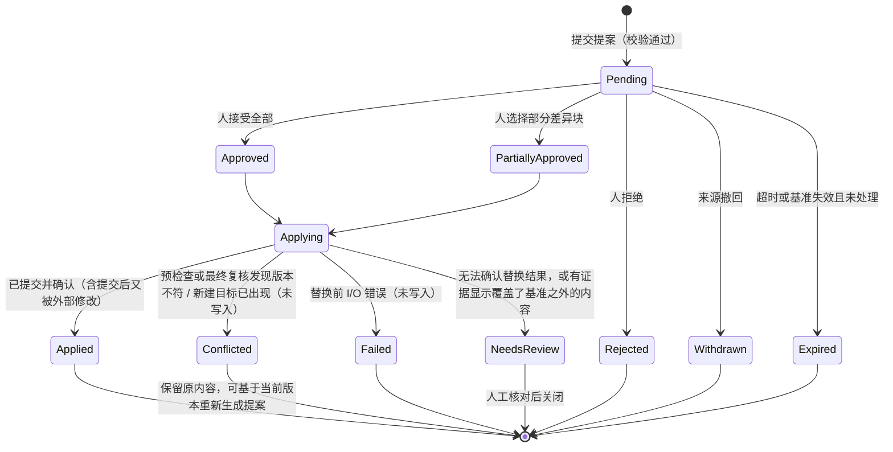

# 写入路径

> 文档状态：草案 · 最后复核：2026-11-14

> 所有文档写入走同一条路：提案、差异、审批、版本检查、原子写入、记录、广播。人工编辑、agent 与插件只是提案来源不同。

**相关文档**：[server 总览](README.md) · [工作区](workspace.md) · [文档历史](history.md) · [Agent / MCP](agent-mcp.md) · [插件](plugin.md) · [架构 7.1](../../architecture.md#71-写入路径) · [架构 13.2](../../architecture.md#132-编辑审批与写入)

**目录**

- [1 职责与非职责](#1-职责与非职责)
- [2 提案来源](#2-提案来源)
- [3 提案模型](#3-提案模型)
- [4 状态机](#4-状态机)
- [5 差异与审批](#5-差异与审批)
- [6 版本检查与冲突](#6-版本检查与冲突)
- [7 原子写入](#7-原子写入)
- [8 溯源](#8-溯源)
- [9 异常流程](#9-异常流程)
- [10 关键取舍](#10-关键取舍)
- [11 验证方法](#11-验证方法)
- [12 待确认事项](#12-待确认事项)

## 1 职责与非职责

职责：

- 接收编辑提案，校验路径与权限；
- 生成差异，管理审批状态；
- 在单一写入者中完成版本检查与原子写入；
- 写入前后与 [history](history.md#4-更新流程) 协作登记溯源；
- 写入后广播“文档已变化”。

非职责：

- 编辑缓冲、光标、撤销：client 负责（技术选型中的 `ropey` 文本缓冲属于 client 侧编辑层）；
- 生成提案内容：agent、插件、client 负责；
- 底层文件操作：由 [workspace](workspace.md#10-模块接口) 的原子替换原语执行。

当前状态：未实现；属于 MVP3 范围（[devPlan 4.3](../../devPlan.md#43-mvp3-编辑与写作)）。MVP2 中 agent 的建议只以报告或差异呈现，不写入。

## 2 提案来源

| 来源 | 阶段 | 权限前提 | 审批方式 |
| --- | --- | --- | --- |
| 人工编辑（TUI 保存） | MVP3 | 交互式 client 会话 | 见 WR-1 |
| 外部编辑器 | MVP3 | 不经过 server | 不经过审批；通过监听发现，记为 `watch` 来源 |
| 内置 agent | MVP3 | agent host 内部 | 必须人工审批 |
| 插件 | MVP4 | `workspace.propose`（`基线`，[架构 10](../../architecture.md#10-插件架构)） | 必须人工审批 |
| MCP 外部 agent | 远期 | 写入能力在权限与审批机制完善后开放（`基线`，[架构 11](../../architecture.md#11-agent-与-mcp)） | 必须人工审批 |

**发现的问题（WR-1）**：[架构 7.1](../../architecture.md#71-写入路径) 的写入路径要求“人确认接受、拒绝或局部采纳”，[架构 15](../../architecture.md#15-基本约束与安全) 要求“写入经过审批”。对于用户在 TUI 中亲手编辑后的保存，再弹出一次审批没有意义。建议：交互式会话中用户自己的保存命令同时作为提交与批准（“自批准”），仍然执行版本检查与溯源记录；其他来源必须由人显式审批。

## 3 提案模型

字段为 `建议`，最终消息形状由 protocol 定义：

| 字段 | 含义 |
| --- | --- |
| 提案 id | server 分配 |
| 来源 | 会话（人工）、agent 工作流、插件 id 与版本、MCP client |
| 发起会话 | 发起或代为发起的 client 会话 |
| 目标路径 | 已校验的工作区相对路径；新建文件时为不存在的路径 |
| 基准版本 | 提案生成时读取的内容指纹；新建文件时为“不存在” |
| 提案内容 | 完整的新内容（建议，MVP3）；后续可支持按块编辑 |
| 差异 | server 根据基准与提案内容生成 |
| 溯源 | 见 [§8](#8-溯源) |
| 创建时间、过期时间 | 过期策略见 WR-3 |
| 状态 | 见 [§4](#4-状态机) |

提案只针对单个文件。跨文件修改（如重命名后修正链接）由多个提案组成；是否需要“提案组”整体审批，留待 MVP3 设计（WR-4）。

删除与重命名文件是否通过提案进行，待确认（WR-5）。建议 MVP3 只支持修改与新建。

## 4 状态机

- 状态变化通过事件推送给订阅的会话；
- `Conflicted` 不自动合并；client 可以请求“基于当前版本重新生成差异”，生成新提案，旧提案结束；
- 文档在 `Pending` 期间被外部修改时，提案不立即失效，保留到审批时由版本检查判定，并在差异视图中提示“基准已变化”。

## 5 差异与审批

差异（`建议`）：

- 按行生成差异，划分为差异块（hunk），每块有稳定标识，用于局部采纳；
- 局部采纳时，server 以基准内容为底，只应用被接受的差异块，得到实际写入内容；
- 长行与 CJK 文本的行内差异作为后续增强；
- 差异算法需要实现或引入依赖，引入依赖需要人工确认（WR-6）；
- 差异与提案内容是不可信数据，展示时由 client 按普通文本处理，不解释其中的终端控制序列（server 在生成 View 时清理控制字符）。

审批（`建议`）：

- 只有交互式 client 会话可以审批；agent、插件、MCP client 不能审批任何提案，包括自己的；
- daemon 形态下多个 client 同时在线时，任一交互式会话都可以审批；审批结果记录审批会话；同一提案的并发审批以第一个到达写入者的为准，后到者收到“状态已变化”；
- 审批命令携带提案 id 与被接受的差异块列表，server 校验列表属于该提案。

## 6 版本检查与冲突

`基线`：写入带版本检查（[架构 16](../../architecture.md#16-架构决策)）；冲突场景提示并保留原内容（[devPlan 4.3](../../devPlan.md#43-mvp3-编辑与写作)）。

版本检查分两次进行，都在单一写入者中执行（见 [README 6](README.md#6-并发模型)），顺序见 [§7](#7-原子写入)：

| 检查 | 时机 | 不符时 |
| --- | --- | --- |
| 预检查 | 开始应用提案时：读取目标文件指纹，与基准版本比较；新建提案确认目标不存在 | 不写入，`Conflicted`，返回 `version_conflict` 与当前版本 |
| 最终复核 | 临时文件已写好、紧接替换之前：再次读取目标指纹；新建提案再次确认目标不存在 | 删除临时文件，不写入，`Conflicted` |

目标文件已被删除、或新建提案的目标已存在，同样视为冲突。

**残余竞争窗口**：server 内部的串行写入只能排除 server 自己的其他写入，不能阻止外部进程（编辑器、Git、脚本）修改文件。最终复核与替换之间仍有一个短窗口，外部进程在此期间写入的内容会被普通的改名替换覆盖。因此：

- 普通的原子改名替换只保证读者看到完整的旧内容或完整的新内容，**不等于**原子的“比较版本并写入”；本文不宣称写入路径能完全排除外部竞争；
- 最终复核把窗口缩小到“复核到替换”之间，但不能独自消除竞争；
- 部分平台可能提供保留被替换文件、或原子交换两个路径的系统机制，可用于替换后检查被覆盖的内容是否等于基准；具体接口、平台覆盖与语义需要调研和原型验证（`待验证`，WR-10）。在验证之前，替换后核对只能发现“提交后文件又变了”，不能可靠发现“替换覆盖了窗口内的外部写入”；
- 新建文件不得使用无条件替换，必须使用“目标已存在即失败”的创建语义（独占创建或不覆盖目标的改名/链接方式；平台实现 `待验证`），保证不会覆盖在检查之后出现的同名文件。

client 侧编辑缓冲同样携带基准版本：用户在 TUI 中编辑期间文件被外部修改，保存时按同一规则检测冲突，TUI 负责提示并保留用户的未保存内容（缓冲内容属于 client 状态）。

三方合并不在 MVP3 范围内（WR-7）。

## 7 原子写入

`基线`：写入使用临时文件与原子替换（[技术选型 7.1](../../techStack.md#71-存储选择)）；技术选型记录 `tempfile` 3.27.0 桌面核查通过（[技术选型 7.3](../../techStack.md#73-验证状态)）。

步骤（`建议`）：

1. **预检查**：见 [§6](#6-版本检查与冲突)；不符即结束（未写入）；
2. **登记意图**：向 history 登记写入意图（目标、基准指纹、预期新指纹、溯源），见 [history 4](history.md#4-更新流程)；
3. **准备**：在**目标文件同目录**创建临时文件（同一文件系统，保证改名原子性），命名带固定前缀，便于崩溃后识别清理；写入内容并刷新到磁盘；尽量保留原文件权限；
4. **最终复核**：确认父目录仍在工作区内且不在内部状态目录中（见 [workspace 8](workspace.md#8-路径校验)）；再次读取目标指纹（新建时确认目标不存在）；不符则删除临时文件、意图标记为放弃（未写入）；
5. **提交**：修改已有文件时改名替换目标；新建文件时使用“目标已存在即失败”的方式落位，失败即视为冲突（未写入）；
6. **提交后核对**：重新读取目标指纹，按下表判定结果；
7. **记录与广播**：提交 history（意图转为已提交、放弃或待核对），发布“文档已变化”。

从第 4 步开始到第 7 步结束为“提交阶段”，关闭流程不会中途打断这一阶段（见 [README 8.2](README.md#82-关闭)）。

结果判定（`建议`）：

| 结果 | 判定依据 | 文件内容 | 提案状态 | history |
| --- | --- | --- | --- | --- |
| 未写入（冲突） | 预检查或最终复核不符；新建目标已出现 | 原样 | `Conflicted` | 意图放弃 |
| 未写入（失败） | 替换前的 I/O 错误 | 原样 | `Failed` | 意图放弃 |
| 已提交并确认 | 替换调用成功，核对指纹等于预期 | 新内容 | `Applied` | 意图已提交 |
| 已提交、随后被外部修改 | 替换调用成功，核对时指纹已不等于预期 | 外部内容 | `Applied`，附“提交后已被修改”提示 | 意图已提交；另记一条 `watch` 来源的外部变更 |
| 结果待核对 | 替换调用返回不确定的错误、进程在提交阶段中断后无法判断，或平台机制显示被覆盖内容不等于基准 | 不确定或已覆盖外部写入 | `NeedsReview` | 意图标记待核对，保留可用的证据（如被替换文件的副本） |

“已提交、随后被外部修改”与“结果待核对”不能合并为成功：前者确认 server 的写入落盘后才被外部改动；后者无法确认，或已知覆盖了外部内容，需要人工处理。

注意事项：

- 内容按提案原样写入，换行符与 BOM 由提案内容决定；编辑层应保留原文件的换行风格（client 与 render 需要协定，WR-8）；
- 目标是符号链接时：解析后的真实路径必须在工作区内，写入真实文件，不替换链接本身（`建议`，`待验证`）；
- Windows 上目标文件被其他程序打开时，替换可能失败，需要重试策略与明确报错（`待验证`）；
- 原子替换不覆盖外部编辑器中尚未保存的内容；这类覆盖只能通过版本检查在下一次保存时发现。

## 8 溯源

`基线`：每次写入保留来源、模型与时间等溯源信息（[架构 11](../../architecture.md#11-agent-与-mcp)、[devPlan 4.3](../../devPlan.md#43-mvp3-编辑与写作)）。

溯源字段（`建议`）：

| 字段 | 人工 | agent | 插件 |
| --- | --- | --- | --- |
| 操作者类型 | `user` | `agent` | `plugin` |
| 操作者标识 | 会话标识 | 工作流名称 | 插件 id + 版本 |
| provider / 模型 | — | provider 标识、模型名称（以 provider 返回为准） | — |
| 上下文清单 | — | 使用的文档路径与版本 | 插件声明的命令 |
| 提案 id | 有 | 有 | 有 |
| 审批会话、审批时间 | 自批准时为同一会话 | 有 | 有 |
| 写入时间 | 有 | 有 | 有 |

- 溯源保存在历史库的 `provenance` 表（见 [history 3.5](history.md#35-存储结构)），与对应的变更记录关联；
- 默认**不**把溯源写入文档正文（如 frontmatter），避免修改用户内容；是否提供可选的正文标注见 WR-9；
- 溯源中不保存提示词全文与模型输出全文（可能包含敏感内容），只保存清单与标识。

## 9 异常流程

| 情况 | 行为 |
| --- | --- |
| 路径校验失败 | 拒绝提案，`path_rejected` |
| 来源无 `workspace.propose` 权限 | 拒绝提案，`permission_denied` |
| 预检查版本不一致 | `Conflicted`，未写入，保留原内容 |
| 最终复核版本不一致（检查后外部保存） | 删除临时文件，`Conflicted`，未写入 |
| 新建时目标在检查后出现 | “目标已存在即失败”生效，`Conflicted`，未写入，不覆盖 |
| 写入临时文件失败（空间、权限） | `Failed`，删除临时文件，原文件不变 |
| 改名明确失败 | `Failed`，删除临时文件，原文件不变 |
| 改名返回不确定错误 | `NeedsReview`，保留临时文件与证据，提示人工核对 |
| 复核与替换之间的外部写入被覆盖 | 未验证平台机制前无法可靠发现；有机制时判定为 `NeedsReview` 并保留被替换内容（WR-10） |
| 替换成功后文件又被外部修改 | `Applied` 附提示；外部修改另行记录 |
| 改名成功但 history 提交失败 | 文档已写入；意图保留，下次对账归因（[history 4](history.md#4-更新流程)） |
| 提交阶段进程被终止 | 下次启动按意图对账：等于预期则已提交，等于基准则放弃，否则待核对 |
| 发起会话断开 | 提案保留或撤回，见 WR-3 |

## 10 关键取舍

- **一条写入路径**：所有来源共享校验、审批、版本检查与溯源；代价是人工保存也要经过提案对象（以自批准降低交互成本）。
- **完整内容提案**：实现简单、差异由 server 统一生成；代价是大文档提案体积大，后续可改为块编辑。
- **不自动合并**：冲突时保证不丢失用户内容；代价是用户需要手动处理。
- **两次检查 + 如实记录残余窗口**：预检查与最终复核覆盖绝大多数外部保存；复核到替换之间的窗口在平台机制验证前无法消除，文档不承诺“永不覆盖外部写入”。
- **溯源不入正文**：不改变用户文件；代价是溯源只在本地历史中可见，换机器或删除 `.mdctrl/` 后丢失。

## 11 验证方法

| 项目 | 方法 |
| --- | --- |
| 状态机 | 单元测试覆盖每条迁移与非法迁移 |
| 版本检查 | 审批前外部修改、删除；新建目标已存在 |
| 检查后外部保存 | 在预检查与最终复核之间注入外部写入，结果为 `Conflicted` 且外部内容保留 |
| 检查后创建目标 | 新建提案在预检查后注入同名文件，不被覆盖，结果为 `Conflicted` |
| 复核与替换之间的外部写入 | 在最终复核与替换之间注入外部写入，记录实际行为（覆盖与否、能否被发现），作为 WR-10 的验证输入 |
| 替换后外部修改 | 替换成功后立即注入外部写入，结果为 `Applied` 附提示，外部变更单独记录 |
| 局部采纳 | 多差异块任意子集，结果与预期一致（属性测试） |
| 原子性 | 写入过程中注入失败，原文件不变；崩溃后临时文件被清理；提交阶段终止后意图按三种情况对账 |
| 并发审批 | 两个会话同时审批 |
| 溯源 | 三种来源写入后查询溯源字段完整 |
| CJK | 含全角标点、CJK 长行的差异与写入 |

## 12 待确认事项

- **WR-1**（三人）：人工保存是否采用“自批准”。这是对[架构 7.1](../../architecture.md#71-写入路径) 的解释，需要确认。
- **WR-2**（`silkage15`）：TUI 审批界面需要的差异数据形状（差异块标识、行号、内容）。
- **WR-3**（`silkage15`）：待审批提案是否持久化到 `.mdctrl/sessions/`；发起会话断开后提案保留还是撤回。建议 agent 与插件提案保留到过期，人工提案随会话撤回。
- **WR-4**（`ylgd0915`）：是否需要多文件提案组。
- **WR-5**（三人）：删除与重命名是否纳入提案。
- **WR-6**（三人）：差异算法自研还是引入依赖。
- **WR-7**（三人）：三方合并是否进入后续规划。
- **WR-8**（`field`、`silkage15`）：编辑层如何保留原文件换行风格与 BOM。
- **WR-9**（三人）：是否提供可选的正文溯源标注。
- **WR-10**（`ylgd0915`，`待验证`）：调研各目标平台（Linux、WSL、未来 Windows）上能否在替换时保留或交换被替换文件，以发现复核与替换之间被覆盖的外部写入；以及新建文件“目标已存在即失败”的落位方式。结论决定 `NeedsReview` 能覆盖哪些情况。
