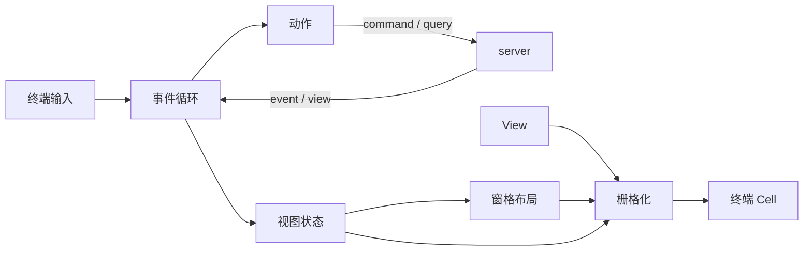
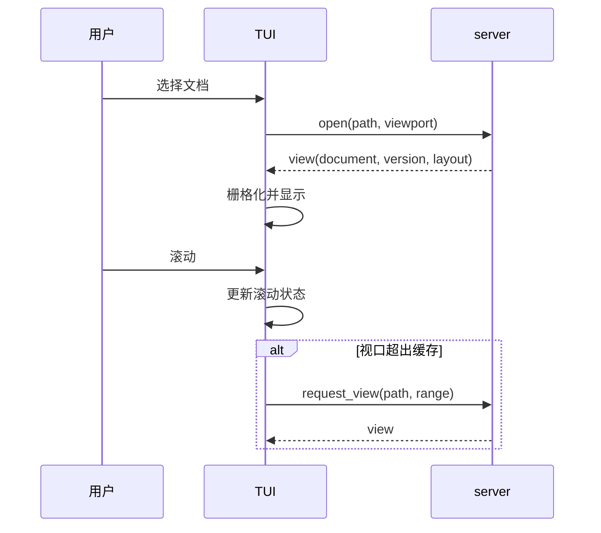

# mdctrl-tui 技术文档

> 文档状态：草案 · 最后复核：2026-11-14

> 终端客户端持有视图会话：它不解析文档，只消费 server 生成的 View，并把语义样式栅格化为终端 Cell。

**关联 Issue**：[#4 建立 clients crate 技术文档](https://github.com/Field-888/mdctrl/issues/4)

**相关文档**：[架构](../../architecture.md) · [技术选型](../../techStack.md) · [开发模式](../../devMode.md) · [开发计划](../../devPlan.md) · [mdctrl-cli](../mdctrl-cli/README.md)

**目录**

- [1 定位与职责](#1-定位与职责)
- [2 与 server 的边界](#2-与-server-的边界)
- [3 运行形态与启动](#3-运行形态与启动)
- [4 模块划分](#4-模块划分)
- [5 消息与数据流](#5-消息与数据流)
- [6 关键流程](#6-关键流程)
- [7 非目标](#7-非目标)
- [8 文件索引](#8-文件索引)
- [9 演进边界](#9-演进边界)

## 1 定位与职责

`mdctrl-tui` 是 mdctrl 的交互终端客户端，负责把 server 的文档视图转换成可读、可导航、可操作的终端界面。

它承担四类职责：

- **视图会话**：维护焦点、滚动、选择、输入组合与窗格布局等本端状态；
- **输入处理**：把终端事件转换为动作，区分本地动作与发往 server 的 command / query；
- **栅格化**：消费 server 返回的 View，把语义样式转换为终端 Cell 与终端样式；
- **终端适配**：探测终端能力，处理颜色、宽度、CJK、窄终端与图片协议降级。

它不承担文档解析、布局生成、索引、健康规则与文件写入。这些能力由 server 侧的 render、index、health 与 workspace store 提供。

```text
源文本 → Parser → Document Model → Layout → View → TUI 栅格化 → Cell Grid
```

上图的 Parser 到 View 位于 server；`mdctrl-tui` 从 View 开始。

## 2 与 server 的边界

状态所有权遵循[架构第 7 节](../../architecture.md#7-状态所有权)：

| 状态 | 所有者 | TUI 的行为 |
| --- | --- | --- |
| 工作区、文档、文档历史 | server | 通过 query 读取 |
| 索引、健康结果、缓存 | server | 触发查询并展示结果 |
| 工作区会话 | server | 建立连接、发送会话标识 |
| 焦点、滚动、选择、输入组合 | client | 本地维护 |
| 窗格布局与可见区域 | client | 本地计算 |
| 终端 Cell 与终端能力 | client | 本地持有 |
| 键位、主题选择、视图布局 | client | 本地配置并持久化 |
| 文档布局与语义样式 token | server | 只读消费 |

边界规则：

- TUI 不直接读写工作区文件，所有写入以 command 提案形式进入 server；
- TUI 不解析 Markdown，也不计算文档内部布局；
- TUI 不缓存完整文档内容，只缓存当前视口与相邻视口的 View；
- server 返回的 View 带有文档版本，TUI 用它判断视图是否过期；
- 文档失效事件到达后，TUI 标记视图过期并按需请求新 View。

窗格布局与文档布局是两件事：文档内部的换行、缩进、块间距由 server 的布局树决定；三栏窗格如何排布、状态栏占多少行，由 client 决定。

## 3 运行形态与启动

TUI 支持 embedded 与 daemon 两种连接方式，两者共享同一套协议语义：

| 形态 | 启动方式 | 连接 |
| --- | --- | --- |
| embedded | `mdctrl open <path>` 在进程内启动 server | 进程内通道 |
| daemon | 连接已有的 `mdctrl serve` 实例 | 本地 IPC |

启动顺序：

1. 解析启动参数与工作区根目录；
2. 探测终端能力并进入备用屏幕；
3. 建立或连接 server，完成协议握手与能力协商；
4. 请求初始 View 与工作区概览；
5. 恢复本端视图偏好；
6. 进入事件循环。

退出时恢复终端状态：离开备用屏幕、关闭鼠标捕获、还原光标与键盘增强模式。异常退出通过 panic hook 与 signal 处理尽量恢复终端。

## 4 模块划分

模块按变化轴划分，每个模块保持单一职责：

| 模块 | 职责 | 主题文件 |
| --- | --- | --- |
| `app` | 启动、会话装配、顶层退出与错误呈现 | 本文 |
| `event` | 事件循环、输入/协议/定时事件调度 | [事件循环](event-loop.md) |
| `input` | 键位解析、模式与动作映射 | [事件循环](event-loop.md) |
| `state` | 视图状态模型与状态迁移 | [视图状态](view-state.md) |
| `pane` | 三栏窗格、状态栏、面板与响应式布局 | [窗格布局](layout.md) |
| `raster` | View 消费、Cell Grid、增量刷新 | [栅格化](rasterization.md) |
| `theme` | 语义 token 到终端样式的映射 | [主题与 CJK](theme-cjk.md) |
| `search` | 文件查找、全文搜索与会话状态 | [搜索、健康与跳转](search-health.md) |
| `health` | 健康结果、问题列表与定位 | [搜索、健康与跳转](search-health.md) |
| `terminal` | 能力探测、终端恢复与降级 | [栅格化](rasterization.md) |
| `testkit` | 测试后端、夹具与快照辅助 | [测试](testing.md) |

依赖方向：

```text
app → event → {input, state, pane, raster, search, health, terminal}
pane → state → protocol
raster → theme → state
```

模块之间通过显式类型传递数据，避免共享可变全局状态。渲染路径保持同步，网络与流式输出通过 channel 进入事件循环。

## 5 消息与数据流

TUI 与 server 之间只使用四类协议信息：

| 类型 | 方向 | TUI 用途 |
| --- | --- | --- |
| command | TUI → server | 打开文档、编辑提案、审批、插件命令 |
| query | TUI → server | 读取 View、搜索、健康、反链 |
| event | server → TUI | 文档变化、索引完成、健康刷新、媒体就绪 |
| view | server → TUI | 当前视口的语义快照 |



数据流规则：

- 输入先被解析为动作，动作再决定是修改本地状态还是发送协议消息；
- 协议响应通过请求标识回到发起方，避免全局匹配；
- event 只改变状态或标记过期，不在事件回调中直接写终端；
- 渲染由统一的 dirty 标记驱动，一帧内合并多次状态变化；
- 所有外部输入按不可信内容处理，路径与文本不直接拼接为命令。

## 6 关键流程

### 6.1 打开与阅读



### 6.2 搜索与跳转

用户输入触发查询；server 返回结果；TUI 维护结果会话与选中项。跳转复用打开流程，并把上一位置压入导航栈。

### 6.3 健康查看（MVP2）

健康面板按需请求 health query，展示问题列表；选中问题后跳转到对应文档与位置。健康数据不常驻内存，刷新由 event 或显式命令触发。MVP1 只保留入口占位。

### 6.4 媒体就绪

View 中的公式、Mermaid 与图片先显示占位；server 推送媒体就绪事件后，TUI 替换对应区域并重绘受影响的行，不重排其他内容。

## 7 非目标

- 不实现 Markdown 解析与文档布局；
- 不实现索引、分词与健康规则；
- 不直接写入工作区文件；
- 不承担 daemon 生命周期管理；
- 不在 MVP1 提供渲染态热编辑（属于 MVP3）；
- 不实现插件宿主，只消费 server 转换后的标准 View。

## 8 文件索引

| 文件 | 内容 |
| --- | --- |
| [README.md](README.md) | 定位、边界、模块划分与消息流 |
| [view-state.md](view-state.md) | 视图状态模型、状态迁移与不变量 |
| [event-loop.md](event-loop.md) | 事件循环、输入处理与渲染调度 |
| [layout.md](layout.md) | 三栏窗格、状态栏、面板与响应式断点 |
| [rasterization.md](rasterization.md) | View 消费、Cell Grid、终端能力与降级 |
| [search-health.md](search-health.md) | 搜索、健康与跳转界面 |
| [theme-cjk.md](theme-cjk.md) | 主题 token、CJK、宽字符与窄终端 |
| [testing.md](testing.md) | 测试层次、夹具、快照与手工矩阵 |

## 9 演进边界

- MVP1 交付阅读、导航、搜索与反链的只读界面，健康入口只保留占位；
- MVP2 增加媒体展示、健康面板与审阅结果呈现；
- MVP3 增加编辑态、diff 与审批交互；
- MVP4 增加插件命令的通用入口；
- 所有阶段保持“server 生成布局、client 栅格化”的边界不变。

终端渲染技术选择见[技术选型第 5 节](../../techStack.md#5-终端渲染与-tui)，分工见[开发计划](../../devPlan.md#61-crate-主责)。
