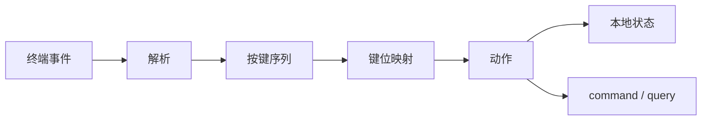
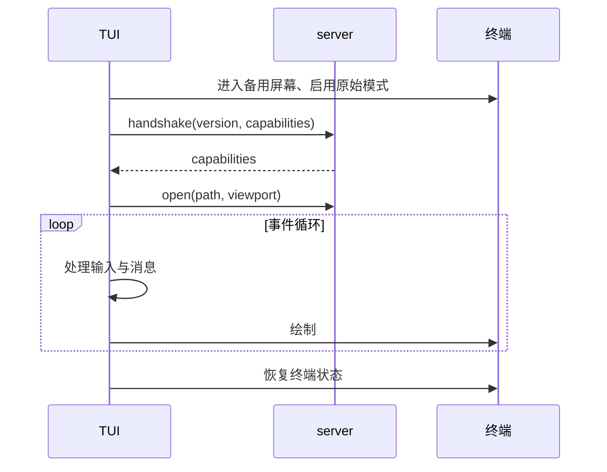

# 事件循环

> 文档状态：草案 · 最后复核：2026-11-14

> 输入、协议与渲染共用一条可预测的循环：先收集事件，再更新状态，最后统一绘制。

**相关文档**：[mdctrl-tui](README.md) · [视图状态](view-state.md) · [栅格化](rasterization.md) · [技术选型](../../techStack.md#5-终端渲染与-tui)

## 1 目标

事件循环负责三件事：

- 以固定节奏收集终端输入、协议消息与定时任务；
- 把输入解析为动作，把动作分派给本地状态或 server；
- 在状态变化后合并重绘，保持交互延迟可预测。

渲染与输入路径保持同步，不引入异步运行时；网络与流式输出由 server 侧处理，client 只消费消息。

## 2 循环结构

```text
loop {
  drain_protocol_messages(blocking = false)
  poll_terminal_event(timeout = frame_budget)
  dispatch_actions()
  if dirty { draw_frame() }
  run_scheduled_tasks()
}
```

规则：

- 有 pending 输入时超时为 0，保证输入优先；
- 空闲时使用帧预算作为超时，避免忙等；
- 一帧内完成多次状态变化，只绘制一次；
- 绘制失败进入降级或退出，不在循环内重试无限次。

## 3 事件来源

| 来源 | 示例 | 处理 |
| --- | --- | --- |
| 终端输入 | 按键、鼠标、粘贴、resize、焦点 | 解析为动作 |
| 协议消息 | view、event、响应、错误 | 更新状态或完成请求 |
| 定时任务 | 去抖、超时、动画占位 | 生成内部动作 |
| 信号 | SIGINT、SIGTERM、挂起 | 恢复终端并退出或暂停 |

## 4 输入处理

输入处理分三步：解析、映射、分派。



### 4.1 解析

- 处理 UTF-8 输入与残缺序列；
- 区分按下、重复与释放；
- 识别粘贴模式，粘贴内容不触发快捷键；
- 处理组合键与终端差异；
- 忽略不可识别序列并记录调试日志，不阻塞循环。

### 4.2 键位映射

键位按模式分组：

| 模式 | 主要动作 |
| --- | --- |
| 普通 | 移动、滚动、打开、跳转、搜索、健康、退出 |
| 搜索 | 输入、删除、上一个/下一个结果、确认、取消 |
| 命令 | 输入、补全、执行、取消 |
| 健康 | 选择、跳转、过滤、关闭 |
| 确认 | 接受、拒绝、取消 |

键位映射由配置覆盖，默认值保持终端习惯：`j`/`k` 与方向键移动，`/` 搜索，`g`/`G` 首尾，`q` 退出，`Ctrl+C` 取消当前模式。

### 4.3 分派

- 只影响视图的动作在本地完成，例如滚动、切换焦点；
- 需要文档数据的动作转成 query，例如打开、搜索、健康；
- 修改文档的动作转成 command，并进入审批路径；
- 动作执行后设置 dirty，不直接绘制。

## 5 协议消息处理

- 响应按请求标识匹配等待中的动作；
- event 只更新状态或标记缓存失效；
- view 按文档版本与视口校验后写入缓存；
- 错误分为可恢复与不可恢复：可恢复错误显示提示，不可恢复错误进入错误界面；
- 消息处理不阻塞输入，长任务通过进度事件反馈。

## 6 渲染调度

| 场景 | 策略 |
| --- | --- |
| 连续滚动 | 每帧合并，优先绘制当前视口 |
| 输入中 | 搜索框与状态栏立即重绘 |
| 媒体就绪 | 只重绘受影响区域 |
| 窗口 resize | 丢弃旧尺寸缓存，重新布局 |
| 后台事件频繁 | 限制每帧处理数量，避免饿死输入 |

绘制顺序：清空脏区 → 窗格背景 → View 内容 → 覆盖层 → 状态栏 → 光标定位。

## 7 生命周期



退出路径统一：用户退出、server 关闭、致命错误、信号中断都走同一清理函数，保证终端状态恢复。

## 8 错误与降级

- server 不可用：保留当前画面，显示连接状态，支持重连；
- 协议版本不兼容：显示能力协商结果并退出；
- 终端能力不足：按[栅格化](rasterization.md)的降级矩阵处理；
- 渲染 panic：捕获后恢复终端并输出诊断信息，避免终端损坏；
- 输入解析失败：忽略单个事件，不终止循环。

## 9 测试关注点

- 键位映射表驱动测试，覆盖每个模式；
- 粘贴与组合键的解析夹具；
- 事件循环用测试后端驱动，断言绘制结果；
- 断线与重连的状态迁移测试；
- 帧预算与合并绘制的行为测试。

具体层次见[测试](testing.md)。
