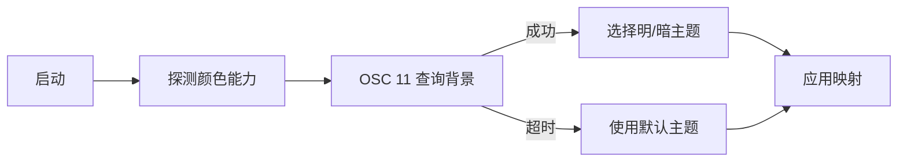

# 主题与 CJK

> 文档状态：草案 · 最后复核：2026-11-14

> 主题是语义映射，CJK 是宽度事实：两者都在 client 收口，避免样式与排版散落。

**相关文档**：[mdctrl-tui](README.md) · [栅格化](rasterization.md) · [窗格布局](layout.md) · [技术选型](../../techStack.md#5-终端渲染与-tui)

## 1 主题模型

server 在 View 中提供语义 token，client 负责把 token 映射为终端样式。主题不携带具体颜色值，只定义 token 到样式的规则。

| token | 用途 | 示例默认 |
| --- | --- | --- |
| `text` | 正文 | 终端默认前景 |
| `muted` | 次要信息、行号 | 暗灰 |
| `accent` | 链接、强调 | 蓝/青 |
| `success` | 成功、健康 | 绿 |
| `warning` | 警告、过期 | 黄 |
| `danger` | 错误、断链 | 红 |
| `code` | 行内代码与代码块 | 前景 + 背景 |
| `selection` | 选中区域 | 反色或背景高亮 |
| `border` | 窗格边框 | 暗灰 |
| `border_focus` | 聚焦窗格边框 | 强调色 |

主题文件支持：

- 选择预设；
- 覆盖单个 token；
- 根据终端背景自动选择亮色或暗色主题；
- 禁止在主题中写死终端特定的转义序列。

## 2 主题选择与探测

规则：

- 探测失败不阻塞启动；
- `NO_COLOR` 存在时禁用颜色，保留修饰；
- 终端背景变化通过事件或重启生效；
- 主题切换只重绘，不重新请求文档布局；
- 对比度不足时给出警告，不强制修改用户选择。

## 3 颜色降级

| 能力 | 策略 |
| --- | --- |
| 真彩色 | 直接使用 RGB |
| 256 色 | 映射到最近调色板 |
| 16 色 | 映射到基础色，保留修饰 |
| 单色 | 仅使用粗体、反色与下划线 |

降级映射保持语义区分：错误与警告在 16 色下仍需可区分。映射表随主题提供，不依赖运行时的近似算法。

## 4 CJK 宽度

宽度计算以字素簇为单位，数据来源为 Unicode 宽度属性。

| 内容 | 宽度 |
| --- | --- |
| ASCII 可见字符 | 1 |
| CJK 汉字、假名、谚文 | 2 |
| 全角标点与全角字母 | 2 |
| emoji | 通常 2，按终端实测 |
| 组合附加符 | 0（并入前一字素簇） |
| 零宽连接符序列 | 整体按首字符宽度 |
| 制表符 | 按列对齐展开，不参与宽度估算 |

规则：

- 不按字节或 Unicode 标量拆分显示；
- 文档行由 server 按宽度断行；client 不重排，只在视口边界整体裁掉无法容纳的宽字符并重新请求 View；
- 截断在字素簇边界，追加省略符后重新计算宽度；
- 表格、代码块与边框按显示宽度对齐，不按字符数；
- 光标移动以 Cell 为准，跳过 continuation 单元。

## 5 全角标点与断行

- 行首禁止出现收尾标点（`，。、；：！？）】》`）；
- 行尾禁止出现起始标点（`（【《「`）；
- 连续标点整体移动，不拆分；
- 以上避头尾规则由 server 在文档布局阶段执行，不依赖 client；
- 中英文混排按 server 提供的换行点处理；
- client 不重新断行，只处理视口截断与宽度不匹配后的重新请求。

## 6 窄终端

| 宽度 | 策略 |
| --- | --- |
| ≥ 80 列 | 完整显示代码块、表格与状态栏 |
| 60–79 列 | 表格横向滚动，状态栏压缩 |
| 40–59 列 | 隐藏次要列，行号可选 |
| < 40 列 | 只显示正文与提示，禁用侧栏 |

窄终端下：

- 保持字符完整优先于信息密度；
- 超长行使用水平滚动而非强行折行；
- 状态栏只保留路径、模式与连接状态；
- 覆盖层宽度不超过终端宽度减去边距。

## 7 无障碍与可读性

- 不仅依赖颜色表达状态，同时使用符号或文本；
- 选中状态使用反色或背景，不只改变前景；
- 支持高对比主题；
- 尊重终端字体与行高设置，不假设像素尺寸；
- 闪烁与动画默认关闭，可通过配置开启。

## 8 性能

- 字素簇宽度缓存按字符内容键控；
- 主题映射在启动时编译为查表结构；
- 样式切换合并，减少转义序列；
- 大段 CJK 文本避免逐字符重复计算宽度；
- 主题切换只重绘，不重新解析文档。

## 9 测试矩阵

| 维度 | 取值 |
| --- | --- |
| 宽度 | 120、100、80、60、40 |
| 颜色 | truecolor、256、16、无色 |
| 背景 | 深色、浅色、未知 |
| 文本 | ASCII、中文、全角标点、emoji、组合字符 |
| 终端 | Linux 终端、WSL、常见复用器 |

快照覆盖：三栏布局、窄终端、表格对齐、代码块、选中与诊断标记。手工验证覆盖真实终端中的图片协议与背景探测。

## 10 与其他文档的关系

主题映射的执行位置见[栅格化](rasterization.md)；窗格宽度与断点见[窗格布局](layout.md)；技术选择依据见[技术选型](../../techStack.md#5-终端渲染与-tui)。
