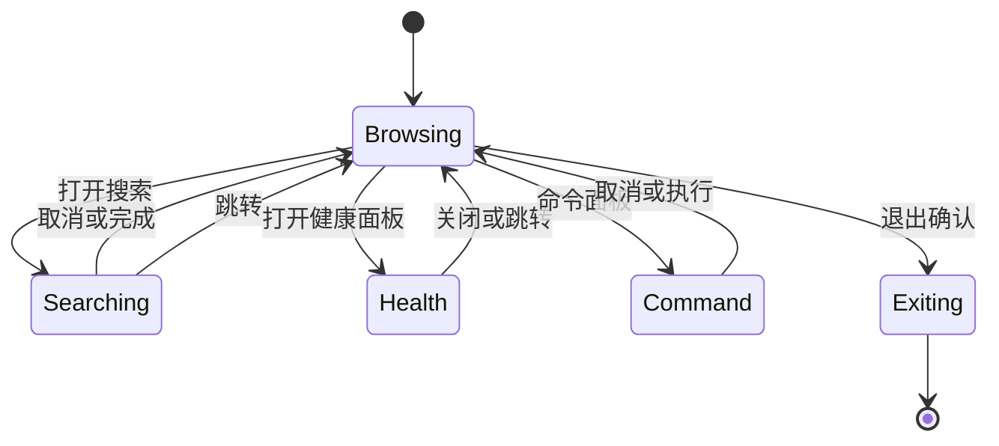

# 视图状态

> 文档状态：草案 · 最后复核：2026-11-14

> client 的状态边界：所有“看起来怎样”的状态都属于 TUI，所有“文档是什么”的状态都属于 server。

**相关文档**：[mdctrl-tui](README.md) · [事件循环](event-loop.md) · [窗格布局](layout.md) · [架构](../../architecture.md#7-状态所有权)

## 1 目的

本文定义 `mdctrl-tui` 的视图状态模型、状态迁移与不变量。视图状态决定界面如何呈现，不决定文档内容。

## 2 状态分层

视图状态分为五层，外层持有内层，禁止反向引用：

| 层 | 内容 | 生命周期 |
| --- | --- | --- |
| 会话 | 连接、工作区标识、终端能力 | 进程 |
| 文档视图 | 当前文档、版本、视口、滚动 | 打开到关闭 |
| 窗格 | 焦点、可见性、尺寸、面板栈 | 进程 |
| 交互 | 输入缓冲、模式、选择、覆盖层 | 短时 |
| 导航 | 历史栈、跳转目标 | 进程 |

## 3 结构草案

以下类型表达设计意图，字段名在实现时按 crate 约定调整：

```rust
struct ViewSession {
    workspace: WorkspaceId,
    connection: ConnectionState,
    terminal: TerminalProfile,
    panes: PaneState,
    document: Option<DocumentViewState>,
    navigation: NavigationStack,
    overlay: Option<Overlay>,
    mode: InputMode,
}

struct DocumentViewState {
    path: DocumentPath,
    version: DocumentVersion,
    viewport: Viewport,
    scroll: ScrollState,
    selection: Option<Selection>,
    cursor: Option<SourcePosition>,
    cache: ViewCache,
}

struct PaneState {
    layout: PaneLayout,
    focus: PaneId,
    visibility: PaneVisibility,
}

enum InputMode {
    Normal,
    Search,
    Command,
    Health,
    Confirm,
}
```

规则：

- `DocumentViewState` 只保存引用与索引，不保存文档正文；
- `version` 来自 server，用于判断 View 是否过期；
- `cache` 保存当前视口与有限相邻视口，按文档版本失效；
- `mode` 与 `overlay` 分离：模式决定按键语义，覆盖层决定显示层级。

## 4 状态迁移



迁移规则：

- 同一时刻只有一个输入模式生效；
- 模式切换不丢失文档视图状态；
- 跳转先写入导航栈，再更新当前文档；
- 退出前若有未提交输入，先确认；
- 连接断开进入降级状态，保留当前视图并允许重连。

## 5 与 server 视图对齐

| 场景 | TUI 行为 |
| --- | --- |
| 收到新 View | 校验文档版本与视口，替换缓存并重绘 |
| 收到失效事件 | 标记版本过期，清空受影响的相邻视口 |
| 本地滚动 | 命中缓存则立即绘制，未命中则请求 View |
| 视口尺寸变化 | 重新计算窗格，丢弃旧尺寸的 View 缓存 |
| 文档被外部修改 | 由 event 触发，保留滚动位置并请求新版本 |
| 写入成功 | 使用返回的新版本更新状态，不乐观修改正文 |

每个文档视图维护 `generation` 代次：打开文档、视口尺寸变化、收到失效事件时递增。请求携带路径、`generation`、可见范围、终端宽度与能力，并区分两种模式：

| 模式 | 版本字段 | 接受条件 |
| --- | --- | --- |
| `latest` | 空 | 首次加载或失效后使用；接受 server 当前版本 |
| `exact` | 当前版本 | 视口分页与相邻预取；只接受同版本响应 |

响应处理：

- 先匹配路径、`generation` 与请求标识，过期响应直接丢弃；
- `latest` 响应到达时原子更新文档版本与缓存；版本变化时清空选择、按源位置夹紧滚动；
- `exact` 响应返回更新版本时丢弃，并立即发起一次 `latest` 请求；
- 宽度不匹配的响应丢弃，按当前窗格宽度重新请求；
- 同一代次最多重试一次，仍失败则保留旧画面并显示错误。

## 6 不变量

- 视图状态不包含文档正文，只包含引用、版本与派生布局；
- 任何时刻 `focus` 指向可见且存在的窗格；
- `scroll` 始终落在文档有效行范围内；
- 选择范围在同一文档版本内有效，版本变化后清空；
- 导航栈最多保留固定深度，超限丢弃最旧项；
- 覆盖层关闭后键盘焦点回到进入前的窗格；
- 渲染路径不产生协议请求，协议请求由动作发起。

## 7 持久化

持久化的只有跨会话仍有意义的偏好：

| 数据 | 位置 | 说明 |
| --- | --- | --- |
| 键位覆盖 | 本机客户端配置 | 不进入工作区 |
| 主题选择 | 本机客户端配置 | 颜色能力不同，按终端区分 |
| 窗格可见性 | 本机客户端配置 | 恢复上次布局 |
| 最近打开文档 | 本机客户端配置 | 仅路径，不含正文 |
| 滚动与选择 | 不持久化 | 每次打开重新定位 |

工作区级共享状态不写入客户端配置；`mdctrl.toml` 与 `.mdctrl` 由 server 管理。

## 8 并发与一致性

- 视图状态只在事件循环线程内修改，避免锁；
- 协议响应通过 channel 投递，按请求标识关联；
- 媒体就绪与索引事件可能乱序到达，按文档版本过滤；
- 断线重连后版本可能跳变，直接丢弃旧缓存并全量请求；
- 取消请求后到达的响应按请求标识忽略。

## 9 与其他文档的关系

窗格尺寸与焦点顺序见[窗格布局](layout.md)；状态如何被事件驱动见[事件循环](event-loop.md)；View 如何被消费见[栅格化](rasterization.md)。
