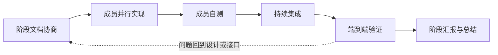

# mdctrl 开发模式

> 文档状态：已确认 · 最后复核：2026-11-09

> 一个阶段交付一个端到端 MVP；团队并行，成员内部按顺序推进。

**相关文档**：[产品愿景](vision.md) · [架构](architecture.md) · [技术选型](techStack.md) · [开发计划](devPlan.md)

**目录**

- [1 目的与范围](#1-目的与范围)
- [2 基本原则](#2-基本原则)
- [3 阶段模型](#3-阶段模型)
  - [3.1 阶段与 MVP](#31-阶段与-mvp)
  - [3.2 阶段入口](#32-阶段入口)
  - [3.3 阶段出口](#33-阶段出口)
- [4 阶段工作流](#4-阶段工作流)
  - [4.1 阶段文档协商](#41-阶段文档协商)
  - [4.2 成员并行实现](#42-成员并行实现)
  - [4.3 自测与持续集成](#43-自测与持续集成)
  - [4.4 端到端验证](#44-端到端验证)
  - [4.5 阶段汇报与总结](#45-阶段汇报与总结)
- [5 文档与接口](#5-文档与接口)
  - [5.1 文档分层](#51-文档分层)
  - [5.2 MVP 文档目录](#52-mvp-文档目录)
  - [5.3 crate 技术文档](#53-crate-技术文档)
  - [5.4 文档规则](#54-文档规则)
- [6 人与 Agent 分工](#6-人与-agent-分工)
- [7 角色与决策](#7-角色与决策)
  - [7.1 四个角色](#71-四个角色)
  - [7.2 决策规则](#72-决策规则)
- [8 完成定义与阶段门禁](#8-完成定义与阶段门禁)
  - [8.1 任务完成](#81-任务完成)
  - [8.2 阶段完成](#82-阶段完成)
- [9 反模式](#9-反模式)
- [10 与其他文档的关系](#10-与其他文档的关系)

## 1 目的与范围

本文定义 mdctrl 的阶段协作方式：阶段如何开始、团队如何并行、如何集成与验证、阶段如何结束，以及文档、角色、Agent 与完成定义的最小约定。

本文覆盖：

- 阶段模型与阶段文档；
- 阶段工作流；
- 文档分层、MVP 文档目录与 crate 技术文档；
- 人与 Agent 的分工；
- 角色与决策规则；
- 完成定义与阶段门禁；
- 常见反模式。

产品方向由 `vision.md` 承接；技术结构由 `architecture.md` 承接；技术选型由 `techStack.md` 承接；MVP 编号、内容、顺序、版本号与发布边界由 `devPlan.md` 维护。本文与这些文档保持引用关系。

## 2 基本原则

- **每阶段一 MVP**：一个阶段交付一条端到端用户路径，包含该路径所需的代码、测试、文档与集成。
- **团队并行，成员顺序推进**：成员之间并行工作；每个任务内部按设计、实现、自测、交付的顺序推进，形成成员级瀑布。
- **文档先行**：阶段说明、接口与验收确认后进入并行实现。
- **持续集成**：每个 PR 通过 CI，主干保持可运行；阶段末完成端到端验证。
- **文档即设计接口**：文档服务协作与验收，管理材料保持最小集。
- **人负责最终质量**：Agent 可以辅助设计、实现、测试与文档，人类 owner 对最终质量负责。
- **阶段闭环**：阶段以端到端演示、测试证据与阶段会议收尾。

## 3 阶段模型

### 3.1 阶段与 MVP

一个阶段对应一个 MVP。阶段是团队成员并行开发的周期；成员之间并行，成员内部按顺序推进。一个 MVP 覆盖一条端到端用户路径，包含：

- 该路径需要的功能实现；
- 对应的单元、契约与集成测试；
- 阶段文档与必要的 crate 文档更新；
- 端到端演示与验收证据。

阶段内只交付这个 MVP。一个阶段包含多条用户路径时，拆成多个阶段。阶段长度由 MVP 规模决定，节奏由团队投入与验证结果决定。

每个阶段有一名阶段 manager，由维护者轮换。

### 3.2 阶段入口

阶段开始时建立 `docs/MVPn/` 目录，并完成最小文档协商：

- 阶段目标与端到端用户路径；
- 范围与阶段边界；
- 跨模块接口与依赖；
- 验收标准与演示方式；
- 任务划分与 owner；
- 测试执行人；
- 主要风险。

阶段说明、接口与验收经过一名非作者评审；跨模块接口由提供方与使用方共同确认。上述内容确认后，团队进入并行实现。

### 3.3 阶段出口

阶段完成时：

- 阶段内任务全部达到完成定义；
- `README.md`、`design/`、`interfaces.md`、`testing.md` 与实现保持一致；
- 端到端用户路径演示通过；
- 测试执行人记录测试结果与证据；
- 阻断级缺陷关闭；
- 阶段会议完成，阶段总结与下一阶段输入明确。

阶段范围调整由三人确认，并记录在阶段说明或会议记录中。集成或演示发现的问题回到设计或接口修正，再继续实现。

## 4 阶段工作流



### 4.1 阶段文档协商

阶段 manager 组织阶段文档：

- `README.md`：阶段说明与阶段总结；
- `design/`：本 MVP 的具体技术设计；
- `interfaces.md`：本 MVP 的开发接口；
- `testing.md`：测试计划、执行人与证据。

任务 owner 编写自己任务的设计与接口部分；测试执行人编写测试计划；评审人完成阶段文档评审。接口与验收确认后，成员进入实现。

### 4.2 成员并行实现

每个任务 owner 按以下顺序推进：

1. 设计：确认接口、数据形状与验收；
2. 实现：完成代码与必要文档；
3. 自测：运行单元、契约与必要集成测试；
4. 交付：提交小 PR，进入集成。

成员之间并行，任务 owner 指导 Agent 完成实现、测试与文档草稿。同一模块同一时间保持一个有协调的写入者。

### 4.3 自测与持续集成

任务 owner 完成自测：

- 单元测试覆盖核心逻辑；
- 契约测试覆盖跨模块接口；
- 集成测试覆盖任务边界；
- 文档与代码在同一个 PR 更新。

每个 PR 通过 CI 后合入主干。主干保持可运行，短分支、小 PR。阶段内以异步沟通、Issue、PR 与 CI 为主。

### 4.4 端到端验证

阶段末，测试执行人按完整用户路径执行验收：

- 运行自动化端到端测试；
- 执行必要的手工验证；
- 在 `testing.md` 记录命令、环境、结果与证据；
- 对发现的问题回到设计或接口修正。

测试执行人默认由任务 owner 担任，阶段 manager 可以指定其他成员代理。

### 4.5 阶段汇报与总结

阶段结束召开一次短会议：

- 演示端到端用户路径；
- 汇报测试、CI 与验收结果；
- 记录问题、决策与后续输入；
- 在 `README.md` 补充阶段总结。

阶段会议采用演示与证据优先的方式，阶段总结保持一页以内。

## 5 文档与接口

### 5.1 文档分层

| 层级 | 位置 | 作用 |
| --- | --- | --- |
| 基线 | `vision.md`、`architecture.md`、`techStack.md` | 产品、架构与技术选型 |
| crate 技术文档 | `docs/crates/<crate>/` | 稳定的设计、API 与实现说明 |
| MVP 文档 | `docs/MVPn/` | 阶段目标、具体设计、接口、测试与总结 |
| 过程文档 | `devMode.md`、`devPlan.md` | 协作方式与 MVP 计划 |

### 5.2 MVP 文档目录

每个 MVP 维护一份独立目录，其中 `n` 是 `devPlan.md` 中的 MVP 编号：

```text
docs/MVPn/
  README.md       阶段说明与阶段总结
  design/
    README.md     design 索引
  interfaces.md   本 MVP 的开发接口
  testing.md      测试计划、执行人与证据
```

`README.md` 包含：

- 阶段目标与端到端用户路径；
- 范围与阶段边界；
- 验收标准与演示方式；
- 任务与 owner；
- 测试执行人；
- 风险；
- 阶段总结。

`design/` 记录本 MVP 的技术设计、取舍与 crate 文档链接，内部结构由阶段 manager 与任务 owner 在阶段开始时协定。`design/README.md` 作为索引，记录文件、owner、任务与状态。`interfaces.md` 记录跨模块接口、错误与数据形状。`testing.md` 记录测试计划、执行人、命令与结果。

MVP 目录可以按需增加图示、样例与决策记录。MVP 文档只写阶段特有内容，稳定设计引用 crate 文档。

### 5.3 crate 技术文档

crate 技术文档位于 `docs/crates/<crate>/`。每个 crate 的内部结构由该 crate 的设计与编写者决定，长期维护稳定的设计、API 与实现说明。

crate owner 维护文档入口与内部组织；MVP 文档通过链接引用 crate 文档，保持信息单一位置。

### 5.4 文档规则

`docs/` 下的文档头部统一使用：

```markdown
> 文档状态：已确认 · 最后复核：YYYY-MM-DD
```

状态取值：

| 状态 | 含义 |
| --- | --- |
| `草案` | 正在编写，尚未评审 |
| `评审中` | 等待或正在评审 |
| `已确认` | 已评审，当前有效 |
| `已归档` | 历史记录，不再维护 |

- 复核日期使用 ISO 8601 日期；
- 文档内容变化后，在复核时更新日期；
- 文档状态变化时同步更新状态；
- Agent session 记录使用自身 frontmatter，不添加该头部；
- 阶段文档归档时，状态改为 `已归档`。
- 文档与代码在同一个 PR 更新；
- 一个信息只在一个地方维护，其他文档链接引用；
- 复杂任务写短设计，简单任务用任务说明；
- 阶段说明、接口与验收在实现前完成最小协商；
- 文档保留当前状态，修订历史由版本控制承担；
- 重要决策记录在 Issue、MVP 总结或 ADR；
- 阶段总结写在 `README.md`，管理材料保持最小集。

## 6 人与 Agent 分工

每个任务有人类 owner。Agent 可以辅助设计、实现、测试、文档与调研，人类 owner 对最终代码、测试与文档质量负责。

Agent 工作约定：

- `AGENTS.md` 提供构建、测试、格式检查、目录结构与边界；
- 任务说明写明目标、涉及文件、约束、验收测试与非目标；
- 设计文档与接口契约提供边界与约束；
- Agent 产出在合入前经过人类评审；
- Agent 任务按模块隔离，同一模块同一时间一个有协调的写入者；
- 测试与 CI 是 Agent 产出的最终契约。

## 7 角色与决策

### 7.1 四个角色

| 角色 | 职责 |
| --- | --- |
| 阶段 manager | 阶段文档、接口协商、集成节奏、阶段会议、范围与总结；由维护者轮换 |
| 任务 owner | 设计、实现、自测、文档；指导 Agent 完成日常任务 |
| 测试执行人 | 执行验收、端到端与手工测试，记录证据；默认由任务 owner 担任，可由阶段 manager 指定他人代理 |
| 评审人 | 非作者代码与文档评审；跨模块接口由使用方参与 |

一名成员可以同时承担多个角色。测试执行人默认由任务 owner 担任，阶段 manager 根据独立性需要指定代理。

### 7.2 决策规则

- 日常实现：任务 owner 决定，一名非作者评审；
- 跨模块接口：提供方与使用方共同确认；
- 阶段范围、接口或重大决策：三人共识；
- 测试执行人调整：阶段 manager 指定并记录；
- 决策理由记录在 Issue、阶段总结或 ADR。

## 8 完成定义与阶段门禁

### 8.1 任务完成

任务完成需要：

- 代码符合阶段说明与验收标准；
- 单元、契约与必要集成测试通过；
- 文档与行为同步；
- CI 通过；
- 非作者评审；
- 变更已合入主干。

### 8.2 阶段完成

阶段完成需要：

- 阶段内任务全部达到完成定义；
- `README.md`、`design/`、`interfaces.md`、`testing.md` 更新；
- 端到端用户路径演示通过；
- 测试执行人记录测试结果与证据；
- 阻断级缺陷关闭；
- 阶段会议完成，阶段总结与下一阶段输入明确。

阶段门禁采用一次短会议与一份阶段总结，管理材料保持最小集。

## 9 反模式

| 反模式 | 应对 |
| --- | --- |
| 一个阶段包含多条用户路径 | 拆成多个阶段，每个阶段一个 MVP |
| 先写代码后补阶段文档 | 阶段文档协商通过后进入实现 |
| MVP 文档复制 crate 文档 | MVP 文档链接 crate 文档，只写阶段特有内容 |
| 成员各自推进，阶段末集中集成 | 小 PR、持续集成、阶段中短同步 |
| Agent 代码缺少人类 owner | 人类 owner、评审人、测试执行人共同把关 |
| 长期分支 | 短分支、主干开发 |
| 用汇报材料替代演示 | 端到端演示与测试证据优先 |
| 测试执行人缺位 | 默认任务 owner 担任，阶段 manager 指定代理 |

## 10 与其他文档的关系

| 文档 | 作用 |
| --- | --- |
| `vision.md` | 产品基线 |
| `architecture.md` | 技术结构基线 |
| `techStack.md` | 技术选型与验证 |
| `devPlan.md` | MVP 编号、内容、顺序、版本号与发布边界 |
| `docs/crates/` | crate 级长期技术文档 |
| `docs/MVPn/` | 阶段说明、具体设计、接口、测试与总结 |
| `devMode.md` | 阶段协作方式 |

本文通过 PR 修改；阶段模型或决策规则的实质性变更需要三人共识；文档修订历史由版本控制承担。MVP 编号与内容由 `devPlan.md` 维护，本文保持引用关系。
